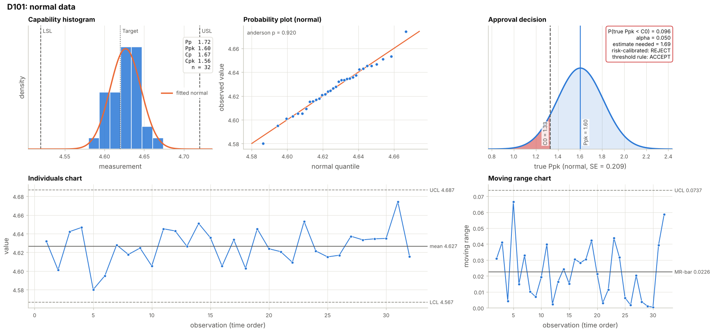

<h1 align="center">uccap</h1>

<p align="center">
  <b>Process Capability Analysis, Risk-Calibrated Approval and Hybrid Statistical Learning Decision Support with Finite Samples</b><br>
  Reference implementation of three published articles and one accepted article in
  <i>The International Journal of Advanced Manufacturing Technology</i> (2026)
</p>

<p align="center">
  <a href="https://github.com/fei-jiang/uccap/actions/workflows/tests.yml"></a>
  
  <a href="https://doi.org/10.1007/s00170-026-17782-7"></a>
  <a href="https://doi.org/10.1007/s00170-026-18284-2"></a>
  <a href="https://doi.org/10.1007/s00170-026-18833-9"></a>
  
</p>

<p align="center">
  <a href="#quick-start">Quick start</a> ·
  <a href="#preparing-your-data">Data format</a> ·
  <a href="https://github.com/fei-jiang/uccap/blob/main/docs/manual_tex/uccap_manual.pdf">User manual (PDF)</a> ·
  <a href="https://github.com/fei-jiang/uccap/blob/main/docs/validation.md">Validation</a> ·
  <a href="#citing">Citing</a>
</p>

---

Capability approval is usually a fixed rule: approve if the estimated Cpk is at least 1.33. With the 20 to
50 parts of a typical approval study, the estimate can easily be 0.2 above or below the true value, so
near the threshold the rule approves incapable processes and rejects capable ones almost at random.

`uccap` turns raw measurements into a capability study and an approval decision that accounts for that
uncertainty:

- **Correct indices for real data.** Outlier screening, normality testing, best-fit distributions for
  skewed characteristics, one-sided and asymmetric tolerances, within and overall sigma.
- **Risk-calibrated approval.** Accept only when the probability that the true capability is below the
  requirement is acceptably small, set directly or from the relative cost of a wrong approval.
- **Learned risk score.** The UC-Cap model adds a trained correction to the statistical risk and returns
  a 0–100 score with a Low / Medium / High level, for one dimension or every row of a batch. Its trained
  parameters are not included in this release (see below).
- **Sample-size planning.** Before the study: how many parts are needed so that a capable process is
  actually approved.
- **Monitoring after approval.** Subgroup by subgroup, the posterior probability that the released
  process still meets its conformance target, with a continue / monitor / intervene zone.
- **Built for production files.** One call analyses every dimension of an Excel or CSV file and writes
  coloured HTML and Excel reports. Everything runs locally.

Risk-calibrated approval and the UC-Cap score are **decision aids** for small samples, where the
estimate is uncertain. They do not replace the capability requirement or the engineer's judgement. The
UC-Cap score is meant for studies with hundreds or thousands of dimensions: it quickly sorts out the
dimensions that need attention instead of a single 1.33 or 1.67 cut-off for all of them.
The thresholds and decision rules in the examples and defaults (C0 = 1.33, cost ratio 19, risk bands
0.40 / 0.70, the mechanism signals of the UC-Cap decision layer, the monitoring settings q0 = 0.997,
γA = 0.95, γR = 0.80) illustrate the methods, as in the articles. They are not general standards for every scenario; set them for your application.

<p align="center">
  
</p>
<p align="center"><sub>Ppk = 1.60 clears 1.33, but with 32 parts there is still a 9.6 % chance (red area) that the
true Ppk is below 1.33. At a 5 % risk the calibrated rule asks for more evidence.</sub></p>

## Quick start

```bash
pip install uccap                  # core: numpy, scipy, pandas
pip install "uccap[excel,plot]"    # optional: Excel files and plots
```

**One dimension**

```python
import numpy as np
from uccap import capability_study, risk_decision

x = np.random.default_rng(42).normal(4.625, 0.023, 32)   # 32 parts in production order
study = capability_study(x, lsl=4.52, usl=4.72, target=4.62)
decision = risk_decision(study, c0=1.33, cost_ratio=19)   # a false accept costs 19x a false reject
print(decision.report())
```

```text
        Ppk estimate : 1.603
      Standard error : 0.209
        P(true < C0) : 0.096   (analytic)
   Required estimate : 1.674   (C0 + 1.645 x SE at this estimate)
   Smallest accepted : 1.691   (estimate that just passes with n = 32)
      Threshold rule : ACCEPT  (estimate >= C0)
     Risk-calibrated : REJECT  (P = 0.096 > alpha)
```

The requirement C0 = 1.33 is unchanged. The calibrated rule does not replace it: it shows how much
evidence a small sample gives that the requirement is met, and helps decide when the estimate is close
to C0 (here, collect more parts or use the actual cost ratio).

**A whole measurement file**

```python
import uccap

results = uccap.batch_study("measurements.xlsx", c0=1.33, cost_ratio=19)
results.table(["dimension", "yield", "normality", "Ppk", "p_fail", "decision", "risk_score", "risk_level"])
results.to_html("results.html")      # coloured, sortable table
results.to_excel("results.xlsx")     # coloured workbook with a full report per dimension
```

**UC-Cap risk score**

```python
import numpy as np
import uccap.hybrid
from uccap import hybrid_risk

x = np.random.default_rng(11).normal(10.012, 0.011, 20)   # 20 parts of another dimension
uccap.hybrid.set_model_path("uccap_v4_2.json")             # trained parameters, available on request
r = hybrid_risk(x, lsl=9.95, usl=10.05, nominal=10.0)
r.p, r.score, r.level                 # probability, score 0-100, Low / Medium / High
```

**Planning a study**

```python
from uccap import sample_size

sample_size(1.67, c0=1.33, cost_ratio=19, power=0.8).n   # 80 parts for an 80 % chance of approval
```

**Monitoring after approval**

```python
import uccap

r = uccap.monitor_study(x, lsl=9.95, usl=10.05, nominal=10.0)   # measurements in production order
r.pi_final, r.zone, r.intervention     # P(still acceptable), continue / monitor / intervene, first intervention
monitor = uccap.batch_monitor("production.xlsx")                # every dimension of a file
monitor.to_html("monitor.html")
```

**From the command line**

```bash
uccap measurements.xlsx --c0 1.33 --cost-ratio 19          # writes measurements_uccap.html
uccap measurements.csv --html --excel --csv --out results  # results.html, .xlsx, .csv
uccap measurements.xlsx --plots all                        # every figure of every dimension as PNG
uccap plan 1.5 1.67 2.0 --cost-ratio 19                    # parts needed for each assumed true Cpk
uccap monitor production.xlsx --plots                      # monitoring after approval
uccap --cite                                               # BibTeX for the articles
```


## What is included

| Module | Implements | Main functions |
|---|---|---|
| `uccap.workflow` | *Practical process capability indices workflows* | `capability_study`: data checks, outlier screen, Anderson–Darling test, AMR / MMR / SRMSSD / pooled within sigma, Cp, Cpk, Pp, Ppk, Cpm, Cpmk (bilateral, asymmetric, one-sided), 10 + 10 candidate distributions ranked by AICc, percentile indices CNp, CNpk |
| `uccap.risk` | *Risk-calibrated process capability approval with finite samples* | `risk_decision`: accept if Ĉ ≥ C₀ + k·SE(Ĉ), k from a risk α or a cost ratio λ; analytic for normal data, bootstrap for non-normal data. `sample_size`: parts needed for a wanted probability of approval |
| `uccap.hybrid` | *A hybrid statistical learning framework for capability-based decision support in manufacturing* | `hybrid_risk`: π = σ(z + f(x)) with the anchor z = (1.33 − Ppk)/SE and the network of the article (V4.2); NumPy only |
| `uccap.monitor` | *Bayesian operational acceptability monitoring for manufacturing process control* (accepted) | `monitor_study`, `batch_monitor`: discounted Normal–Inverse-Gamma posterior per subgroup, π_t = P(q(θ_t) ≥ q₀ \| data), zones continue / monitor / intervene; HTML and Excel output with every trajectory |
| `uccap.batch`, `uccap.io`, `uccap.export` | Production use | `batch_study` (with the UC-Cap score per dimension), `read_table`, HTML and Excel export with colour rules |
| `uccap.plot` | Figures by question | outlier screen, stability (I-MR), capability, risk-calibrated approval, UC-Cap score; overview, batch overview, sample-size curves; monitoring trajectory and overview |

The trained UC-Cap parameters (weights and preprocessing) are not included in this release; they are
available from the authors on request. Give their location with `uccap.hybrid.set_model_path(path)`, the
environment variable `UCCAP_MODEL` or `uccap --model PATH`. Without them `hybrid_risk` raises a clear
error, the batch and the command line leave out the UC-Cap columns with a warning, and everything else,
including the model inputs and the mechanism signals of the decision layer, works as usual. The industrial
data used for training are not public.

## Preparing your data

Start from a template in [`templates/`](https://github.com/fei-jiang/uccap/tree/main/templates): [`uccap_template.xlsx`](https://github.com/fei-jiang/uccap/blob/main/templates/uccap_template.xlsx),
[`multiple_dimensions.csv`](https://github.com/fei-jiang/uccap/blob/main/templates/multiple_dimensions.csv) or
[`single_dimension.csv`](https://github.com/fei-jiang/uccap/blob/main/templates/single_dimension.csv). Specifications go on top, measurements below:

| Dimension | D101  | D102   | D103  | D104  |
|-----------|-------|--------|-------|-------|
| Nominal   | 4.62  | 50.78  | 12.00 |       |
| USL       | 4.72  | 50.88  | 12.10 | 0.12  |
| LSL       | 4.52  | 50.70  | 11.90 |       |
| 1         | 4.618 | 50.781 | 12.04 | 0.021 |
| 2         | 4.627 | 50.779 | 12.06 | 0.018 |
| …         | …     | …      | …     | …     |

- **Limits** are absolute values. Leave USL or LSL empty for a one-sided tolerance (D104).
  Rows **UpperTol / LowerTol** (or +Tol / −Tol, or Tol for ±) are converted with the nominal.
- **Measurements** are one row per part, **in production order**; at least 8 per dimension, 30 to 50 is
  typical for an approval.
- Labels ignore case and units (`usl`, `Upper Limit`, `USL (mm)`); the usual Chinese labels work too.
  Missing cells, title rows, summary rows (Mean, Cpk, …), decimal commas and GBK-encoded CSV are handled.
- `print(uccap.read_table("file.xlsx").summary())` shows how a file was read before anything is computed.

Wide, long (database export) and transposed layouts, and separate specification tables, are also
recognised; see Chapter 4 of the manual.

## Documentation

| | |
|---|---|
| [User manual (PDF)](https://github.com/fei-jiang/uccap/blob/main/docs/manual_tex/uccap_manual.pdf) | The complete manual: workflow diagrams, every option, how to read the reports, warnings, API reference, formulas |
| [Manual (Markdown version)](https://github.com/fei-jiang/uccap/blob/main/docs/MANUAL.md) | The full manual for reading on GitHub, generated from the PDF source |
| [Validation](https://github.com/fei-jiang/uccap/blob/main/docs/validation.md) | Comparison with R and the NIST/SEMATECH handbook, reproduction of the articles' published results, Minitab check package |
| [Notebooks](https://github.com/fei-jiang/uccap/tree/main/examples/notebooks) | One per article: [workflow](https://github.com/fei-jiang/uccap/blob/main/examples/notebooks/01_workflow.ipynb), [risk-calibrated approval](https://github.com/fei-jiang/uccap/blob/main/examples/notebooks/02_risk_calibrated_approval.ipynb), [UC-Cap risk score](https://github.com/fei-jiang/uccap/blob/main/examples/notebooks/03_uccap_hybrid_risk.ipynb), [monitoring](https://github.com/fei-jiang/uccap/blob/main/examples/notebooks/04_acceptability_monitoring.ipynb) |
| [Examples](https://github.com/fei-jiang/uccap/tree/main/examples) | `quickstart.py`, `batch_example.py`, `hybrid_example.py`, `plots_example.py`, `planning_example.py`, `monitor_example.py` |
| [Changelog](https://github.com/fei-jiang/uccap/blob/main/CHANGELOG.md) · [Contributing](https://github.com/fei-jiang/uccap/blob/main/CONTRIBUTING.md) | |

## Validation

Every numerical building block is checked against independent software: distribution fits, normality
tests, sigma estimators, percentiles and control-chart constants against R (`fitdistrplus`, `MASS`,
`nortest`), and the indices against the NIST/SEMATECH e-Handbook. **127 of 127** comparisons agree.
The published results of the articles are reproduced as well: the constants and case study of the
workflow article, Tables 1 and 2 of the risk article's simulation study, and the operating
characteristics of the monitoring article (Tables 4 and 11), all with the test suite. The UC-Cap model parameters reproduced the test metrics of their article (Table 10) when they were
exported, on the original data, which are not public; that check is therefore not part of the test
suite. See [docs/validation.md](https://github.com/fei-jiang/uccap/blob/main/docs/validation.md).

## Citing

Please cite the article behind each module you use ([`CITATION.cff`](https://github.com/fei-jiang/uccap/blob/main/CITATION.cff) lists them).
`uccap.cite()` (or `uccap --cite`) prints the BibTeX below; `uccap.cite("risk")` gives one entry.

```bibtex
@article{jiang2026practical,
  author = {Jiang, Fei and Yang, Lei},
  title = {Practical Process Capability Indices Workflows},
  journal = {The International Journal of Advanced Manufacturing Technology},
  year = {2026}, volume = {143}, number = {7--8}, pages = {3581--3599},
  publisher = {Springer}, doi = {10.1007/s00170-026-17782-7}
}
@article{jiang2026risk,
  author = {Jiang, Fei and Yang, Lei},
  title = {Risk-Calibrated Process Capability Approval with Finite Samples},
  journal = {The International Journal of Advanced Manufacturing Technology},
  year = {2026}, volume = {144}, number = {9--10}, pages = {7189--7206},
  publisher = {Springer}, doi = {10.1007/s00170-026-18284-2}
}
@article{jiang2026hybrid,
  author = {Jiang, Fei and Yang, Lei},
  title = {A Hybrid Statistical Learning Framework for Capability-Based Decision Support in Manufacturing},
  journal = {The International Journal of Advanced Manufacturing Technology},
  year = {2026}, publisher = {Springer}, doi = {10.1007/s00170-026-18833-9}
}
@article{jiang2026bayesian,
  author = {Jiang, Fei and Yang, Lei},
  title = {Bayesian Operational Acceptability Monitoring for Manufacturing Process Control},
  journal = {The International Journal of Advanced Manufacturing Technology},
  year = {2026}, publisher = {Springer}, note = {Accepted}
}
```

Free preprints: [arXiv:2604.15544](https://arxiv.org/abs/2604.15544) (workflow),
[arXiv:2603.14479](https://arxiv.org/abs/2603.14479) (risk), [arXiv:2604.13352](https://arxiv.org/abs/2604.13352) (hybrid).
Related: *Finite-sample decision instability in threshold-based process capability approval*,
[arXiv:2603.11315](https://arxiv.org/abs/2603.11315).

## Authors and contributions

Lei Yang and Fei Jiang contributed equally to `uccap`.

| Area | Main files | Lead |
|---|---|---|
| Risk-calibrated approval and sample-size planning | `src/uccap/risk/` | Lei&nbsp;Yang |
| Batch processing, data input, templates, HTML and Excel export | `src/uccap/batch.py`, `io.py`, `export.py`, `templates/` | Lei&nbsp;Yang |
| Hybrid UC-Cap risk score | `src/uccap/hybrid/` | Lei&nbsp;Yang |
| Operational acceptability monitoring | `src/uccap/monitor/`, `validation/monitor_simulation.py` | Lei&nbsp;Yang and Fei&nbsp;Jiang, equally |
| Testing, continuous integration and release | `tests/`, `.github/`, `pyproject.toml` | Lei&nbsp;Yang |
| Capability workflow: sigma estimators, indices, normality tests, outlier screening, distribution fitting | `src/uccap/workflow/` | Fei&nbsp;Jiang |
| External validation against R and NIST, Minitab check package; reproduction of the articles' results; notebooks | `validation/`, `tests/test_validation.py`, `tests/test_paper_reproduction.py`, `docs/validation.md`, `examples/notebooks/` | Fei&nbsp;Jiang |
| Plots | `src/uccap/plot.py` | Fei&nbsp;Jiang |
| User manual and README | `docs/MANUAL.md`, `docs/manual_tex/`, `README.md` | Fei&nbsp;Jiang |

The [commit history](https://github.com/fei-jiang/uccap/commits/main) records every change and its author.

## License

MIT License, see [LICENSE](LICENSE).
