# uccap User Manual

*Process Capability Analysis, Risk-Calibrated Approval and Hybrid Statistical Learning Decision Support with Finite Samples*

> This is the Markdown version of the typeset manual [`docs/manual_tex/uccap_manual.pdf`](manual_tex/uccap_manual.pdf): same chapters, tables, figures and numbering. It is generated from the LaTeX source by `docs/manual_tex/to_markdown.py`; edit the LaTeX source, not this file.

## Contents

- [About this manual](#about-this-manual)
- [1 Introduction](#1-introduction)
- [2 Installation](#2-installation)
- [3 Quick start](#3-quick-start)
- [4 Preparing the data](#4-preparing-the-data)
- [5 The capability workflow](#5-the-capability-workflow)
- [6 Risk-calibrated approval](#6-risk-calibrated-approval)
- [7 The hybrid UC-Cap risk score](#7-the-hybrid-uc-cap-risk-score)
- [8 Batch processing](#8-batch-processing)
- [9 Monitoring after approval](#9-monitoring-after-approval)
- [10 Reading the reports](#10-reading-the-reports)
- [11 Plots](#11-plots)
- [12 Warnings and errors](#12-warnings-and-errors)
- [13 API reference](#13-api-reference)
- [14 Validation and implementation notes](#14-validation-and-implementation-notes)
- [Appendix A. Formula summary](#appendix-a-formula-summary)
- [Appendix B. Glossary](#appendix-b-glossary)
- [Appendix C. Frequently asked questions](#appendix-c-frequently-asked-questions)
- [Appendix D. How to cite and references](#appendix-d-how-to-cite-and-references)

## About this manual

uccap (Uncertainty-Calibrated Capability) is a Python package that turns measurements of a product characteristic into a process capability study and an approval decision that accounts for finite-sample uncertainty, and follows the process after approval. It is the reference implementation of four articles by Fei Jiang and Lei Yang (Table 0.1): three peer-reviewed and published, one accepted for publication. The DOI links lead to the published versions of record; the arXiv versions are freely accessible preprints of the same work.

**Table 0.1.** Articles implemented in uccap.

| Module     | Article (Int. J. Adv. Manuf. Technol., 2026)                                                                                                                                                       | Free preprint                                        |
|:-----------|:---------------------------------------------------------------------------------------------------------------------------------------------------------------------------------------------------|:-----------------------------------------------------|
| `workflow` | **Practical process capability indices workflows.** Vol. 143, no. 7–8, pp. 3581–3599. [doi:10.1007/s00170-026-17782-7](https://doi.org/10.1007/s00170-026-17782-7)                                 | [arXiv:2604.15544](https://arxiv.org/abs/2604.15544) |
| `risk`     | **Risk-calibrated process capability approval with finite samples.** Vol. 144, no. 9–10, pp. 7189–7206. [doi:10.1007/s00170-026-18284-2](https://doi.org/10.1007/s00170-026-18284-2)               | [arXiv:2603.14479](https://arxiv.org/abs/2603.14479) |
| `hybrid`   | **A hybrid statistical learning framework for capability-based decision support in manufacturing.** Published online. [doi:10.1007/s00170-026-18833-9](https://doi.org/10.1007/s00170-026-18833-9) | [arXiv:2604.13352](https://arxiv.org/abs/2604.13352) |
| `monitor`  | **Bayesian operational acceptability monitoring for manufacturing process control.** Accepted for publication.                                                                                     | –                                                    |

The articles give the derivations and the evidence behind each method. This manual explains how the package applies them: what each function computes, which options exist, how to read the output, and what to do when the data are not ideal. Formulas are stated where they are needed to interpret a result; proofs and simulation studies are left to the articles.

### Who should read what

| Reader                      | Suggested route                                                                                                                                                        |
|:----------------------------|:-----------------------------------------------------------------------------------------------------------------------------------------------------------------------|
| First-time user             | Chapter 1 for the overview, Chapter 2 to install, Chapter 3 for a first result in a few minutes.                                                                       |
| Quality or process engineer | Chapter 4 to prepare measurement files, Chapter 8 to run many dimensions, Chapter 9 to follow them after approval, Chapters 10–12 to read reports, plots and warnings. |
| Statistician or reviewer    | Chapters 5–7 and 9 for the methods, Chapter 14 for validation and implementation choices, Appendix A for all formulas.                                                 |
| Developer                   | Chapter 13 for the programming interface.                                                                                                                              |

### Typographic conventions

- Python code, function and argument names are set in `monospace`.

- Code to type appears on a grey background with a blue rule on the left. Program output appears in a framed box whose label names the call that produced it. All output in this manual was produced by the package itself; long reports are shortened where marked with `...`.

- Estimates carry a hat: $\widehat{P}_{pk}$ is the sample estimate of the true capability $P_{pk}$.

- Observation numbers in reports start at 1, in production order.

- Key point boxes summarise rules worth remembering;

  Caution boxes mark steps that can change a decision.

### Scope of the package

uccap assesses one characteristic at a time from variable (continuous) measurements, or many characteristics in a batch. It does not cover attribute data, measurement-system analysis (gauge R&R) or multivariate capability. All computation runs locally; no data leave the computer.

## 1 Introduction

*What problem uccap solves, which sources of uncertainty enter a capability decision, how the package is organised, and how the methods of the four articles fit together.*

### 1.1 The problem: decisions under uncertainty

Process capability indices such as $C_{pk}$ and $P_{pk}$ compare the location and spread of a process with its tolerance: $C_{pk}$ uses the within (short-term) standard deviation, $P_{pk}$ the overall one \[1, Secs. 3.2, 3.5\]. Approval rules in manufacturing usually read “accept if $\widehat{C}_{pk} \ge C_0$”, with a requirement $C_0$ such as 1.00, 1.33 or 1.67 \[2, Sec. 1\]. The rule treats the estimate as if it were the true capability. It is not: every capability decision is made under uncertainty, and the rule ignores it in two ways.

1.  **Model uncertainty: the index must be computed correctly.** The textbook formulas assume a stable, normal process with a known time order. Real data contain outliers, coarse gauges and skewed distributions, and GD&T features such as flatness, position or profile have one-sided tolerances \[1, Sec. 3.1.3\]. Which model describes the data is itself uncertain, and a wrong choice biases the index before any decision is made.

2.  **Sampling uncertainty: the index is an estimate.** With the 20 to 50 parts typical of a first-article or run-at-rate study, the estimate can easily lie 0.2 above or below the true value. Near the threshold, the plain rule is close to a coin toss, and it does not reflect how costly a wrong approval is.

uccap (*Uncertainty-Calibrated Capability*) makes this uncertainty explicit at every step and carries it into the decision. The methods apply to $C_{pk}$ and $P_{pk}$ alike once the estimate and its standard error are given \[3, Sec. 2\]. As in the simulation and empirical studies of the risk and hybrid articles, which compute the index from the overall (sample) standard deviation \[2, Sec. 5.1.3\]\[3, Sec. 2\], uccap bases approval and the UC-Cap score on $P_{pk}$ and reports $C_{pk}$ next to it as the short-term potential; the rest of this manual therefore writes $\widehat{P}_{pk}$. Table 1.1 lists the sources it handles and where the manual treats each one.

**Table 1.1.** Sources of uncertainty in a capability decision and how uccap handles them.

| Source                | How uccap quantifies or controls it                                                                                                                                                              | Output                                                                |
|:----------------------|:-------------------------------------------------------------------------------------------------------------------------------------------------------------------------------------------------|:----------------------------------------------------------------------|
| Data quality          | Missing and unreadable entries, outlier fences, coarse resolution and sorted data are detected and reported, never removed silently (Chapter 4, Section 5.3).                                    | Warnings, flagged points                                              |
| Process stability     | Within and overall sigma (and between-subgroup sigma) separate short-term noise from drift (Section 5.4).                                                                                        | $\hat\sigma_{\text{within}}/\hat\sigma_{\text{overall}}$, I-MR charts |
| Distribution model    | Normality tests and an AICc ranking of 10 or 20 candidate distributions; percentile indices for non-normal data (Chapter 5).                                                                     | Test p-values, $\Delta$AICc, $C_{Npk}$                                |
| Sampling (estimation) | Standard error of the estimate, its lower confidence bound, and the probability that the true capability is below $C_0$ (Chapter 6).                                                             | SE, lower bound, $P(\text{true} < C_0)$                               |
| Decision              | The accepted risk $\alpha$, set directly or from the cost ratio of a false acceptance to a false rejection; sample-size planning (Chapter 6).                                                    | ACCEPT/REJECT, parts needed                                           |
| Residual (learned)    | A neural correction, trained on industrial data, refines the statistical failure probability from the shape of the data (Chapter 7).                                                             | UC-Cap score and level                                                |
| State after approval  | A discounted Bayesian posterior of the process mean and standard deviation, updated subgroup by subgroup, gives the probability that the process still meets its conformance target (Chapter 9). | $\pi_t$; continue, monitor, intervene                                 |

The three published methods map onto these sources. *Practical process capability indices workflows* \[1\] (the workflow article) controls data and model uncertainty (Chapter 5). *Risk-calibrated process capability approval with finite samples* \[2\] (the risk-calibration article) turns sampling uncertainty into a decision with a stated risk (Chapter 6). *A hybrid statistical learning framework for capability-based decision support in manufacturing* \[3\] (the hybrid statistical learning article) learns the part of the uncertainty that the statistical model leaves (Chapter 7); it names its method UC-Cap (Uncertainty-Calibrated Capability), the name this manual uses for the hybrid risk score and its decision layer. The package uccap takes its name from the same idea and implements all three articles. A fourth article, *Bayesian operational acceptability monitoring for manufacturing process control* \[4\] (the monitoring article, accepted for publication), follows the process after approval: it tracks the posterior probability that the process state still meets a conformance target as subgroups accumulate (Chapter 9). uccap implements it as the separate module `uccap.monitor`, which reads the same inputs and leaves the other modules unchanged.

The thresholds and decision rules used in this manual and as defaults, such as $C_0 = 1.33$, the cost ratio $\lambda = 19$, the risk bands 0.40 and 0.70, the mechanism signals of the UC-Cap decision layer and the monitoring settings $q_0 = 0.997$, $\gamma_A = 0.95$, $\gamma_R = 0.80$, illustrate the methods in the same way as the settings in the articles do. They are not general standards for every scenario: set them for the process, the customer requirement and the costs at hand.

### 1.2 Architecture

Figure 1.1 shows how data move through the package. Every analysis starts with one capability study per characteristic. The approval decision and the hybrid risk score both build on that study; `batch_study` repeats the study, the decision and the UC-Cap score for every column of a table and collects the results.

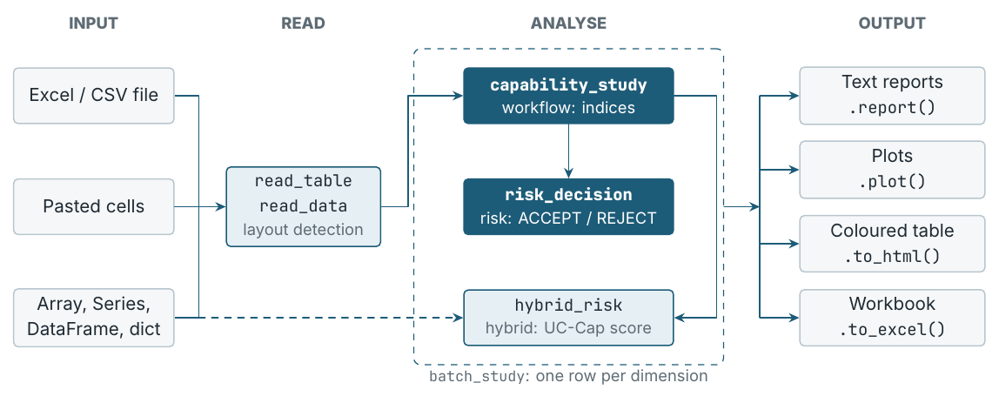

**Figure 1.1.** Architecture of uccap. Dark boxes are the two steps of every approval; the dashed frame is what `batch_study` repeats for each dimension (the UC-Cap score included). A single array can also be passed directly to `capability_study` or `hybrid_risk` (dashed arrow).

Monitoring after approval is a separate path: `monitor_study` (one characteristic) and `batch_monitor` (many dimensions) read the same inputs and give their own reports, plots and tables (Chapter 9).

### 1.3 Modules

**Table 1.2.** Modules of the package.

| Module           | Main entry point                   | Purpose                                                                                                                                            |
|:-----------------|:-----------------------------------|:---------------------------------------------------------------------------------------------------------------------------------------------------|
| `uccap.workflow` | `capability_study`                 | Data checks, outlier screen, normality test, within and overall sigma, normal and percentile indices, distribution fitting.                        |
| `uccap.risk`     | `risk_decision`, `sample_size`     | Standard error of the estimate, probability that the true capability is below $C_0$, risk-calibrated decision; sample-size planning.               |
| `uccap.hybrid`   | `hybrid_risk`                      | UC-Cap risk score from a statistical anchor plus a trained neural correction.                                                                      |
| `uccap.monitor`  | `monitor_study`, `batch_monitor`   | Operational acceptability monitoring after approval: posterior acceptability probability and continue, monitor or intervene, subgroup by subgroup. |
| `uccap.batch`    | `batch_study`                      | Many dimensions at once, results table, colour rules.                                                                                              |
| `uccap.io`       | `read_table`                       | Reading files, pasted cells and the standard layout.                                                                                               |
| `uccap.export`   | `BatchResult.to_html`, `.to_excel` | Coloured HTML and Excel output.                                                                                                                    |
| `uccap.plot`     | `study.plot(kind=...)`             | Figures by question: outliers, stability, capability, approval, UC-Cap; overview and batch overview; monitoring trajectory and overview.           |

### 1.4 Design principles

- **Nothing is removed silently.** Missing entries, unreadable cells and suspected outliers are listed in the report. Points are excluded only on explicit request.

- **Every choice is visible.** The report states the sigma estimator, the normality test, the distribution used and the index used for approval.

- **One dimension never stops a batch.** A dimension that cannot be analysed gets an `ERROR` row with the reason; the others are computed as usual.

- **Reproducible.** Bootstrap steps take a seed (`rng`); batch runs use a fixed seed by default.

## 2 Installation

*Requirements, optional components and how to check that the installation works.*

### 2.1 Requirements

uccap requires Python 3.9 or newer. The core depends only on NumPy, SciPy and pandas, and runs on Windows, macOS and Linux.

### 2.2 Installing

```sh
pip install uccap                  # core: numpy, scipy, pandas
pip install "uccap[excel]"         # + openpyxl, to read and write .xlsx files
pip install "uccap[plot]"          # + matplotlib, for figures
pip install "uccap[excel,plot]"    # both
```

Optional components.

| Extra   | Installs   | Needed for                                                                          |
|:--------|:-----------|:------------------------------------------------------------------------------------|
| `excel` | openpyxl   | Reading `.xlsx` files, `BatchResult.to_excel`.                                      |
| `plot`  | matplotlib | `study.plot()`, `decision.plot()`, `risk.plot()`, `result.plot()` and `uccap.plot`. |
| `test`  | pytest     | Running the test suite from a source checkout.                                      |

The hybrid model needs no extra package: it is evaluated with NumPy. Its trained parameters are not included in this release (Section 7.2).

### 2.3 Checking the installation

```sh
python -c "import uccap; print(uccap.__version__)"
uccap --version                     # the command-line tool (Section 8.3)
```

### 2.4 Working from the source

To modify the package or run the tests and examples:

```sh
git clone https://github.com/uccap-lab/uccap.git
cd uccap
pip install -e ".[test,excel,plot]"
pytest                              # full test suite
python examples/quickstart.py       # worked examples of this manual
```

Contents of the repository.

| Folder               | Contents                                                                                                                                           |
|:---------------------|:---------------------------------------------------------------------------------------------------------------------------------------------------|
| `src/uccap`          | The package.                                                                                                                                       |
| `examples`           | Scripts behind the examples in this manual: `quickstart.py`, `batch_example.py`, `hybrid_example.py`, `plots_example.py`, `planning_example.py`.   |
| `examples/notebooks` | One Jupyter notebook per article: `01_workflow`, `02_risk_calibrated_approval`, `03_uccap_hybrid_risk`.                                            |
| `templates`          | Input templates: `uccap_template.xlsx`, `multiple_dimensions.csv`, `single_dimension.csv`.                                                         |
| `tests`              | Unit tests, the validation tests against R and the reproduction of the articles’ results.                                                          |
| `validation`         | Reference data and scripts for the comparison with R, a check package for Minitab, and the scripts that reproduce the articles’ published results. |
| `docs`               | This manual, its Markdown version and `validation.md`.                                                                                             |

## 3 Quick start

*Four short tutorials: one dimension, its approval decision, a whole measurement file, and the hybrid risk score. Each takes a few lines of code.*

### 3.1 One dimension

A capability study needs the measurements of one characteristic *in production order* and its specification limits. Here, 32 parts of a dimension with tolerance $4.62 \pm 0.10$:

```python
import numpy as np
from uccap import capability_study, risk_decision

x = np.random.default_rng(42).normal(4.625, 0.023, 32)   # stands in for real data
study = capability_study(x, lsl=4.52, usl=4.72, target=4.62)
print(study.report())
```

```text
================================================================
  PROCESS CAPABILITY STUDY
================================================================
         Sample size : 32
       Specification : LSL = 4.52   Target = 4.62   USL = 4.72
                Mean : 4.6266
        Sigma within : 0.0200   (average moving range)
       Sigma overall : 0.0194   (within / overall = 1.03)
      Normality test : Anderson-Darling
             p-value : 0.920   (normal at alpha = 0.05)
         Other tests : SW p = 0.984   K2 p = 0.757   (reference)
            Skewness : -0.076   (excess kurtosis 0.163)
            Outliers : 2 flagged (obs. 5, 31), review before use
----------------------------------------------------------------
  Normal-based indices

              Within              Overall
                  Cp :  1.666          Pp :  1.716
                 Cpk :  1.556         Ppk :  1.603
...
----------------------------------------------------------------
     Capability used : Ppk = 1.603   (95% lower bound 1.259)
================================================================
```

The data pass the normality test, so the normal-based indices are used. The index carried forward to approval is $\widehat{P}_{pk} = 1.603$. Two observations are flagged as possible outliers but not removed. Chapter 10 explains every line of the report.

### 3.2 The approval decision

The decision needs the required capability $C_0$ and the relative cost of a wrong approval. Here a false acceptance is taken to cost 19 times as much as a false rejection:

```python
decision = risk_decision(study, c0=1.33, cost_ratio=19)
print(decision.report())
```

```text
================================================================
  RISK-CALIBRATED APPROVAL
================================================================
         Requirement : Ppk >= C0 = 1.33
          Risk basis : cost ratio c_FA/c_FR = 19  ->  alpha = 0.050
----------------------------------------------------------------
        Ppk estimate : 1.603
      Standard error : 0.209
        P(true < C0) : 0.096   (analytic)
   Required estimate : 1.674   (C0 + 1.645 x SE at this estimate)
   Smallest accepted : 1.691   (estimate that just passes with n = 32)
----------------------------------------------------------------
      Threshold rule : ACCEPT  (estimate >= C0)
     Risk-calibrated : REJECT  (P = 0.096 > alpha)

  Note: the two rules differ because the estimate is close to C0 for this
  sample size. C0 is unchanged; the calibrated rule shows how much evidence
  the sample gives. More parts or the actual cost ratio settle the case.
================================================================
```

Although $1.603 > 1.33$, there is still a 9.6 % probability that the true $P_{pk}$ is below 1.33, more than the 5 % the cost ratio allows. The plain rule would accept; the risk-calibrated rule asks for more evidence. Chapter 6 explains the calculation.

### 3.3 A whole measurement file

Measurement files in the standard layout (Chapter 4) hold the specifications above the measurements, so one call analyses every dimension:

```python
import uccap

results = uccap.batch_study("templates/multiple_dimensions.csv", c0=1.33, cost_ratio=19)
print(results.table(["dimension", "n", "normality", "capability", "p_fail",
                     "threshold_decision", "decision"]))
results.to_html("results.html")      # coloured table for the browser
results.to_excel("results.xlsx")     # coloured workbook with a Reports sheet
```

```text
  dimension   n normality  capability  p_fail threshold_decision decision
0      D101  32      Pass      1.9496  0.0067             ACCEPT   ACCEPT
1      D102  32      Pass      1.2832  0.6079             REJECT   REJECT
2      D103  32      Pass      0.9562  0.9975             REJECT   REJECT
3      D104  32      Pass      3.4099  0.0000             ACCEPT   ACCEPT
```

### 3.4 The hybrid risk score

For bilateral tolerances or an upper limit only, and samples of about 20 parts, the UC-Cap model of the third article gives the probability that the true $P_{pk}$ is below 1.33, a score from 0 to 100 and a risk level. The trained parameters of its network are not included in this release; they are available from the authors on request (Section 7.2). With them:

```python
from uccap import hybrid_risk

x = np.random.default_rng(11).normal(10.012, 0.011, 20)
r = hybrid_risk(x, lsl=9.95, usl=10.05, nominal=10.0)
print(r)
```

prints the statistical anchor, the learned correction, the probability, the score, the level, and the reason and action of the decision layer (Figure 7.2). The statistical part needs no model parameters:

```python
from uccap.hybrid import compute_features, mechanism

f = compute_features(x, 9.95, 10.05, 10.0)
f["A_Ppk"], f["A_SE_Ppk"], f["A_z_stat_133"]   # (1.3654, 0.2828, -0.1251)
mechanism.signals(f).active                    # ('shift',): mean shifted toward USL
```

The anchor $z$ is close to zero, so the statistics alone are undecided ($\sigma(z) = 0.469$); the mean-shift signal is raised because $P_p = 1.905$ exceeds $P_{pk}$ by more than the standard error. Chapter 7 explains the model and when it applies.

### 3.5 Monitoring after approval

Once a process runs, `monitor_study` follows it subgroup by subgroup: after every subgroup of five parts it gives the posterior probability $\pi_t$ that the process still meets its conformance target, and the zone continue, monitor or intervene (Chapter 9). The measurements must be in production order.

```python
from uccap import monitor_study, batch_monitor

r = monitor_study(x, lsl=9.95, usl=10.05, nominal=10.0)   # one characteristic
print(r.pi_final, r.zone, r.intervention)
result = batch_monitor("production.xlsx")                  # every dimension of a file
```

> **Where to go next.** Prepare your own files with Chapter 4; choose options with Chapter 5 and Chapter 6; look up any function in Chapter 13.

## 4 Preparing the data

*How to lay out measurements and specifications so that uccap reads them correctly, and what the package does with imperfect files.*

### 4.1 The standard layout

Measurements and specifications go in one table, with the specifications on top (Figure 4.1). This is the layout of the templates in the folder `templates/`: `uccap_template.xlsx` (sheets *Multiple dimensions*, *Single dimension* and *Instructions*), `multiple_dimensions.csv` and `single_dimension.csv`.

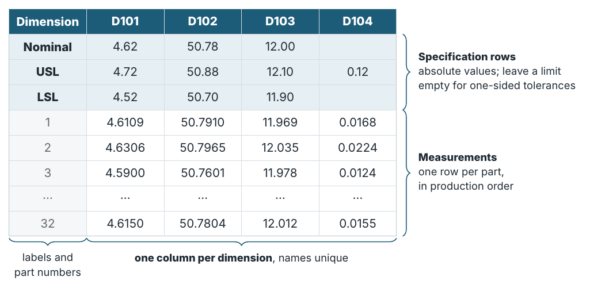

**Figure 4.1.** The standard layout, as in `templates/multiple_dimensions.csv`. D104 is a one-sided characteristic (upper limit only).

**Rules.**

- **Row 1**: dimension names, one column per dimension. Names must be unique.

- **Specification rows**: Nominal, USL and LSL as *absolute* values in the measurement unit, not $\pm$ tolerances. Leave USL or LSL empty for a one-sided tolerance; Nominal may be empty. Nominal 0 with LSL 0 is read as a GD&T characteristic (upper limit only; Section 5.6.1). Labels are not case sensitive; Target, Upper and Lower are also recognised, as are the usual Chinese labels. Optional rows *Unit* and *Description* may follow; they are shown in reports and not used in calculations.

- **Tolerance rows instead of limits**: rows labelled UpperTol and LowerTol (also Upper Tol, +Tol and $-$Tol, Tol for a symmetric $\pm$ tolerance, and the usual Chinese labels) are converted with the Nominal row: $\mathrm{USL} = \text{Nominal} + \text{upper}$, $\mathrm{LSL} = \text{Nominal} - |\text{lower}|$. A lower tolerance written as 0.1 or $-0.1$ gives the same limit. Explicit USL and LSL rows take precedence. For a tolerance band that does not contain the nominal (for example $12.00\,{}^{+0.10}_{+0.05}$), give USL and LSL directly.

- **Labels**: case, spaces, underscores, hyphens and a trailing unit in brackets are ignored, so `USL`, `upper_limit` and `USL (mm)` are all recognised. A text-labelled row directly below the specification rows that is not recognised is skipped and named in the notes, never read as a measurement.

- **Measurement rows**: one row per part, in production order. The first column holds the part number or a time stamp.

**Tolerated irregularities.** Title rows above the table and summary rows below it (Mean, Max, Min, Cpk, …) are skipped and reported. CSV files may use comma, semicolon or tab separators and decimal commas, and may be GBK encoded. Dimensions may have different numbers of parts.

### 4.2 Checking how a file was read

`read_table` reads a file without computing anything and reports what it recognised. Use it whenever a file comes from a new source:

```python
t = uccap.read_table("templates/multiple_dimensions.csv")
print(t.summary())
```

```text
layout     : specs on top
dimensions : 4  (D101, D102, D103, D104)
parts      : 32
with specs : 4
```

Any skipped title or summary rows, and rows with an unknown label, appear as `note` lines. The measurements are in `t.data` (one column per dimension) and the limits in `t.specs`.

### 4.3 Other layouts

`read_table` and `batch_study` also recognise three other layouts (Figure 4.2). Measurements and specifications can then come from separate tables.

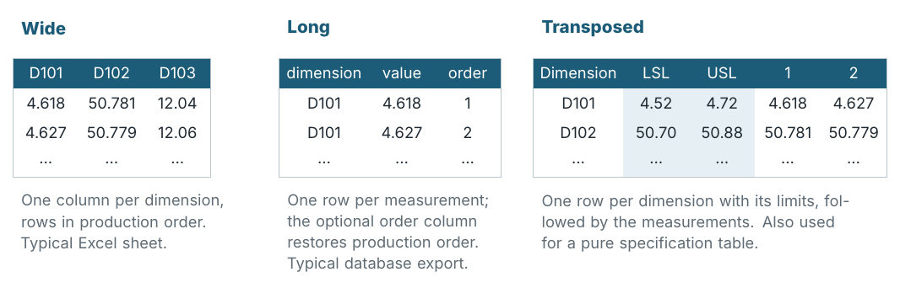

**Figure 4.2.** The wide, long and transposed layouts. The layout is detected automatically.

### 4.4 Specification tables

When the measurements carry no specifications, pass a specification table with one row per dimension as the second argument of `batch_study`. Column names are matched without regard to case (Table 4.1). A dictionary such as `{"D101": {"lsl": 4.52, "usl": 4.72, "target": 4.62}}` works as well.

**Table 4.1.** Recognised column names.

| Field      | Accepted column names (the usual Chinese names are accepted as well)                       |
|:-----------|:-------------------------------------------------------------------------------------------|
| dimension  | dimension, dim, feature, characteristic, name, id                                          |
| value      | value, measurement, measure, x, reading                                                    |
| order      | order, time, timestamp, seq, sequence, index                                               |
| LSL        | lsl, lower, lower limit, lower spec, lower_spec_limit, lo                                  |
| USL        | usl, upper, upper limit, upper spec, upper_spec_limit, hi                                  |
| target     | target, nominal, nom                                                                       |
| tolerances | upper tol, lower tol, +tol, $-$tol, tol (symmetric), tolerance; converted with the nominal |

### 4.5 Data for a single dimension

For one dimension, the measurements can be passed directly to `capability_study` as a list, a NumPy array or a pandas Series.

- **Order matters.** The within (short-term) sigma is computed from neighbouring points. If the order is unknown, pass `time_ordered=False`; only the overall sigma is then estimated.

- **Sample size.** At least 8 usable values are required; fewer than 20 gives a warning. The risk-calibrated decision is most useful from about 30 parts upwards.

- **Missing and non-numeric entries** (`None`, `NaN`, empty strings, `"N/A"`, text) are dropped and listed in the report. Numbers followed by a unit, such as `"4.618 mm"`, are read as numbers. A gap left by a missing value is never bridged when moving ranges are computed.

- **Subgrouped data.** Pass the subgroups as a list of arrays, `subgroups=[[...], [...]]`, to use the pooled within-subgroup sigma. Subgroup sizes may differ.

- **Two-dimensional arrays** are rejected rather than flattened, so that several dimensions are never mixed by accident.

**Specification arguments.** `lsl` and `usl` are the limits; at least one is required and `lsl` must be below `usl`. `target` is the nominal value $T$, needed for $C_{pm}$ and $C_{pmk}$; it must lie between the limits. If $T$ is not the midpoint, the tolerance is treated as asymmetric (Section 5.6.1).

> **Caution.** Give the limits as absolute values. A tolerance written as $12.00\,{}^{+0.10}_{-0.05}$ means `lsl=11.95`, `usl=12.10`, `target=12.00`.

## 5 The capability workflow

*What `capability_study` computes, step by step, following the workflow of the *Practical process capability indices workflows* article \[1\]: how data quality, process stability and the choice of distribution model are checked before an index is reported, and the options that control each step.*

### 5.1 Overview

Figure 5.1 shows the complete workflow. The data are checked, screened for outliers and tested for normality. Normal data use the classical indices; non-normal data use percentile indices from the best-fitting distribution. The index that leaves the workflow, $P_{pk}$ or its percentile counterpart $C_{Npk}$, is the one used for approval.

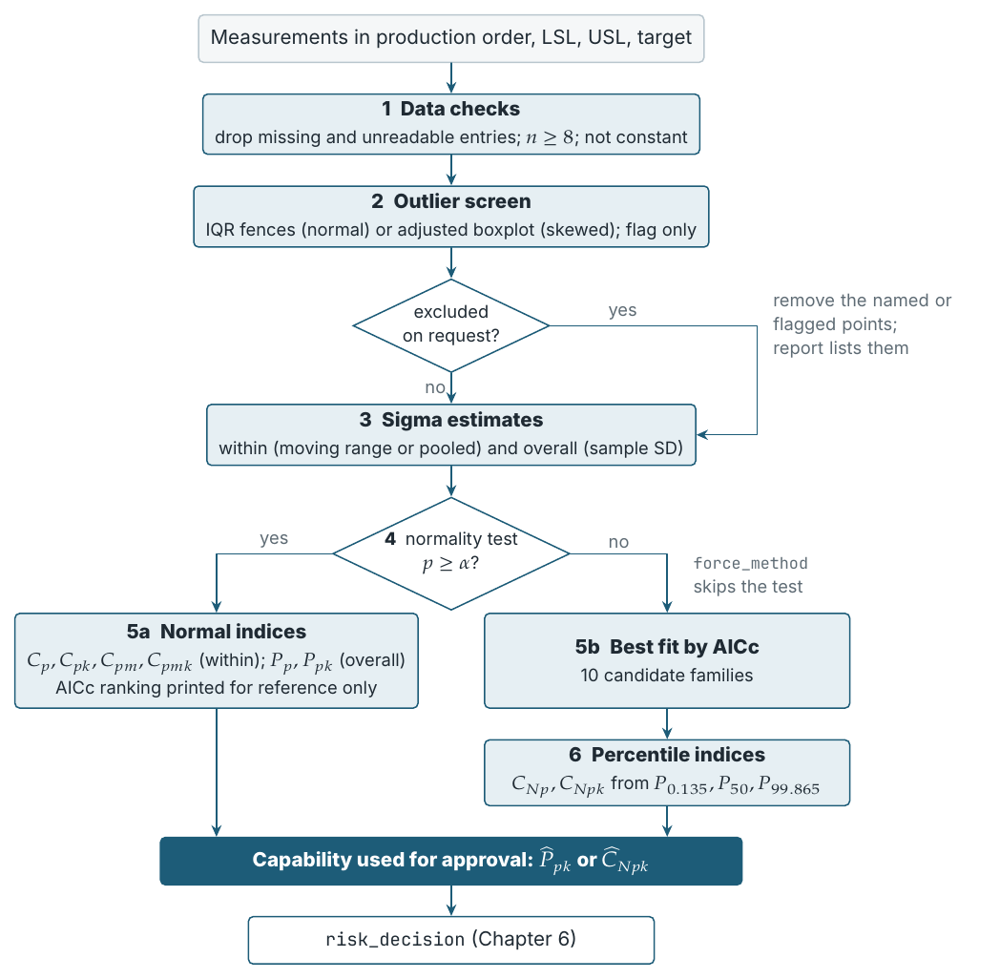

**Figure 5.1.** The capability workflow of `capability_study`. Numbers refer to the sections of this chapter.

### 5.2 Step 1: data checks

Missing and unreadable entries are removed and listed. The study stops with a `DataError` if fewer than 8 usable values remain or all values are identical. It continues, with a warning, when the sample is small ($n < 20$), the data look sorted (time order lost), the gauge resolution is coarse (fewer than 10 distinct values, or a step larger than half the standard deviation) or the mean lies outside the limits. Chapter 12 lists every message.

### 5.3 Step 2: outlier screen

Points are **flagged, never removed automatically**. With `outlier_method="auto"` (the default) the screen depends on the normality test on all usable values:

- **Normal data**: Tukey’s fences \[21\] $[Q_1 - k\,\mathrm{IQR},\ Q_3 + k\,\mathrm{IQR}]$ with $k = 1.5$ (A.18), the IQR rule of the workflow article’s case study \[1, Sec. 6.1.1\].

- **Non-normal data** (a uccap addition): the skewness-adjusted boxplot of Hubert and Vandervieren \[15\], which widens the fence on the long side by $e^{3\,\mathrm{MC}}$ using the medcouple MC \[7\], so that the tail of a skewed distribution is not mistaken for outliers (A.19).

The fence coefficient $k$ of both screens is set with `outlier_k` (default 1.5): a larger value flags fewer points, for example `outlier_k=3` flags only far-out values, as in Tukey’s “extreme” fences. When it differs from 1.5 the report shows it next to the outlier line. `"iqr"`, `"adjusted"` and `"grubbs"` (iterated two-sided Grubbs test \[14\], for approximately normal data, which does not use $k$) can be chosen explicitly. Once flagged points have been confirmed as special causes (gauge error, set-up, a damaged part), the study can be recomputed without them:

```python
clean  = study.without_outliers()                      # drop the flagged points
study2 = capability_study(x, 4.52, 4.72, 4.62, exclude=[5, 31])   # or name them (1-based)
```

> **Caution.** Excluding points can change the decision. In the quick-start example, removing the two flagged points raises $\widehat{P}_{pk}$ from 1.603 to 1.968 and turns REJECT into ACCEPT. Exclude points only with a documented reason; the report records which observations were excluded.

### 5.4 Step 3: within and overall sigma

Short-term (within) and long-term (overall) variation are estimated separately, as in the workflow article \[1, Sec. 5\]; the unbiasing constants $d_2$, $d_4$ and $c_4$ are those of statistical process control \[17\]. The estimators are (A.1)–(A.6) in Appendix A.

**Table 5.1.** The two sigma estimates.

| Sigma                  | Used for                                                    | Estimator                                                                                                                                                                                                                                                                                                                                                                                                                                                                                         |
|:-----------------------|:------------------------------------------------------------|:--------------------------------------------------------------------------------------------------------------------------------------------------------------------------------------------------------------------------------------------------------------------------------------------------------------------------------------------------------------------------------------------------------------------------------------------------------------------------------------------------|
| **Overall**(long-term) | $P_p$, $P_{pk}$ and the **approval decision**               | Sample standard deviation, denominator $n-1$.                                                                                                                                                                                                                                                                                                                                                                                                                                                     |
| **Within**(short-term) | $C_p$, $C_{pk}$, $C_{pm}$, $C_{pmk}$ (potential capability) | `within="amr"` (default): average moving range, $\overline{MR}/d_2(w)$. `"mmr"`: median moving range, $\widetilde{MR}/d_4(w)$, robust to isolated spikes. `"srmssd"`: root mean square successive difference, $\sqrt{\sum (x_{i+1}-x_i)^2 / 2(n-1)}\,/\,c_4(n)$. The span $w$ = `mr_span` is the number of consecutive points per moving range (2 to 10, default 2). With `subgroups=`: `"pooled"` (default), `"rbar"` ($\bar R/d_2(m)$) or `"sbar"` ($\bar S/c_4(m)$) for subgroups of size $m$. |

The article gives the conditions for each within estimator \[1, Sec. 5.1\]. All of them need the data in time order. The average moving range suits stable, time-ordered processes; it depends on the order of the data, and a larger span $w$ makes it less sensitive to small shifts. The median moving range is more robust to isolated large jumps. SRMSSD is meant for data where consecutive points cannot be assumed to come from similar conditions. The pooled estimator assumes equal variances in the subgroups. In the article’s case study the choice of estimator alone changed the indices noticeably, which is why uccap reports the method next to every within-sigma index.

Because approval uses the overall sigma, **the choice of within-sigma estimator never changes the decision**. The report prints the ratio $\hat\sigma_{\text{within}}/\hat\sigma_{\text{overall}}$ and warns when it falls outside 0.75–1.25. A ratio well below 1 indicates drift or variation between subgroups: the process may not be stable and $C_{pk}$ overstates what it delivers. A ratio well above 1 suggests that the time order or the subgroup definition is wrong.

**Table 5.2.** Constants of the moving-range estimators by span $w$. $d_2$: mean of the range of $w$ standard normal values; $d_4$: its median.

| $w$      | 2     | 3     | 4     | 5     | 6     | 7     | 8     | 9     | 10    |
|:---------|:------|:------|:------|:------|:------|:------|:------|:------|:------|
| $d_2(w)$ | 1.128 | 1.693 | 2.059 | 2.326 | 2.534 | 2.704 | 2.847 | 2.970 | 3.078 |
| $d_4(w)$ | 0.954 | 1.588 | 1.978 | 2.257 | 2.472 | 2.645 | 2.791 | 2.915 | 3.024 |

With subgroups, the report also gives the sigma *between* subgroup means, $\hat\sigma_{\text{between}} = \sqrt{\max\bigl(0,\ s_{\bar x}^2 - \hat\sigma_{\text{within}}^2/\bar m\bigr)}$, with $s_{\bar x}$ the standard deviation of the subgroup means and $\bar m$ the mean subgroup size, and the between/within sigma $\sqrt{\hat\sigma_{\text{between}}^2 + \hat\sigma_{\text{within}}^2}$. A between sigma of the same order as the within sigma means that subgroups differ systematically (setups, tools, batches). These two values are an addition to the workflow article and are not used by any index.

### 5.5 Step 4: normality test

The workflow article discusses four tests \[1, Sec. 2.1\], all available through `normality_test`:

- `"anderson"` (default): Anderson–Darling, which gives more weight to the tails and is preferred in the article for capability analysis and distribution fitting; p-value of D’Agostino and Stephens \[12\].

- `"shapiro"`: Shapiro–Wilk \[20\], sensitive and suited to small to moderate samples.

- `"ks"`: Kolmogorov–Smirnov, which compares the whole distribution and is less powerful; with estimated parameters uccap uses the Lilliefors form \[16\] with a Monte Carlo p-value.

- `"chi2"`: chi-square goodness of fit, suited to large samples and sensitive to the binning; uccap uses equiprobable bins, $\lceil 2n^{0.4}\rceil$ of them (an implementation choice).

`"k2"`, the D’Agostino–Pearson omnibus test \[11\], is an addition of uccap; its kurtosis part is an approximation that needs about 20 observations. The decision rule is that of the article: at `alpha=0.05`, normality is rejected when $p \le \alpha$. The report also lists the p-values of Anderson–Darling, Shapiro–Wilk and D’Agostino–Pearson that were not chosen as “Other tests”, for reference only; the decision uses the chosen test.

> **Key point.** If the normality test passes, the normal method is used, even when another distribution has a lower AICc. The distribution ranking is still printed for reference, and a warning appears when the normal distribution trails the best fit by more than 10 AICc units. `force_method="normal"` or `"percentile"` overrides the test.

### 5.6 Step 5a: normal-based indices

Figure 5.2 shows the quantities behind the indices; $C_{pm}$ is the Taguchi index of Chan, Cheng and Spiring \[9\]. With $\mu$ the mean, $T$ the target and $\sigma$ the relevant sigma:

```math
\begin{aligned}
C_p &= \frac{\mathrm{USL}-\mathrm{LSL}}{6\sigma}, &
C_{pk} &= \min\left(\frac{\mathrm{USL}-\mu}{3\sigma},\ \frac{\mu-\mathrm{LSL}}{3\sigma}\right),\\[3pt]
C_{pm} &= \frac{\mathrm{USL}-\mathrm{LSL}}{6\sqrt{\sigma^{2}+(\mu-T)^{2}}}, &
C_{pmk} &= \frac{\min\left(\mathrm{USL}-\mu,\ \mu-\mathrm{LSL}\right)}{3\sqrt{\sigma^{2}+(\mu-T)^{2}}}.
\end{aligned}
```

These are (A.7)–(A.10) in Appendix A, with the equation numbers of the workflow article. The two terms of $C_{pk}$ are reported as $C_{pu}$ and $C_{pl}$. As a general reading the article gives, for $C_p$: below 1.00 not capable, 1.00 to 1.33 marginal, 1.33 or more capable, and it notes that a $C_{pk}$ above 1.33 is generally considered acceptable \[1, Secs. 3.1, 3.2\]; the requirement that applies is the one agreed for the characteristic. $C_{pm}$ and $C_{pmk}$ need a target and are left blank without one. $P_p$, $P_{pk}$, $P_{pu}$, $P_{pl}$, $P_{pm}$ and $P_{pmk}$ use the same formulas with the overall sigma.

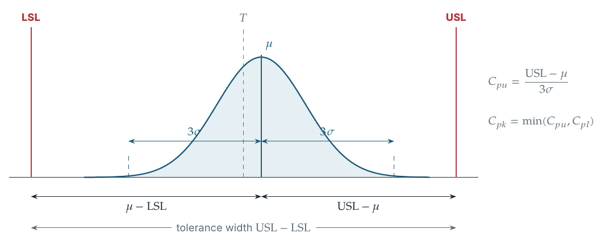

**Figure 5.2.** Geometry of the normal-based indices. $C_{pk}$ is the distance from the mean to the nearer limit in units of $3\sigma$; here the upper side is the nearer one.

#### 5.6.1 Asymmetric and one-sided tolerances

- **Asymmetric tolerance** ($T$ not at the midpoint): the starred indices $C_p^{*}$, $C_{pk}^{*}$, $C_{pm}^{*}$ and $C_{pmk}^{*}$ of the workflow article are used \[1, Eqs. (3), (5), (9), (13)\], with the distances $d_l = T-\mathrm{LSL}$ and $d_u = \mathrm{USL}-T$ from the target to each limit; for example $C_{pk}^* = \min\bigl(d_l - |T-\mu|,\ d_u - |T-\mu|\bigr)/3\sigma$, floored at zero ((A.11)–(A.14)). `asymmetric="pearn-chen"` selects the Pearn–Chen generalisation \[19\] instead (A.15); the two agree when the mean is on target.

- **One-sided tolerance**: $C_{pk}$ reduces to $C_{pu}$ or $C_{pl}$; $C_p$ and $P_p$ are not defined and are left blank.

**GD&T characteristics and a lower limit at zero.** A GD&T tolerance such as flatness, position or profile has an upper limit only \[1, Sec. 3.1.3\]; zero is a physical bound, not a specification limit, and a value close to zero is good, so $C_{pk} = C_{pu}$ \[1, Eq. (6)\]. Such characteristics are commonly recorded as nominal 0, LSL 0 and USL $> 0$. Computing $P_{pk}$ on $[0, \mathrm{USL}]$ would then let the lower side dominate and rate the best parts as the least capable, so `batch_study` reads such a record as an upper limit only ($P_{pu}$) and says so in `warnings` (`zero_lsl_gdt=True`, the default ). A dimension with LSL left empty is an upper limit only as well. A real lower limit at zero is a different case, for example a step between two parts that may deviate to one side only: values below zero are then out of tolerance and both sides count. Enter it with LSL 0 and no nominal (or set `zero_lsl_gdt=False`); it gives the two-sided tolerance $[0, \mathrm{USL}]$ and $P_{pk} = \min(P_{pu}, P_{pl})$. The engineer decides which case applies; uccap does not infer it from the data. The simplified workflow of the article leaves out $C_{pm}$, $C_{pmk}$ and bilateral asymmetric tolerances; the article notes that this aligns with common manufacturing practice, where processes are typically centred within the specification limits unless the design requires otherwise, for example by GD&T \[1, Sec. 7\]. In uccap the ordinary indices are used whenever no target is given, or the target is the midpoint.

### 5.7 Steps 5b and 6: non-normal data

#### 5.7.1 Choosing the distribution

All candidate distributions are fitted by maximum likelihood and ranked by AICc, Akaike’s criterion corrected for small samples \[8\] (A.20). AIC and BIC are shown for reference. The column $\Delta$AICc is the difference from the best candidate: below 2 means about as good as the best, above 10 means essentially no support.

**Table 5.3.** Candidate distributions. $k$ is the number of parameters.

| Set           | Families                                                                                                                                                                                                 |
|:--------------|:---------------------------------------------------------------------------------------------------------------------------------------------------------------------------------------------------------|
| Default (10)  | normal (2), lognormal (2), lognormal3 (3), weibull (2), weibull3 (3), gamma (2), gamma3 (3), exponential (1), sev (2; smallest extreme value, left-skewed), lev (2; largest extreme value, right-skewed) |
| Optional (10) | exponential2, logistic, loglogistic, loglogistic3, boxcox, johnson_su, johnson_sb, shash, normal_mix2, normal_mix3. Enable with `candidates="all"` or by name.                                           |

- Families ending in `3` estimate a threshold (lower bound) below the smallest observation.

- Families that need positive data are skipped when the data contain zero or negative values; the report lists them as “not fitted” with the reason.

- The extreme value families accept negative values, so they cover skewed deviations recorded relative to nominal.

- The optional families are off by default: at typical sample sizes they duplicate a default family, are transformations rather than distributions, or have four or more parameters and extrapolate the tails poorly. A good fit by a normal mixture usually means two process streams that should be analysed separately.

The article recommends this route, fitting a distribution and computing percentile indices, over transforming the data to normality with Box–Cox or Johnson transformations, which alter the data and complicate the interpretation \[1, Sec. 4\]; the `boxcox` and Johnson families are therefore optional. It also warns against choosing the distribution with the highest goodness-of-fit p-value: a large p-value does not confirm a distribution, and the lowest AICc can still be a poor fit, so check the probability plot \[1, Sec. 2.2\].

> **Tip.** Choose a family that is also physically plausible \[1, Sec. 4\]. Restrict `candidates` when you know the characteristic, for example `candidates=["weibull", "weibull3", "lognormal"]` for flatness or position.

#### 5.7.2 Percentile indices

Following Clements’ percentile method \[10\], for non-normal data the 0.135 %, 50 % and 99.865 % points of the distribution replace $\mu-3\sigma$, $\mu$ and $\mu+3\sigma$ (Figure 5.3):

```math
C_{Np} = \frac{\mathrm{USL}-\mathrm{LSL}}{P_{99.865}-P_{0.135}}, \qquad
C_{Npk} = \min\left(\frac{\mathrm{USL}-P_{50}}{P_{99.865}-P_{50}},\
                   \frac{P_{50}-\mathrm{LSL}}{P_{50}-P_{0.135}}\right).
```

These are (A.16) and (A.17); the target-based and one-sided forms are in Appendix A.

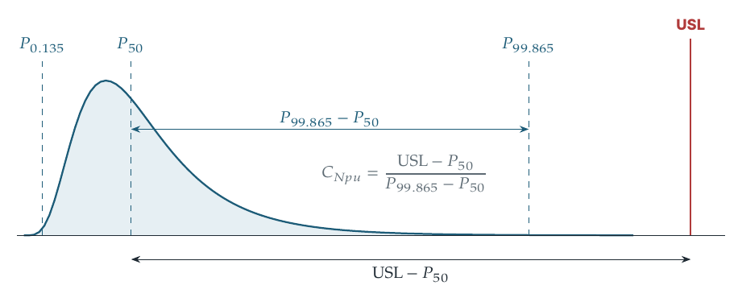

**Figure 5.3.** Percentile indices for a right-skewed characteristic with an upper limit only (for example flatness). The long right tail is what limits capability; a normal approximation would understate it.

The percentiles are obtained in one of two ways, selected with `percentile_method`:

**Table 5.4.** Parametric and non-parametric percentiles.

|                  | `"fit"` (default, parametric)                     | `"empirical"` (non-parametric)                                                       |
|:-----------------|:--------------------------------------------------|:-------------------------------------------------------------------------------------|
| Percentiles from | The best-fitting distribution.                    | The sample, by linear interpolation (as Excel `PERCENTILE.INC`).                     |
| Suitable for     | Typical capability samples, $n \approx 30$–$100$. | Large samples only (about 1000 or more); a warning is given below that.              |
| Main risk        | A wrong family distorts the tails.                | With small $n$ the extreme percentiles collapse onto the sample minimum and maximum. |

When the target is given, the percentile versions $C_{Npm}$ and $C_{Npmk}$ are also reported, with $(P_{99.865}-P_{0.135})/6$ in place of $\sigma$ and $P_{50}$ in place of $\mu$.

### 5.8 Options of capability_study

**Table 5.5.** Keyword options, their defaults and when to change them.

| Option              | Default      | When to change                                                                                                                                                          |
|:--------------------|:-------------|:------------------------------------------------------------------------------------------------------------------------------------------------------------------------|
| `within`            | `"amr"`      | `"mmr"` when isolated spikes inflate the moving ranges; `"srmssd"` when consecutive parts are not a rational subgroup; with subgroups `"pooled"`, `"rbar"` or `"sbar"`. |
| `mr_span`           | 2            | Points per moving range (2 to 10), for example to match a control-chart convention.                                                                                     |
| `subgroups`         | `None`       | Data collected in subgroups (for example 5 parts per hour).                                                                                                             |
| `time_ordered`      | `True`       | `False` when the production order is unknown.                                                                                                                           |
| `normality_test`    | `"anderson"` | `"shapiro"`, `"ks"` or `"chi2"` to match a company standard.                                                                                                            |
| `alpha`             | 0.05         | Significance level of the normality test (not the approval risk).                                                                                                       |
| `outlier_method`    | `"auto"`     | `"iqr"`, `"adjusted"` or `"grubbs"` to fix the screen.                                                                                                                  |
| `outlier_k`         | 1.5          | Fence coefficient of the IQR and adjusted-boxplot screens; 3 for far-out points only.                                                                                   |
| `candidates`        | 10 defaults  | A list of names, or `"all"`.                                                                                                                                            |
| `force_method`      | `None`       | `"normal"` or `"percentile"` to override the normality test.                                                                                                            |
| `percentile_method` | `"fit"`      | `"empirical"` for very large samples.                                                                                                                                   |
| `exclude`           | `None`       | `"flagged"` or a list of 1-based observation numbers.                                                                                                                   |

## 6 Risk-calibrated approval

*How `risk_decision` turns a capability estimate and its sampling uncertainty into ACCEPT or REJECT with a stated risk, following the *Risk-calibrated process capability approval with finite samples* article \[2\].*

### 6.1 Sampling uncertainty near the threshold

The requirement $C_0$ (typical values are 1.00, 1.33 and 1.67 \[2, Sec. 1\]) is not changed by anything in this chapter. The usual rule $\widehat{P}_{pk} \ge C_0$ compares a point estimate with that requirement and gives no explicit protection against a wrong approval near the threshold \[2, Sec. 7\]. The risk-calibrated rule is an aid for this situation: it keeps the requirement and accounts for the uncertainty of an estimate from a finite sample, typically 20 to 50 parts in a validation study \[2, Sec. 1\]. With such samples the usual rule is unstable near the threshold: for a process whose true index equals $C_0$, the probability of approval tends to one half, so the outcome is close to a coin toss \[5\] \[2, Sec. 2.3\].

The estimate $\widehat{P}_{pk}$ varies from sample to sample around the true value: this sampling uncertainty is what a finite study cannot avoid. Its standard error is, to a good approximation \[5\] \[2, App. A\],

```math
\mathrm{SE}(\widehat{P}_{pk}) \approx \sqrt{\frac{1/9 + \widehat{P}_{pk}^{\,2}/2}{n}} .
```

The approximation is derived for normal data and a centred process in which one specification limit is the active constraint; for off-centre or strongly skewed processes the bootstrap is the more reliable check \[2, Sec. 5.1.3, 5.5\]. For the quick-start example ($\widehat{P}_{pk} = 1.603$, $n = 32$) this is 0.209. Figure 6.1 shows what that means: a sizeable part of the plausible values of the true $P_{pk}$ lies below the requirement $C_0 = 1.33$, even though the estimate clears it.

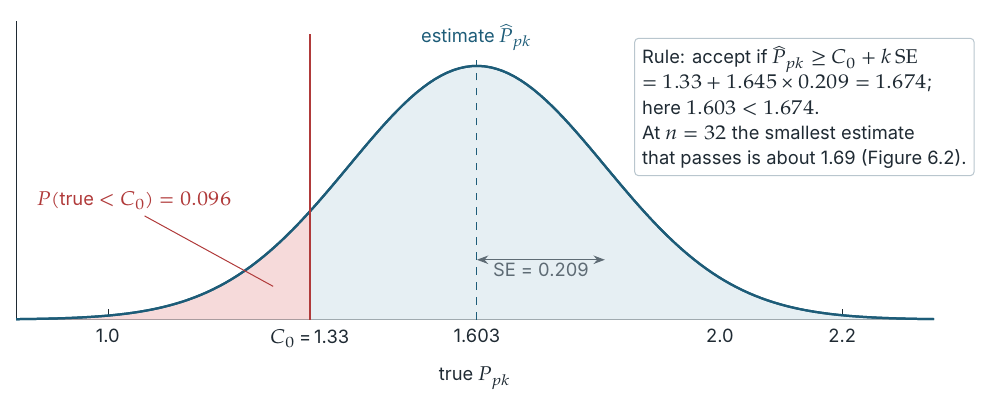

**Figure 6.1.** Uncertainty in the true $P_{pk}$ for the quick-start example. The red area is the probability that the process is actually below the requirement. It exceeds $\alpha = 0.05$, so the evidence is not sufficient for the risk-calibrated rule at this sample size, although the estimate is above $C_0$.

### 6.2 The rule

The process is accepted when the probability that its true capability lies below $C_0$ is at most $\alpha$ \[2\]:

```math
\text{accept if}\quad P\bigl(P_{pk} < C_0 \mid \text{data}\bigr) \le \alpha
\quad\Longleftrightarrow\quad
\widehat{P}_{pk} \;\ge\; C_0 + k\cdot\mathrm{SE}(\widehat{P}_{pk}), \qquad k = z_{1-\alpha}.
```

For normal data the probability is $\Phi\bigl((C_0 - \widehat{P}_{pk})/\mathrm{SE}\bigr)$. The calibration only changes decisions near the threshold: clearly capable processes are still accepted and clearly incapable ones are still rejected \[2, Sec. 7\]. The failure probability and the cost-based choice of $\alpha$ are (A.21) and (A.22) in Appendix A. Figure 6.2 shows the steps.

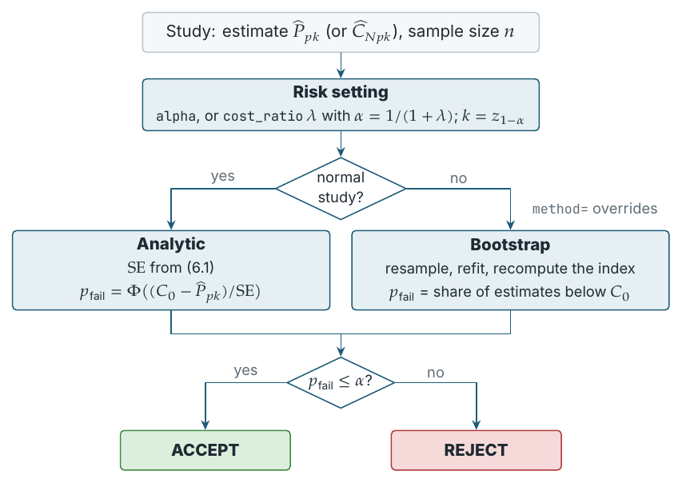

**Figure 6.2.** The risk-calibrated decision of `risk_decision`. For normal data the rule is equivalent to $\widehat{P}_{pk} \ge C_0 + k\,\mathrm{SE}$ (6.2); the bootstrap follows Appendix B of the article \[2\]. The plain threshold decision $\widehat{P}_{pk} \ge C_0$ is reported alongside.

The article shows that several familiar procedures are members of one family of margin rules $\widehat{P}_{pk} \ge C_0 + k\,\mathrm{SE}$ that differ only in $k$ \[2, Sec. 4.3\] (Table 6.1). The `RiskDecision` reports the plain threshold decision next to the calibrated one, and `expected_loss` gives the expected operational loss that the article uses to compare the rules \[2, Sec. 3.4\].

**Table 6.1.** Members of the margin-rule family \[2, Sec. 4.3\].

| Rule                                                     | $k$                                      | In uccap                             |
|:---------------------------------------------------------|:-----------------------------------------|:-------------------------------------|
| Deterministic threshold $\widehat{P}_{pk} \ge C_0$       | $0$                                      | `threshold_accept`; also `alpha=0.5` |
| Probability rule $P(C < C_0) \le \alpha$                 | $z_{1-\alpha}$                           | `alpha=`                             |
| Cost-sensitive rule                                      | $z_{1-\alpha}$, $\alpha = 1/(1+\lambda)$ | `cost_ratio=`                        |
| Lower confidence bound $\mathrm{LCB}_{1-\gamma} \ge C_0$ | $z_{1-\gamma}$                           | `study.lower_bound(1 - gamma)`       |

### 6.3 Setting the risk

Give exactly one of `alpha` or `cost_ratio`.

- `alpha`: the largest acceptable probability that an approved process is actually below $C_0$.

- `cost_ratio` $\lambda = c_{\text{FA}}/c_{\text{FR}}$: the cost of a false acceptance divided by the cost of a false rejection. Minimising the expected cost gives $\alpha = 1/(1+\lambda)$.

**Table 6.2.** Cost ratios and the margin they imply, after Table 1 and Section 4.7 of the risk-calibration article \[2\].

| $\lambda$ | $\alpha$ | $k$   | Description in the article                                          |
|:----------|:---------|:------|:--------------------------------------------------------------------|
| 1         | 0.50     | 0     | Non-critical or cosmetic features; close to the deterministic rule. |
| 4         | 0.20     | 0.842 | Lenient.                                                            |
| 9         | 0.10     | 1.282 | Used as an example in the article (its Fig. 1).                     |
| 19        | 0.05     | 1.645 | Matches a 95 % lower confidence bound.                              |
| 99        | 0.01     | 2.326 | Strong protection against false approval.                           |

The article leaves $\lambda$ to the application, as a relative rather than a monetary quantity, and gives as orientation $\lambda \ge 20$ for safety-critical features (automotive, aerospace, medical), $\lambda$ of about 5 to 10 for high-volume consumer products and $\lambda$ near 1 for non-critical features \[2, Sec. 4.7\].

### 6.4 How many parts are needed

Because the standard error shrinks with $\sqrt n$, the estimate needed for acceptance falls as more parts are measured (Figure 6.3). The curves solve $\widehat C - C_0 = k\,\mathrm{SE}(\widehat C)$ for $\widehat C$; they give the smallest estimate that is accepted at each sample size.

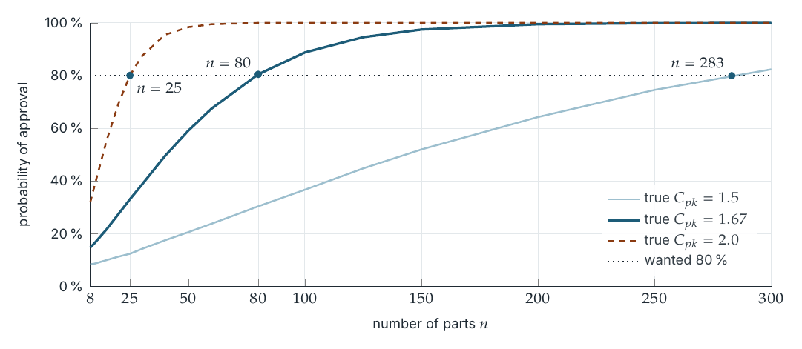

**Figure 6.3.** Smallest $P_{pk}$ estimate that is accepted, as a function of sample size, for $C_0 = 1.33$ (analytic method). With 32 parts and $\lambda = 19$, an estimate of about 1.69 is needed.

> **Key point.** The *Required* line of the decision report is $C_0 + k\cdot\mathrm{SE}$ evaluated at the current estimate (1.674 in the example). Since the standard error grows with the estimate, the smallest estimate that is actually accepted is slightly higher (1.69). Both say the same thing: near the threshold, either accept more risk or measure more parts.

### 6.5 Planning a study

Figure 6.3 answers the question after the study. Before the study the question is the reverse: if the process is as good as we believe, how many parts must be measured so that it is approved with reasonable probability? `sample_size` answers it for an assumed true capability and a wanted probability of approval (the power of the study):

```python
from uccap import sample_size

plan = sample_size(1.67, c0=1.33, cost_ratio=19, power=0.8)
print(plan.report())
```

```text
Sample-size plan (risk-calibrated approval)
            Requirement C0  1.33
                 Risk rule  cost ratio 19 (alpha = 0.050)
          Assumed true Cpk  1.67
          Wanted P(accept)  80%
              Parts needed  80
    P(accept) with n parts  80.5%
     Smallest accepted Cpk  1.539
```

A process with a true $C_{pk}$ of 1.67 is approved in only 39 % of studies with 30 parts; 80 parts are needed for an 80 % chance (Figure 6.4). For a true $C_{pk}$ of 2.0, 25 parts suffice; for 1.5, close to $C_0$, almost 300 are needed. When the plan asks for more parts than can be measured, the honest options are to accept more risk (a smaller $\lambda$) or to improve the process first. From the command line, `uccap plan 1.67 --cost-ratio 19` gives the same plan (Section 8.3).


**Figure 6.4.** Probability that a study is approved, for $C_0 = 1.33$ and $\lambda = 19$, as a function of the number of parts. Dots: the sample size `sample_size` returns for 80 % power.

**Table 6.3.** Parts needed for $C_0 = 1.33$, by assumed true $C_{pk}$, cost ratio and wanted probability of approval.

|                         |                                 |      |     |                                  |      |     |                                  |      |     |
|:------------------------|:--------------------------------|:-----|:----|:---------------------------------|:-----|:----|:---------------------------------|:-----|:----|
|                         | $\lambda = 4$ ($\alpha = 0.20$) |      |     | $\lambda = 19$ ($\alpha = 0.05$) |      |     | $\lambda = 99$ ($\alpha = 0.01$) |      |     |
| Probability of approval | 1.5                             | 1.67 | 2.0 | 1.5                              | 1.67 | 2.0 | 1.5                              | 1.67 | 2.0 |
| 50 %                    | 43                              | 11   | 8   | 143                              | 41   | 14  | 271                              | 80   | 27  |
| 80 %                    | 135                             | 36   | 11  | 283                              | 80   | 25  | 453                              | 130  | 42  |
| 90 %                    | 200                             | 54   | 16  | 377                              | 105  | 33  | 571                              | 161  | 52  |

- The probability of approval is simulated for a centred normal process: the estimate is $\widehat C = (3C - |\bar x|)/(3s)$ with $\bar x \sim N(0, 1/n)$ and $(n-1)s^2 \sim \chi^2_{n-1}$, so no samples are drawn and the calculation takes milliseconds. A centred process is the conservative case, because its estimate has the largest downward bias.

- `method="approx"` uses $\widehat C \sim N\bigl(C, \mathrm{SE}(C, n)^2\bigr)$ instead; it overstates the probability by a few points for small $n$ (`sample_size(1.67).n` is 74 instead of 80).

- The plan assumes normal data. For skewed characteristics, whose decisions use the bootstrap, treat it as a lower bound. The result is never below 8, the smallest sample uccap analyses.

- `min_accepted(n, ...)` returns the smallest accepted estimate for $n$ parts (the curves of Figure 6.3); `acceptance_probability(cpk, n, ...)` the probability of approval; `uccap.plot.planning_plot()` draws Figure 6.4 for any settings.

### 6.6 Analytic and bootstrap probability

`method="auto"` (the default) chooses the calculation from the study:

- **Normal studies**: the analytic probability $\Phi\bigl((C_0 - \widehat{P}_{pk})/\mathrm{SE}\bigr)$ with equation (6.1).

- **Non-normal studies**: a nonparametric bootstrap \[13\] with `n_boot=1000` resamples. Each resample refits the selected family and recomputes $C_{Npk}$; the probability is the share of resamples below $C_0$. For three-parameter families the fitted threshold is kept fixed, which makes the bootstrap about 30 times faster. Pass `rng` for reproducible results.

`method="analytic"` or `"bootstrap"` forces one of the two.

### 6.7 Decisions without raw data

When only a reported estimate and its sample size are known, for example from a supplier’s PPAP, pass the number and `n`:

```python
d = risk_decision(1.45, n=32, c0=1.33, alpha=0.05)
d.accept, round(d.p_fail, 3), round(d.margin, 3)    # (False, 0.264, 1.643)
```

## 7 The hybrid UC-Cap risk score

*The learned risk model of the *hybrid statistical learning framework* article \[3\]: how it refines the statistical failure probability with a learned correction, which inputs it uses, and where it applies.*

### 7.1 The model

UC-Cap estimates the probability that the true $P_{pk}$ is below 1.33. Like the risk-calibrated rule, it is an aid for deciding under the uncertainty of finite samples; it refines rather than replaces the statistical estimate \[3, Sec. 6.1\]. The article describes the workflow as particularly useful for capability studies containing hundreds or thousands of dimensions \[3, Sec. 5.2\]: it finds the dimensions that need attention quickly, instead of judging every dimension only against one fixed threshold such as 1.33 or 1.67 (Chapter 8). It starts from the statistical anchor of Chapter 6 and adds a correction learned from industrial data:

```math
\pi = \sigma\bigl(z + f(\mathbf{x})\bigr), \qquad
z = \frac{1.33 - \widehat{P}_{pk}}{\mathrm{SE}(\widehat{P}_{pk})}, \qquad \sigma(t) = \frac{1}{1+e^{-t}} .
```

$z$ is the uncertainty-adjusted distance to the threshold and enters with a fixed weight of one, so the model can never ignore the statistics. $f$ is a neural network that shifts the anchor using the shape of the data and the position of the tolerance (Figure 7.1). Without the correction the model reduces to $\sigma(z)$, reported as `p_stat`.


**Figure 7.1.** Structure of UC-Cap V4.2. The statistical anchor and the learned correction are added on the logit scale. The network is the final model of the article (Table 10 there). Its trained weights and preprocessing parameters are not included in this release (Section 7.2).

### 7.2 The model parameters

The trained weights and preprocessing parameters of the network are not included in this release of uccap; they are available from the authors on request. Everything that does not need the network works without them: the model inputs (`compute_features`, Table 7.2), the statistical anchor $z$ with its probability $\sigma(z)$, and the mechanism signals of the decision layer (Section 7.4.1). With a copy of the parameter file, give its location in Python, in the environment variable `UCCAP_MODEL`, or with the `--model` option of the `uccap` command (Section 8.3):

```python
import uccap.hybrid
uccap.hybrid.set_model_path("path/to/uccap_v4_2.json")
uccap.hybrid.model_available()          # True once the file is found
```

Without the file, `hybrid_risk` stops with `ModelNotAvailable` and this explanation, while `batch_study` and the `uccap` command leave out the UC-Cap columns and plots with a warning; all other results are unchanged.

### 7.3 Using it

```python
from uccap import hybrid_risk

r = hybrid_risk(x, lsl=9.95, usl=10.05, nominal=10.0)   # raw measurements
r = hybrid_risk(study)                                   # or an existing CapabilityStudy
r.p, r.score, r.level          # probability, score 0-100, level
r.z, r.correction, r.p_stat    # anchor, learned shift, anchor-only probability
r.driver, r.action             # decision layer, compact labels (Section 7.4.1)
r.reason, r.action_detail      # the same in full
r.features                     # every model input, as a dict
```

`hybrid_risk` needs the model parameters (Section 7.2). The anchor does not: in the example of Chapter 3, `compute_features(x, 9.95, 10.05, 10.0)["A_z_stat_133"]` gives $z = -0.1251$, so the statistics alone give $\sigma(z) = 0.469$ and are undecided; the learned correction then moves the risk up or down according to the shape of the data and the position of the tolerance.

`batch_study` computes the score for every dimension with two limits and adds the columns `risk_score`, `risk_level`, `risk_driver` and `risk_action` (and the full texts `risk_reason`, `risk_action_detail`) to the results table (Section 8.2.1).

#### Reading the output

Figure 7.2 takes the report of the quick-start example (Chapter 3) line by line. The colours follow the model: blue for the statistical anchor, orange for the learned correction, and green for the result. The statistical lines are shown with their values; the lines that come from the network are shown with their symbols.

| print(r)                                             |                                                  | What it means                                                                                                                                                                                   |
|:-----------------------------------------------------|:-------------------------------------------------|:------------------------------------------------------------------------------------------------------------------------------------------------------------------------------------------------|
| Ppk                                                  | 1.3654                                           | Estimate from the 20 measurements (overall sigma). It is just above 1.33.                                                                                                                       |
| SE(Ppk), bootstrap                                   | 0.2828                                           | Its uncertainty, from 200 bootstrap resamples as in training.                                                                                                                                   |
| <span style="color: accent"> anchor z</span>         | <span style="color: accent"> -0.1251</span>      | <span style="color: accent">Statistical evidence:</span> $z = (1.33 - 1.3654)/0.2828$. Close to zero, so the statistics alone are undecided: $\sigma(z) = 0.469$ (`r.p_stat`).                  |
| <span style="color: kw"> learned correction</span>   | <span style="color: kw"> $f(\mathbf{x})$</span>  | <span style="color: kw">Learned shift</span> on the logit scale. Negative lowers the risk, positive raises it.                                                                                  |
| <span style="color: goodline"> P(Ppk \< 1.33)</span> | <span style="color: goodline"> $\pi$</span>      | $\pi = \sigma(z + f)$: the estimated risk that the true $P_{pk}$ is below 1.33.                                                                                                                 |
| <span style="color: goodline"> risk score</span>     | <span style="color: goodline"> $100\,\pi$</span> | The probability on a scale of 0 to 100.                                                                                                                                                         |
| <span style="color: goodline"> risk level</span>     | <span style="color: goodline"> level</span>      | Low, Medium or High from the bands of Figure 7.3, with the action of the level.                                                                                                                 |
| reason                                               | label                                            | Compact reason label (Section 7.4.1). For this sample the mean-shift signal is raised: $P_p = 1.905$ exceeds $P_{pk}$ by more than the standard error; how it is reported depends on the level. |
| action                                               | label                                            | Compact action of the level and the mechanism.                                                                                                                                                  |
| reason, in full                                      | …                                                | The same reason with the statistics behind it.                                                                                                                                                  |
| action, in full                                      | …                                                | The level’s action \[3, Eq. (26)\] and the follow-up for the mechanism.                                                                                                                         |

**Figure 7.2.** The UC-Cap report of the quick-start example, annotated. Blue: statistical anchor; orange: learned correction; green: the result. The values of the network’s lines need the model parameters (Section 7.2).

#### Many dimensions at once

The score is meant for screening many dimensions. The example below simulates six dimensions with the tolerance $10.00 \pm 0.05$ and 20 parts each, runs the batch and lists the approval decision next to the UC-Cap columns.

```python
import numpy as np, uccap

rng = np.random.default_rng(2026)
params = [(10.0, 0.008), (10.01, 0.011), (10.015, 0.011), (10.0, 0.012), (10.02, 0.012), (10.0, 0.016)]
data = {f"D{i + 1:02d}": rng.normal(m, s, 20) for i, (m, s) in enumerate(params)}
specs = {d: {"lsl": 9.95, "usl": 10.05, "target": 10.0} for d in data}
results = uccap.batch_study(data, specs, cost_ratio=19)
results.table(["dimension", "Ppk", "p_fail", "decision", "risk_score", "risk_level", "risk_driver", "risk_action"])
```

In the HTML and Excel output the levels are coloured green, amber and red, and sorting by `risk_score` puts the dimensions that need attention first. The two numbers usually agree. Where they do not, for example an estimate below 1.33 that the approval rule rejects while the learned correction gives a Low score, neither number settles the case, nor do the illustrative labels; it is a reason to look at the dimension’s plots and data before deciding (Section 8.2.1).

### 7.4 Risk levels and actions

As in the article, the risk score is $100\,\pi$ and the level follows from two thresholds (Figure 7.3) \[3, Eq. (22)\]. The values 0.40 and 0.70 are the prespecified settings of the article’s illustrative configuration, fixed before evaluation; they are not plant-specific optima and can be replaced \[3, Sec. 5.3\].

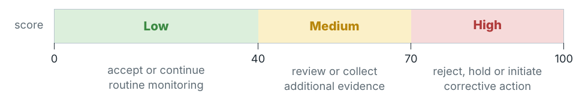

**Figure 7.3.** Risk levels with the article’s default bands: Low ($\pi < 0.40$), Medium ($0.40 \le \pi < 0.70$), High ($\pi \ge 0.70$), and the action of each level \[3, Eq. (26)\].

The actions come from the article’s three-action policy. Besides accepting and rejecting, a *review* (remeasurement, inspection or engineering investigation) has a cost $c_R$. Comparing expected losses gives the bands \[3, Eqs. (23)–(26)\]

```math
\alpha_L = \frac{c_R}{c_{FA}}, \qquad \alpha_H = 1 - \frac{c_R}{c_{FR}},
```

with a review region only when $c_R < c_{FA}c_{FR}/(c_{FA}+c_{FR})$; otherwise the policy reduces to the binary accept–reject rule. In uccap the bands are set with `thresholds=(low, high)` or derived from costs:

```python
r = hybrid_risk(x, 9.95, 10.05, 10.0, thresholds=(0.30, 0.60))
r = hybrid_risk(x, 9.95, 10.05, 10.0, costs=(20, 1, 0.5))   # c_FA, c_FR, c_R -> (0.025, 0.5)
```

The score prioritises; it does not decide. When elevated risk is found without a clear statistical failure mode, the article recommends additional review rather than an automatic process adjustment, and the responsible engineer confirms the process condition and selects the final action \[3, Sec. 5.2\].

#### 7.4.1 Reason and action

The article’s decision chain is score $\to$ level $\to$ reason $\to$ action \[3, Sec. 5.1\]. The reason names the mechanism behind the risk, and the follow-up depends on it: a specification-side mean shift suggests re-centering, while interacting centering, spread and distributional signals call for a combined response, such as variation reduction together with re-centering \[3, Sec. 5.2\]. A deterministic conservative layer may raise a Low level to Medium when additional statistical diagnostics indicate a compound mechanism or latent structural risk; it changes only the displayed level and action, never the probability or the score \[3, Sec. 5.1\]. The article gives no criterion for latent structural risk at a Low level, so uccap raises the level only for a compound mechanism (below).

The article does not give numerical criteria for the mechanism signals. uccap uses three that rest on quantities already in the model inputs, chosen so that the labels of the article’s Table 1 are reproduced for its representative rows (Table 7.1). Like the probability bands of the article’s illustrative configuration, these rules illustrate how the decision layer works; they are not a general standard for every application, and the criteria suited to a given process, customer requirement or cost structure may differ.

> **Illustrative rules.** The decision rules in this chapter (risk bands, mechanism signals, compact labels) serve to explain the method, as the corresponding settings do in the article \[3, Sec. 5.1\]. They are not universal criteria; set them for the application (`thresholds=`, `costs=`) and read the labels as decision support.

**Table 7.1.** Mechanism signals of the decision layer (uccap’s illustrative criteria; the article does not fix them).

| Signal       | Criterion                                         | Meaning                                                                                                                                                                                   |
|:-------------|:--------------------------------------------------|:------------------------------------------------------------------------------------------------------------------------------------------------------------------------------------------|
| Mean shift   | $P_p - P_{pk} > \mathrm{SE}(P_{pk})$              | The capability lost by off-centring exceeds the sampling uncertainty. Direction: the side of the tolerance midpoint the mean is on.                                                       |
| Spread       | $P_p < 1.00$                                      | Not capable even if centred: $C_p < 1.00$ in the workflow article \[1, Sec. 3.1\]. $P_p$ between 1.00 and 1.33 (“marginal”) is not a spread signal, as for D020 in the article’s Table 1. |
| Distribution | Anderson–Darling test rejected at $\alpha = 0.05$ | The normality test of the workflow (Section 5.5) fails.                                                                                                                                   |

For a tolerance with an upper limit only (GD&T), $P_p$ is not computed, as in the training data, so the mean-shift and spread signals do not apply and only the distribution signal can be raised.

- **Reason.** Low level without a compound mechanism: *Acceptable*, as for D003 and D018 in the article’s Table 1 (D018 is off-centre but still Acceptable); a single signal is mentioned in the full text only. Medium or High without a signal: *Latent model risk* (the model indicates risk that the classical statistics do not explain). One signal: *Mean shift to USL/LSL*, *Excessive variation* or *Skewed* (normality rejected, as in the article’s Table 1). Two or more: *Mixed mechanism*.

- **Conservative layer.** Two or more signals raise Low to Medium (`r.model_level` keeps the level from the bands, `r.elevated` is true).

- **Action.** Low: *Accept* (the full text adds what to watch if there is a signal). Medium or High: the action of each signal (*Re-center*, *Reduce sd*, *Review distribution*), combined for a mixed mechanism (*Reduce sd + re-center*), and *Investigate latent risk* when there is no signal.

- **Compact and full.** The labels above are compact, in the style of the article’s Table 1, whose entries “may be expanded into detailed diagnostic explanations and recommended actions” \[3, Table 1\]. uccap gives both: `driver` and `action` hold the labels, `reason` and `action_detail` the explanation with the statistics behind it and the level’s action \[3, Eq. (26)\] followed by the follow-up for the mechanism.

Because the distribution signal is a test at the 5 % level, about 5 % of samples from a normal process show it by chance; in simulations of capable normal processes ($P_{pk} \approx 2$) with 20 to 32 parts, about 2 % of dimensions were raised from Low to Medium. The labels are short decision-support labels, as in the article; they point to where to look first, and the engineer decides.

### 7.5 Model inputs

`compute_features` computes the inputs from the sample in the same way as the training data (Table 7.2). The full list of the 16 numeric inputs is nominal, USL, LSL, specification width, $P_{pk}$, $P_p$, mean, standard deviation, skewness, kurtosis, the three distances, the Anderson–Darling p-value, $\mathrm{SE}(P_{pk})$ and the margin $P_{pk} - 1.33$; the two categorical inputs are the normality result and the best-fit label.

**Table 7.2.** Definitions of the model inputs.

| Input                 | Definition                                                                                                                                                                                                                                           |
|:----------------------|:-----------------------------------------------------------------------------------------------------------------------------------------------------------------------------------------------------------------------------------------------------|
| $P_{pk}$, $P_p$       | Normal overall indices with the sample standard deviation if the Anderson–Darling test passes ($p \ge 0.05$); otherwise empirical percentile indices from the 0.135 %, 50 % and 99.865 % sample quantiles.                                           |
| $\mathrm{SE}(P_{pk})$ | Standard deviation of 200 bootstrap $P_{pk}$ values, each computed with the same rule as the sample (seed `rng=0`).                                                                                                                                  |
| Skewness, kurtosis    | Moment ratios $m_3/m_2^{3/2}$ and $m_4/m_2^2$ (kurtosis 3 for a normal distribution).                                                                                                                                                                |
| Distances             | Mean $-$ LSL, USL $-$ mean, and the smaller of the two, in measurement units.                                                                                                                                                                        |
| Nominal               | The drawing nominal; defaults to the midpoint of the tolerance.                                                                                                                                                                                      |
| Normality, best fit   | AD Pass/Fail. Best fit “normal” for Pass. For Fail, the named distribution of the training levels (lognormal, Weibull, gamma, logistic) with the lowest AICc if its own Anderson–Darling goodness-of-fit test passes at 0.05, otherwise “empirical”. |

When the best fit is a named distribution, `features["Fit_Ppk"]` and `"Fit_Pp"` also give the percentile indices from the 0.135 %, 50 % and 99.865 % quantiles of that distribution, and the report prints them as `Ppk, gamma fit` (for example). They are for reference only: the model inputs $P_{pk}$ and $P_p$ stay the empirical percentile indices, as in the training data. The article does not state how the training table chose a named distribution; the goodness-of-fit rule is uccap’s, with the critical values for estimated parameters of D’Agostino and Stephens \[12\].

Missing numeric inputs are replaced by the training median and unknown categories are encoded as zeros, as in the training pipeline.

### 7.6 Scope and limitations

> **Scope.** The network was trained with $C_0 = 1.33$. In the training data a characteristic with an upper limit only (a GD&T tolerance such as flatness or position, bounded below by 0) is coded with $\mathrm{LSL} = 0$ and nominal 0, and its $P_{pk}$ is the upper index $P_{pu}$, while $P_p$ is not computed (a missing input, which the model’s preprocessing fills with the training median), and the distance to the nearest limit is the smaller of the distances to $\mathrm{LSL} = 0$ and to USL; uccap codes such dimensions the same way (the report says so), including records with nominal 0 and LSL 0 (Section 5.6.1). In training, the measurements of each dimension were split into two disjoint parts: the model inputs, including the anchor $z$, were computed from 20 measurements, and the training target from the remaining ones, with the split repeated at random and all records of a dimension kept in the same training, validation or test set \[3, Sec. 7.5\]. `hybrid_risk` refuses a lower limit alone and fewer than 8 values; for other sample sizes, or a different requirement, treat the result as indicative and use `risk_decision` for approval.

The article states the following limitations \[3, Sec. 7.2, 8\]:

- The training labels are outcomes of a decision rule, not externally observed failure events, and models trained on historical labels may inherit earlier decision biases.

- The statistical anchor relies on asymptotic approximations and may degrade under small samples or strong non-normality.

- Dependence between correlated dimensions and multistage processes is not modelled; a full gauge R&R decomposition is outside the scope of the data.

In addition:

- In the article, logistic baselines matched or beat UC-Cap on several predictive metrics. Its value is the explicit statistical anchor and the interpretable correction, not higher accuracy.

- The score complements the approval decision; it does not replace it. For a formal ACCEPT or REJECT at a chosen risk, use `risk_decision`.

- Two inputs are close approximations of the training table (Section 14.2).

## 8 Batch processing

*Running studies and decisions for every dimension of a measurement file, and producing coloured result tables.*

### 8.1 The batch pipeline

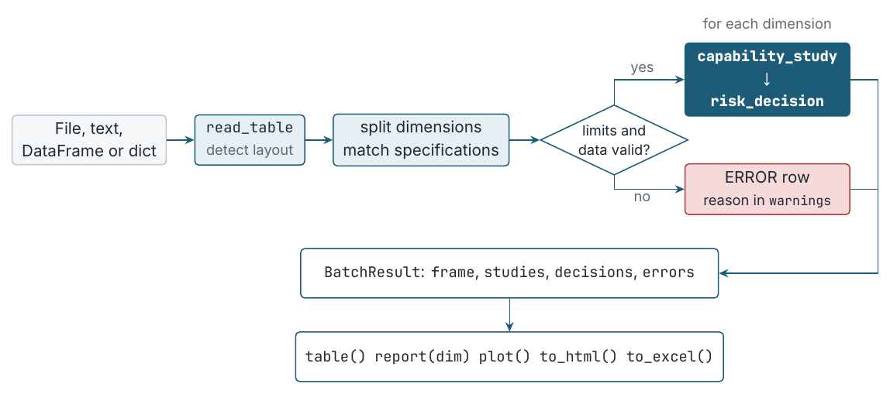

**Figure 8.1.** The batch pipeline. A dimension that cannot be analysed gets an ERROR row; the others are unaffected.

### 8.2 Running a batch

```python
import uccap

# standard layout: specifications are read from the same table
results = uccap.batch_study("measurements.xlsx", c0=1.33, cost_ratio=19)

# separate data and specification tables
data    = uccap.read_data("measurements.xlsx", sheet="Data")
specs   = uccap.read_data("specs.csv")
results = uccap.batch_study(data, specs, c0=1.33, cost_ratio=19)
```

- Every keyword of `capability_study` (Table 5.5) can be passed to `batch_study` and applies to all dimensions, for example `within="mmr"`.

- Without `alpha` or `cost_ratio`, $\alpha = 0.05$ is used; `c0=None` skips the decisions.

- Bootstrap decisions use `rng=0` by default, so a batch gives the same result every time.

- `progress=True` prints one line per dimension, useful for files with hundreds of dimensions.

- `hybrid=True` (the default) adds the UC-Cap risk score of every dimension with two limits (Section 8.2.1) when the model parameters are available (Section 7.2); without them the score is left out with a warning. `hybrid=False` skips it.

#### 8.2.1 UC-Cap risk score in a batch

For each dimension with both limits or an upper limit only, `batch_study` calls `hybrid_risk` on the same measurements and stores the probability (`risk_p`), the score $100\,\pi$ rounded to one decimal (`risk_score`) and the level (`risk_level`, coloured green, amber or red in the HTML and Excel output) with the driver, reason and action of the decision layer (compact: `risk_driver`, `risk_action`; in full: `risk_reason`, `risk_action_detail`; Section 7.4.1); `risk_thresholds` and `risk_costs` set the bands as above. The full UC-Cap report is appended to `results.report(dimension)` and the `HybridRisk` objects are in `results.risks`. These columns need the model parameters (Section 7.2); without them they are left out and every other column is unchanged. The score always refers to $C_0 = 1.33$, the requirement the model was trained for, whatever `c0` is set to; a dimension with only a lower limit gets no score. In a large batch the score orders the review: high- and medium-risk dimensions can be looked at first while the full statistical results of every dimension stay in the table \[3, Sec. 5.2\]. It is a second opinion next to `decision`, not a replacement: the two agree in most cases, and a disagreement is a reason to look at the dimension’s plots.

### 8.3 From the command line

Installing uccap also installs the command `uccap` (equivalently `python -m uccap`). It runs `batch_study` on a file in the standard layout and writes the results, without any Python code. Table 8.1 lists its options. Typical calls:

```sh
uccap measurements.xlsx                          # writes measurements_uccap.html
uccap measurements.xlsx --c0 1.33 --cost-ratio 19
uccap measurements.csv --html --excel --csv --out results
uccap measurements.xlsx --plots all              # every figure as PNG
uccap monitor production.xlsx                    # monitoring after approval
uccap --cite                                     # BibTeX of the articles
```

`uccap monitor` runs `batch_monitor` on a file of production measurements (Chapter 9).

`uccap plan` plans the sample size (Section 6.5) for one or more assumed true capabilities. Its options are `--c0`, `--alpha` or `--cost-ratio` as above, `--power` (the wanted probability of approval, default 0.8), `--parts` (a planned number of parts) and `--plot` (the acceptance curves of Figure 6.4 as PNG; needs matplotlib):

```text
$ uccap plan 1.5 1.67 2.0 --cost-ratio 19 --parts 32 --plot plan.png

C0 = 1.33, cost ratio 19, alpha = 0.0500, wanted P(accept) = 80%

 true Cpk  parts needed  P(accept)  smallest accepted   P(accept) at 32
      1.5           283     0.8005             1.4344            0.1492
     1.67            80     0.8052             1.5393            0.4083
        2            25     0.8006             1.7521            0.8979

With 32 parts the smallest accepted estimate is 1.6909.
written: plan.png
```

**Table 8.1.** Options of the `uccap` command.

| Option                                                        | Effect                                                                                                                                                                                                                                                                                             |
|:--------------------------------------------------------------|:---------------------------------------------------------------------------------------------------------------------------------------------------------------------------------------------------------------------------------------------------------------------------------------------------|
| `DATA`                                                        | CSV, TXT or Excel file in the standard layout (Section 4.1).                                                                                                                                                                                                                                       |
| `--sheet`                                          | Excel sheet name or index; default the first sheet.                                                                                                                                                                                                                                                |
| `--out`                                            | Output folder or file stem; default next to the data file, as `<name>_uccap`.                                                                                                                                                                                                                      |
| `--html`, `--excel`, `--csv` | Output formats; HTML when none is given. Excel needs openpyxl.                                                                                                                                                                                                                                     |
| `--c0`                                             | Required capability $C_0$; default 1.33.                                                                                                                                                                                                                                                           |
| `--alpha` or `--cost-ratio`             | The risk of Section 6.3; default $\alpha = 0.05$.                                                                                                                                                                                                                                                  |
| `--model PATH`                                     | File of the UC-Cap model parameters (Section 7.2); without it, or `UCCAP_MODEL`, the UC-Cap columns and plots are left out.                                                                                                                                                                        |
| `--no-hybrid`                                      | Skip the UC-Cap risk score.                                                                                                                                                                                                                                                                        |
| `--zero-lsl-limit`                                 | Read nominal 0 with LSL 0 as a real lower limit, not as a GD&T bound (Section 5.6.1).                                                                                                                                                                                                              |
| `--plots [KINDS]`                                  | Write PNG figures (Chapter 11) of every dimension into `<name>_uccap_plots`: `overview` (the default), `outliers`, `stability`, `capability`, `approval`, `uccap` (needs the model parameters), a comma-separated list, or `all`; plus `all_dimensions.png`, the batch overview. Needs matplotlib. |
| `--show-values`                                    | Write the measured values on the outlier and stability charts.                                                                                                                                                                                                                                     |
| `--decimals N`                                     | Decimals of these values (default: as many as the data have, at most three).                                                                                                                                                                                                                       |
| `--quiet`                                          | Do not print the summary table.                                                                                                                                                                                                                                                                    |
| `--cite`, `--version`                   | Print the BibTeX entries or the version, then exit.                                                                                                                                                                                                                                                |

### 8.4 A worked example

`examples/batch_example.py` simulates seven dimensions that cover the usual situations: a capable dimension with one suspicious reading (D101), an off-centre one (D102), an incapable one (D103), a one-sided flatness simulated from a skewed distribution (D104; with 32 parts the normality test does not reject it), an asymmetric tolerance with two missing readings (D105), a coarse gauge (D106) and a dimension without specification (D107).

```text
dimension yield normality     method  capability  p_fail threshold decision
     D101 32|32      Fail Percentile       0.943   0.934    REJECT   REJECT
     D102 31|32      Pass     Normal       0.781   1.000    REJECT   REJECT
     D103 30|32      Pass     Normal       0.589   1.000    REJECT   REJECT
     D104 32|32      Pass     Normal       2.838   0.000    ACCEPT   ACCEPT
     D105 30|30      Pass     Normal       1.432   0.299    ACCEPT   REJECT
     D106 32|32      Fail Percentile       1.281   0.535    REJECT   REJECT
     D107   NaN       NaN        NaN         NaN     NaN       NaN    ERROR
```

Points to note: D101’s single reading at 4.71 makes the sample strongly non-normal, so percentile indices are used; `threshold` is the plain rule `threshold_decision`; D105 clears 1.33 but not by enough for 30 parts, so the risk-calibrated rule reverses the threshold decision; D106 carries the warning *coarse measurement resolution (3 distinct values, step 0.1, …)*; D107 reports *no specification limits*.

### 8.5 The results table

`results.table()` returns the default columns as a pandas DataFrame; `results.frame` holds every computed column (Table 8.2). Choose and rename columns as needed:

```python
results.table(["dimension", "yield", "Ppk", "decision"], rename={"Ppk": "Ppk (overall)"})
results.report("D105")        # full study and decision report for one dimension
```

**Table 8.2.** Result columns.

| Column                                      | Meaning                                                                                                                                                                                                                                                                |
|:--------------------------------------------|:-----------------------------------------------------------------------------------------------------------------------------------------------------------------------------------------------------------------------------------------------------------------------|
| dimension, target, LSL, USL, spec_width     | Specification.                                                                                                                                                                                                                                                         |
| n, yield, in_spec                           | Usable observations; parts within limits, shown as `in_spec|n`.                                                                                                                                                                                                        |
| mean, sd_within, sd_overall                 | Mean; within sigma (normal method only) and overall sigma.                                                                                                                                                                                                             |
| normality, p_value                          | Normality test result (Pass/Fail) and its p-value.                                                                                                                                                                                                                     |
| skewness, excess_kurtosis, shape            | Sample shape. `shape` is normal-like, skewed ($|g_1| \ge 0.5$), heavy-tailed (excess kurtosis $\ge 1$) or strongly non-normal ($|g_1| \ge 1$ or excess kurtosis $\ge 3$).                                                                                              |
| best_fit, method                            | Distribution used (full name); Normal, Percentile or Empirical.                                                                                                                                                                                                        |
| sd_within_method                            | Estimator of the within sigma chosen with `sigma_method`: AMR, MMR, SRMSSD, Pooled, R-bar or S-bar (with the span when it is not 2); `not used` when the method is not Normal.                                                                                         |
| Cp, Cpk, Cpm, Cpmk, Cpu, Cpl                | Within-sigma indices (normal method only).                                                                                                                                                                                                                             |
| Pp, Ppk, Ppu, Ppl                           | Overall indices; for non-normal data Pp and Ppk hold $C_{Np}$ and $C_{Npk}$.                                                                                                                                                                                           |
| ppk_mode                                    | How Ppk was computed: Normal, Parametric or Empirical.                                                                                                                                                                                                                 |
| CNp, CNpk, CNpu, CNpl, CNpm, CNpmk          | Percentile indices (non-normal data only).                                                                                                                                                                                                                             |
| capability_index, capability                | Name and value of the index used for approval.                                                                                                                                                                                                                         |
| p_fail                                      | Probability that the true capability is below $C_0$.                                                                                                                                                                                                                   |
| required                                    | $C_0 + k\cdot\mathrm{SE}$ at the current estimate.                                                                                                                                                                                                                     |
| threshold_decision, decision                | Plain rule; risk-calibrated decision (ACCEPT, REJECT or ERROR).                                                                                                                                                                                                        |
| reversed                                    | True when the two rules disagree.                                                                                                                                                                                                                                      |
| risk_p, risk_score, risk_level              | UC-Cap probability, score (0–100) and level (`hybrid=True` and model parameters available, Section 7.2). An upper limit alone is coded $\mathrm{LSL} = 0$, $P_{pk} = P_{pu}$, no $P_p$; a lower limit alone has no score and its level reads `n/a (lower limit only)`. |
| risk_driver, risk_action                    | Decision layer of the UC-Cap score, compact labels (Section 7.4.1).                                                                                                                                                                                                    |
| risk_reason, risk_action_detail             | The same reason and action in full.                                                                                                                                                                                                                                    |
| n_outliers, n_excluded, n_missing, warnings | Data quality.                                                                                                                                                                                                                                                          |

### 8.6 HTML and Excel output

```python
results.to_html("results.html", title="Capability results")
results.to_excel("results.xlsx")             # needs uccap[excel]
```

- **HTML**: a single self-contained page with a sortable, coloured table. A **Sigma** switch (Overall, Within or Both; Overall by default) shows or hides the within- and overall-sigma columns, and a **Columns** menu hides any other column. The viewer’s choice is remembered in that browser. Pointing at a column header shows what the column holds (Table 8.2); **How the decisions are made** above the table states the rules of this run with its settings ($C_0$, $\alpha$, $k$, the risk bands and the mechanism signals).

- **Excel**: coloured cells, filters and a frozen header; each header cell carries the column’s meaning as a comment. The within-sigma columns form a collapsed column group (click **+** above the header). A *How decided* sheet holds the same rules as the HTML page, and with `details=True` (default) a *Reports* sheet holds the full text report of every dimension.

- In Jupyter, `results` displays directly as a coloured table.

**Colours.** Cells are coloured on three levels:

green meets the requirement,

yellow needs a look and

red fails. By default capability indices are red below 1.0 and yellow below 1.33; a failed normality test is red; a skewed or heavy-tailed shape is yellow; `p_fail` is red above 0.5 and yellow above 0.05; decisions are green or red; and any warning is yellow. To change the rules, pass your own:

```python
from uccap.batch import DEFAULT_RULES

rules = {**DEFAULT_RULES, "Ppk": lambda v: "bad" if v < 1.67 else "good"}
results.to_html("results.html", rules=rules)
```

A rule receives the cell value and returns `"good"`, `"warn"`, `"bad"` or `None`.

### 8.7 Reading files and pasted cells

Input functions.

| Source                          | Function                                     |
|:--------------------------------|:---------------------------------------------|
| Any layout, with specifications | `uccap.read_table(source, sheet=0)`          |
| CSV or text file                | `uccap.read_data("file.csv")`                |
| Excel workbook                  | `uccap.read_data("file.xlsx", sheet="Data")` |
| Cells copied from Excel         | `uccap.read_clipboard()`                     |
| Pasted text (notebook )         | `uccap.read_text("""...""")`                 |

The separator (tab, semicolon, comma or spaces) is detected automatically. With a semicolon or tab separator, a decimal comma (`4,618`) is read as a decimal point. A first row that contains text is used as the header; otherwise the columns are named Dim1, Dim2, and so on.

## 9 Monitoring after approval

*The sequential Bayesian operational acceptability monitoring (SBOAM) of the monitoring article \[4\]: how the probability that a released process is still acceptable is updated subgroup by subgroup, the three decision zones, monitoring many dimensions, and the limitations stated in the article.*

### 9.1 From approval to operation

The methods of the previous chapters decide once, from a validation sample, whether a process can be approved. After release the question changes: does the evidence accumulated so far still support continued operation? Control charts answer a related but different question. Their signals show that a statistic has left its in-control range; they do not say whether the process is still acceptable, and mapping every chart signal directly to an intervention can act on isolated excursions and on changes that leave conformance intact \[4, Sec. 2.1\]. The monitoring article instead tracks the posterior probability that the process state lies in an acceptable region defined by the specification. It does not decide whether a process should be approved in the first place, and it is not a replacement for optimised chart design \[4, Sec. 1\]: conventional charts remain useful as complementary statistical diagnostics \[4, Sec. 6\]. uccap implements the method in the separate module `uccap.monitor`; it uses the same data input as the other modules and does not change them.

### 9.2 The method

The operational state of the process at subgroup $t$ is $\theta_t = (\mu_t, \sigma_t)$, the mean and standard deviation of a Gaussian observation model. Its specification-conformance probability is

```math
q(\theta_t) = P(\mathrm{LSL} \le X \le \mathrm{USL} \mid \theta_t)
  = \Phi\!\left(\frac{\mathrm{USL}-\mu_t}{\sigma_t}\right) - \Phi\!\left(\frac{\mathrm{LSL}-\mu_t}{\sigma_t}\right),
```

and the state is acceptable when $q(\theta_t) \ge q_0$ \[4, Eqs. 14–18\]. Acceptability can therefore be lost through a mean shift, a larger spread, or both. For a centred process, $q = 2\Phi(3C_{pk}) - 1$, so the default $q_0 = 0.997$ corresponds to $C_{pk} \approx 0.99$ \[4, Eqs. 16–17\]. After every completed subgroup the package computes the *posterior acceptability probability*

```math
\pi_t = P\bigl(q(\theta_t) \ge q_0 \mid \text{data up to subgroup } t\bigr)
```

and places the process in one of three zones \[4, Eqs. 20–21\]:

- **continue**, when $\pi_t \ge \gamma_A$;

- **intervene**, when $\pi_t \le \gamma_R$ and $t \ge t_{\min}$;

- **monitor**, otherwise.

The first subgroup in the intervene zone is the posterior intervention time $\tau = \inf\{t \ge t_{\min} :
\pi_t \le \gamma_R\}$. The minimum number of subgroups $t_{\min}$ keeps the rule from acting on very little evidence. $\gamma_R$ alone determines when intervention is triggered; $\gamma_A$ only separates continued operation from the monitoring zone \[4, Sec. 4.3\].

**Posterior update.** Older subgroups are discounted with the forgetting factor $\lambda_f$: an observation from subgroup $\tau$ has weight $\lambda_f^{\,t-\tau}$ at subgroup $t$ \[4, Eq. 22\]. The posterior is the Normal–Inverse-Gamma prior $(\mu_0, \kappa_0, \alpha_0, \beta_0)$ multiplied by this discounted likelihood. It depends on three running statistics, the total weight $W_t$, the weighted mean $\bar x_{w,t}$ and the weighted sum of squares $Q_t$, which are updated once per subgroup (Algorithm 1 of the article; Appendix A.8). $\pi_t$ is estimated from $M$ draws of the posterior, with a Monte Carlo standard error of at most $1/(2\sqrt M)$ \[4, Eqs. 25–28\]. The total weight is bounded by $n/(1-\lambda_f)$, so the posterior uncertainty does not vanish: with $\lambda_f = 0.95$ the half-life of past evidence is about 13.5 subgroups \[4, Sec. 4.4\]. Figure 9.1 summarises one update.

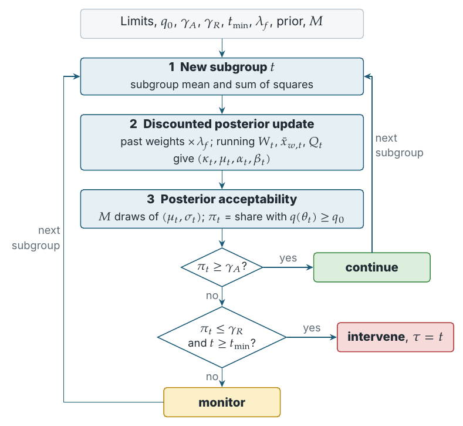

**Figure 9.1.** One monitoring update of `monitor_study`, repeated for every completed subgroup (Algorithm 1 of the monitoring article \[4\]). The zones follow (9.2) and Section 9.2.

**Prior.** The simulation study of the article uses $(\mu_0, \kappa_0, \alpha_0, \beta_0) = (0, 10^{-3}, 2, 1)$. For the industrial replay it uses a *tolerance-aware* prior: $\mu_0$ is the nominal, $\kappa_0 = 10^{-3}$, $\alpha_0 = 2$ and $\beta_0 = s_0^2(\alpha_0 - 1)$ with $s_0 = (\mathrm{USL}-\mathrm{LSL})/8$, so that dimensions with very different tolerances start from comparable prior uncertainty while the prior stays weak \[4, Sec. 4.4\]. The tolerance-aware prior is the default of uccap.

### 9.3 Monitoring one characteristic

`monitor_study` takes the measurements in production order and cuts them into consecutive subgroups of `subgroup_size` values; an incomplete last subgroup is left out. A list of subgroups is accepted as well. The example is the simulation setting of the article: $\mathrm{LSL} = -4$, $\mathrm{USL} = 4$, $\sigma = 1$, and the mean shifts to 1.5 after subgroup 60. With $q_0 = 0.997$ a shift up to about 1.25 is still acceptable \[4, Sec. 5.4\], so the shifted state is not.

```python
import numpy as np
import uccap

rng = np.random.default_rng(1)
mu = np.r_[np.zeros(60), np.full(60, 1.5)]          # means of 120 subgroups
x = (mu[:, None] + rng.standard_normal((120, 5))).ravel()   # 600 parts, in order
r = uccap.monitor_study(x, lsl=-4, usl=4, prior=(0, 1e-3, 2, 1))
print(r)
r.plot()                                            # trajectory figure
```

```text
Operational acceptability monitoring
             Specification  LSL -4, USL 4
     Conformance target q0  0.997 (Cpk about 0.9892 for a centred process)
                     Zones  continue if pi >= 0.95, intervene if pi <= 0.8 (t >= 10)
         Forgetting factor  0.95 (half-life 13.5 subgroups)
                     Prior  mu0 0, kappa0 0.001, alpha0 2, beta0 1
                 Subgroups  120 of size 5, 2000 posterior draws each
                  Final pi  0.0425 -> intervene
    Lowest pi (t >= t_min)  0.0175
        First intervention  subgroup 72
                  Category  persistent low-confidence
        Subgroups per zone  continue 66, monitor 5, intervene 49
```

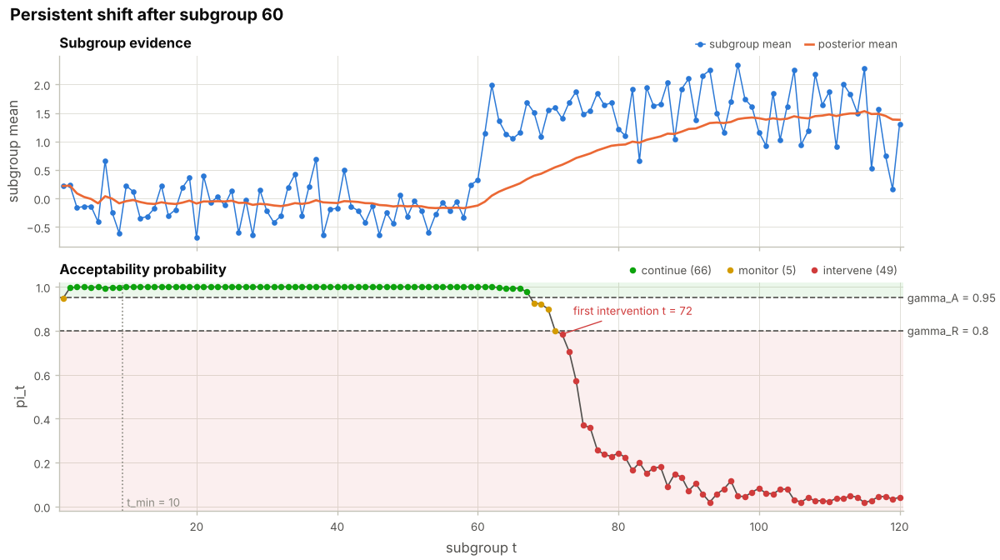

**Figure 9.2.** Monitoring of one characteristic. Top: subgroup means and the posterior mean. Bottom: $\pi_t$ with the continue band above $\gamma_A$, the intervene band below $\gamma_R$, $t_{\min}$ and the first intervention.

`r.frame` holds one row per subgroup: `t`, `n`, the subgroup `mean` and `sd`, the posterior means `mu_post` and `sigma_post`, the discounted evidence `weight` ($W_t$), `pi`, `q_pred` and `zone`. `q_pred` is the average of $q$ over the posterior draws, the posterior predictive conformance $\bar q_t$ of the article; it is shown for reference only. The two quantities can differ substantially under finite samples, and the zones use $\pi_t$ \[4, Eq. 19, Sec. 5.4\].

```text
     t    mean  mu_post  sigma_post      pi       zone
69  70  1.5453   0.4911      1.1584  0.8990    monitor
70  71  1.5888   0.5475      1.1731  0.8010    monitor
71  72  1.4020   0.5913      1.1688  0.7845  intervene
72  73  1.6863   0.6474      1.1716  0.7055  intervene
73  74  1.8767   0.7103      1.1874  0.5720  intervene
```

### 9.4 Settings

The defaults are the validation configuration of the article (Table 2 there). The article treats $q_0$, $\gamma_A$, $\gamma_R$, $\lambda_f$, the prior strength, the subgroup size and $t_{\min}$ as engineering and operational policy parameters, not as universal statistical constants \[4, Sec. 6\].

**Table 9.1.** Settings of `monitor_study` and `batch_monitor`.

| Argument        | Default       | Role                                                                                                                                                                                                                                                                                               |
|:----------------|:--------------|:---------------------------------------------------------------------------------------------------------------------------------------------------------------------------------------------------------------------------------------------------------------------------------------------------|
| `q0`            | 0.997         | Conformance target: what is acceptable. Set from the engineering or customer requirement, for example through $C_{pk}$ (Section 9.2); it is not a tuning parameter of the monitor.                                                                                                                 |
| `gamma_r`       | 0.80          | Intervention threshold. For one decision, intervening has the lower expected loss when $\pi_t \le c_M/(c_M + c_I)$, so 0.80 corresponds to a cost ratio $c_M/c_I = 4$ of continuing in an unacceptable state to an unnecessary intervention, an action-prone illustrative setting \[4, Sec. 5.4\]. |
| `gamma_a`       | 0.95          | Continue threshold; it never changes the intervention time.                                                                                                                                                                                                                                        |
| `forgetting`    | 0.95          | $\lambda_f$; smaller values react faster and forget sooner. The article suggests matching the half-life to the time over which the process can be treated as constant, for example a fraction of the tool-change interval in subgroups.                                                            |
| `t_min`         | 10            | First subgroup at which intervention is allowed.                                                                                                                                                                                                                                                   |
| `subgroup_size` | 5             | Consecutive values per subgroup.                                                                                                                                                                                                                                                                   |
| `n_draws`       | 2000          | Posterior draws $M$ per subgroup; Monte Carlo SE of $\pi_t$ at most 0.011.                                                                                                                                                                                                                         |
| `prior`         | `"tolerance"` | The tolerance-aware prior, a `MonitorPrior`, or a tuple $(\mu_0, \kappa_0, \alpha_0, \beta_0)$.                                                                                                                                                                                                    |
| `gauge_sd`      | `None`        | Known gauge standard deviation: the approximate gauge-corrected variant evaluates $q$ on $\sigma^2 - \sigma_g^2$ for every draw \[4, Sec. 5.5\].                                                                                                                                                   |
| `rng`           | 0             | Seed of the posterior draws; the same seed gives the same trajectory.                                                                                                                                                                                                                              |

The sensitivity analysis of the article confirms the direction of each effect: a larger $q_0$ or $\gamma_R$ makes intervention more likely and earlier, a smaller $\lambda_f$ makes the rule more responsive, and larger subgroups stabilise the trajectory \[4, Sec. 5.6\].

### 9.5 Many dimensions

`batch_monitor` reads the same inputs as `batch_study` (Chapter 4): a file in the standard layout, a wide or long table, or a dictionary, with the rows of every dimension in production order. Each dimension is monitored on its own with the tolerance-aware prior, as in the industrial replay of the article \[4, Sec. 5.7\]. `examples/monitor_example.py` simulates four dimensions with a tolerance of $10.00 \pm 0.10$ in the scenarios of the article, scaled to this tolerance: stable (M101), a persistent shift of $1.5\sigma$ after subgroup 60 (M102), a transient shift of $1.2\sigma$ during subgroups 45–64 (M103), and a spread that grows to $1.8\sigma$ after subgroup 60 (M104).

```python
result = uccap.batch_monitor(data, specs)     # or a file: "production.xlsx"
result.table(["dimension", "Ppk_normal", "pi_final", "first_intervention",
              "zone", "category"])
result.report("M102")                         # the report of one dimension
result.plot()                                 # overview figure
result.to_html("monitor.html")
result.to_excel("monitor.xlsx")
```

```text
dimension  Ppk_normal  pi_final  first_intervention      zone                   category
     M101      1.2557    0.9995                <NA>  continue no intervention-zone entry
     M102      0.9352    0.7545                  65 intervene  persistent low-confidence
     M103      1.1561    0.9960                  57  continue        recovered transient
     M104      1.0961    0.0950                  83 intervene  persistent low-confidence
```

`pi_final` is $\pi$ at the last subgroup, `pi_min` (not shown) the lowest $\pi$ from $t_{\min}$ on, `zone` the zone of the last subgroup and `category` the monitoring category of Table 9.2. `Ppk_normal` is the empirical capability from all values with the overall standard deviation, shown for comparison only; in the industrial replay of the article the final $\pi$ was strongly associated with the empirical capability \[4, Sec. 5.7\]. M103 shows the boundary behaviour the article reports: its transient state is still acceptable, yet the rule entered the intervention zone before $\pi$ recovered. M104 keeps its mean centred; the rule reacts to the growing spread, and here it acted at subgroup 83, before the state became unacceptable at subgroup 87, as the article also observes for variance degradation \[4, Sec. 5.3\].

**Table 9.2.** Monitoring categories \[4, Table 14\], assigned in the order listed.

| Category                   | Definition                                                          | Colour |
|:---------------------------|:--------------------------------------------------------------------|:-------|
| persistent low-confidence  | $\pi_T \le \gamma_R$                                                | red    |
| recovered transient        | $\min_{t \ge t_{\min}} \pi_t \le \gamma_R$ and $\pi_T \ge \gamma_A$ | amber  |
| no intervention-zone entry | $\min_{t \ge t_{\min}} \pi_t > \gamma_R$                            | green  |
| borderline final           | the rest ($\gamma_R < \pi_T < \gamma_A$)                            | amber  |

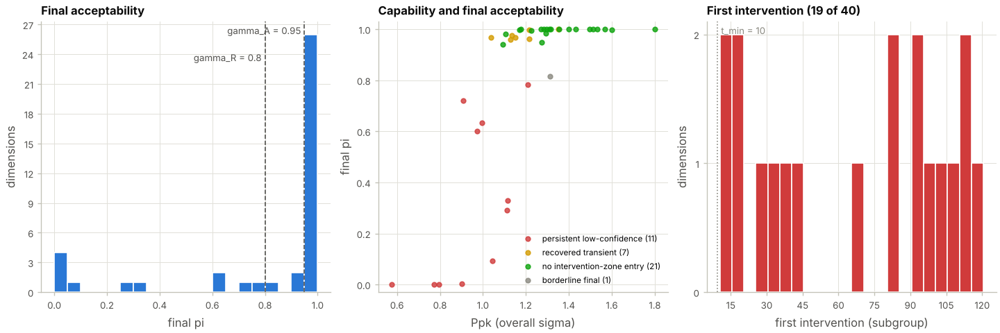

**Figure 9.3.** Overview of 40 simulated dimensions (tolerance $10.00 \pm 0.10$; stable, or with a persistent shift, a transient shift or a growing spread from a random subgroup; `examples/plots_example.py`): the final $\pi$ with $\gamma_R$ and $\gamma_A$, the empirical capability against the final $\pi$ by category, and the first intervention times.

The HTML table and the Excel workbook use the colours of Chapter 8: `zone`, `category` and the $\pi$ columns green, amber or red. A *How decided* section states the rules with the settings used; the workbook also has a *Reports* sheet and a *Trajectories* sheet with every subgroup of every dimension (`result.trajectories()` returns the same table). A dimension without limits, or with a lower limit only (the tolerance-aware prior needs a tolerance width), gets the zone `n/a` and the reason in `warnings`; the others are unaffected. In a large file, the article notes that a first intervention at $t_{\min}$ usually means that $\pi$ was already low at the start of the record, not that a change began there \[4, Sec. 5.7\].

### 9.6 From the command line

```sh
uccap monitor production.xlsx                  # writes production_monitor.html
uccap monitor production.xlsx --excel --plots  # workbook and PNG figures
uccap monitor production.csv --gamma-r 0.5 --forgetting 0.9 --csv
```

The options `--subgroup-size`, `--q0`, `--gamma-a`, `--gamma-r`, `--forgetting`, `--t-min` and `--draws` set the arguments of Table 9.1; `--sheet`, `--out`, `--html`, `--excel`, `--csv`, `--zero-lsl-limit` and `--quiet` work as in Table 8.1. `--csv` writes the results table and `<name>_monitor_trajectories.csv`; `--plots` writes the overview (`all_dimensions.png`) and one trajectory figure per dimension into `<name>_monitor_plots`.

### 9.7 One-sided tolerances and other conventions

The article evaluates two-sided tolerances. uccap applies the following conventions, which go beyond it:

- With one specification limit, $q$ in (9.1) uses that limit only.

- An upper limit only, or a GD&T characteristic recorded as nominal 0 and LSL 0 (Section 5.6.1), is coded with LSL $= 0$ for the tolerance-aware prior, whose scale is then USL$/8$, as uccap codes such characteristics for the UC-Cap score. The report says so.

- A lower limit only needs an explicit prior.

- The report adds a note when the within-subgroup variation fails the Anderson–Darling normality test at 0.05 (on within-subgroup contrasts, which are independent and normal for normal data whatever the subgroup means). The note is a reminder of the working assumption, not a decision.

### 9.8 Scope and limitations

The article states the following limitations \[4, Secs. 5.5, 6\]:

- The exponentially discounted Normal–Inverse-Gamma posterior is a transparent approximation to sequential state adaptation, not a fully specified stochastic state-space model.

- The Gaussian observation model is a working approximation. Under contaminated or skewed residuals the operating characteristics change, above all for states near the boundary of the acceptable region; the method should not be read as distribution-free or robust to arbitrary misspecification.

- The measured values include gauge error, which inflates the estimated spread; the gauge-corrected variant reduces this effect. Gauge drift cannot be separated from process drift with a single measurement channel.

- Serial correlation is treated as independent evidence: moderate correlation ($\phi = 0.3$) had little effect, strong correlation ($\phi = 0.6$) raised the probability of acting on a stable process.

- The simulation studies and the industrial replay illustrate selected behaviours; the replay is retrospective, without maintenance records, and does not show that acting on the intervention outputs would have been effective.

> **Scope.** The zones support the engineer’s decision after approval; they do not replace control charts, the approval itself or the capability requirement. The defaults illustrate the method in the same way as the settings of the article do; set them for the process, the requirement and the costs at hand. In the article the rule rarely intervened on stable processes or on shifts that leave conformance clearly intact, and detected the persistent unacceptable shift in all replications, but it intervened frequently on acceptable states close to the boundary of the acceptable region, including transient disturbances \[4, Secs. 5.4, 7\].

## 10 Reading the reports

*A line-by-line guide to the capability study report and the approval report.*

### 10.1 The capability study report

The report has seven blocks (Table 10.1). The complete report of the quick-start example:

```text
================================================================
  PROCESS CAPABILITY STUDY
================================================================
         Sample size : 32
       Specification : LSL = 4.52   Target = 4.62   USL = 4.72
                Mean : 4.6266
        Sigma within : 0.0200   (average moving range)
       Sigma overall : 0.0194   (within / overall = 1.03)
      Normality test : Anderson-Darling
             p-value : 0.920   (normal at alpha = 0.05)
         Other tests : SW p = 0.984   K2 p = 0.757   (reference)
            Skewness : -0.076   (excess kurtosis 0.163)
            Outliers : 2 flagged (obs. 5, 31), review before use
----------------------------------------------------------------
  Normal-based indices

              Within              Overall
                  Cp :  1.666          Pp :  1.716
                 Cpk :  1.556         Ppk :  1.603
                 Cpu :  1.556         Ppu :  1.603
                 Cpl :  1.776         Ppl :  1.830
                 Cpm :  1.582         Ppm :  1.625
                Cpmk :  1.477        Ppmk :  1.518
----------------------------------------------------------------
  Distribution ranking (sorted by AICc; lower is better) - reference only

        Distribution   k   AIC        BIC        AICc       dAICc
              normal : 2   -158.5     -155.5     -158.0     0.0
               gamma : 2   -158.5     -155.5     -158.0     0.0
           lognormal : 2   -158.4     -155.5     -158.0     0.0
              gamma3 : 3   -156.5     -152.1     -155.6     2.4
          lognormal3 : 3   -156.5     -152.1     -155.6     2.4
            weibull3 : 3   -156.4     -152.0     -155.5     2.5
             weibull : 2   -153.6     -150.7     -153.2     4.8
                 sev : 2   -153.5     -150.5     -153.1     5.0
                 lev : 2   -152.5     -149.6     -152.1     5.9
         exponential : 1   164.0      165.5      164.2      322.2

  k = parameters; dAICc = AICc - best AICc (< 2: about as good as the best)
----------------------------------------------------------------
  Parts per million outside the specification

                              < LSL       > USL       Total
            Observed :          0.0         0.0         0.0
     Expected within :          0.0         1.5         1.6
    Expected overall :          0.0         0.8         0.8
----------------------------------------------------------------
  Intervals (normal, overall sigma)

     Prediction, 95% : [4.5864, 4.6668]   (next single part)
  Tolerance, 99%/95% : [4.5622, 4.6910]   (99% of parts, 95% confidence)
----------------------------------------------------------------
     Capability used : Ppk = 1.603   (95% lower bound 1.259)
================================================================
```

**Table 10.1.** Blocks of the study report and what to check in each.

| Block                      | Content                                                                                                                                                                                                               | What to check                                                                                                                   |
|:---------------------------|:----------------------------------------------------------------------------------------------------------------------------------------------------------------------------------------------------------------------|:--------------------------------------------------------------------------------------------------------------------------------|
| 1\. Data and specification | Sample size (with excluded and missing points), limits, mean.                                                                                                                                                         | Are $n$ and the limits what you expect? Is the mean near the target?                                                            |
| 2\. Data checks            | Within and overall sigma and their ratio (with subgroups also the between sigma); normality test and the other tests for reference; skewness; outliers.                                                               | Ratio within 0.75–1.25? Normal or not, and do the tests agree? Are flagged points explainable?                                  |
| 3\. Indices                | Normal-based (within and overall side by side, including $C_{pm}$/$P_{pm}$ when a target is given) or percentile-based with the fitted distribution.                                                                  | The gap between $C_{pk}$ and $P_{pk}$ shows how much drift costs.                                                               |
| 4\. Distribution ranking   | All fitted families by AICc, with those that could not be fitted.                                                                                                                                                     | For non-normal data: is the chosen family plausible and clearly better ($\Delta$AICc)?                                          |
| 5\. Parts per million      | Observed share outside the limits and the expected share from the model (within and overall sigma, or the fitted distribution).                                                                                       | Expected ppm is a model extrapolation into the tails; with 30 parts the observed count is almost always zero.                   |
| 6\. Intervals              | For normal data, a 95 % prediction interval for the next part and a tolerance interval for 99 % of the parts at 95 % confidence (overall sigma), the supplementary tools named in the workflow article \[1, Sec. 7\]. | Do the intervals lie inside the limits? With few parts the tolerance interval is much wider than $\pm 3\sigma$.                 |
| 7\. Capability used        | The index passed to the approval decision, with its 95 % lower confidence bound; any warnings.                                                                                                                        | A lower bound below $C_0$ means the sample does not rule out an incapable process (Chapter 6). Read every warning (Chapter 12). |

For non-normal data, block 3 lists the percentile indices and names the best fit, for example `Percentile-based indices (best fit: lognormal)` followed by `CNpk : 2.056`. When points were excluded, block 1 reads `Sample size : 30 (of 32; 2 excluded: obs. 5, 31)`. Warnings appear in a final block, each line starting with `!`.

### 10.2 The approval report

Lines of the approval report.

| Line              | Meaning                                                                                                                                                                                                 |
|:------------------|:--------------------------------------------------------------------------------------------------------------------------------------------------------------------------------------------------------|
| Requirement       | The index used ($P_{pk}$ or $C_{Npk}$) and $C_0$.                                                                                                                                                       |
| Risk basis        | The cost ratio and the $\alpha$ it implies, or $\alpha$ directly.                                                                                                                                       |
| Estimate          | The capability estimate from the study.                                                                                                                                                                 |
| Standard error    | Equation (6.1) at the estimate. With the bootstrap method it is marked “analytic, for reference”: the decision then uses the bootstrap probability.                                                     |
| P(true \< C0)     | Probability that the true capability is below $C_0$, with the method (analytic or bootstrap).                                                                                                           |
| Required estimate | $C_0 + k\cdot\mathrm{SE}$ with the standard error at this estimate, the form of the article’s rule \[2, Eq. (29)\]. Analytic; with the bootstrap method it is for reference only.                       |
| Smallest accepted | The estimate that just passes with this $n$ (analytic method). It is slightly above the required estimate because the standard error grows with the estimate (Figure 6.3); both give the same decision. |
| Threshold rule    | The plain decision $\widehat C \ge C_0$, for comparison.                                                                                                                                                |
| Risk-calibrated   | The decision of uccap: ACCEPT if $P \le \alpha$.                                                                                                                                                        |
| Note              | Shown when the two rules disagree. $C_0$ is unchanged; the note says that the sample does not give enough evidence at the chosen risk.                                                                  |

### 10.3 Interpreting the four outcomes

Combinations of the two rules.

| Threshold rule | Risk-calibrated | Interpretation and action                                                                                                              |
|:---------------|:----------------|:---------------------------------------------------------------------------------------------------------------------------------------|
| **ACCEPT**     | **ACCEPT**      | Capable with sufficient evidence. Approve.                                                                                             |
| **ACCEPT**     | **REJECT**      | The estimate clears $C_0$, but not by enough for this sample size. Measure more parts, or reconsider the cost ratio with the customer. |
| **REJECT**     | **REJECT**      | Not capable. Improve centring or spread; the gap between $C_{pk}$ and $P_{pk}$ shows whether drift is the cause.                       |
| **REJECT**     | **ACCEPT**      | Cannot occur with the analytic method when $\alpha \le 0.5$ ($\lambda \ge 1$); rare with the bootstrap. Treat as a borderline case.    |

## 11 Plots

*The figures uccap draws with matplotlib (install `uccap[plot]`).*

### 11.1 Figures by question

The panels are grouped by the question they answer, one figure per group (Table 11.1). The overview puts the main panels together for a first look. From the command line, `uccap data.xlsx --plots all` writes every figure of every dimension as PNG (Section 8.3).

```python
fig = study.plot(decision, title="D101")       # overview
study.plot(kind="outliers")                    # outlier screen
study.plot(kind="stability")                   # I-MR control charts
study.plot(kind="capability")                  # histogram and probability plot
study.plot(decision, kind="approval")          # risk-calibrated approval
study.plot(kind="uccap")                       # UC-Cap risk score
fig.savefig("D101.png", dpi=150)
results.plot()                                 # batch overview
```

**Table 11.1.** Figures of a study.

| kind         | Panels                                                               | Question                                                    |
|:-------------|:---------------------------------------------------------------------|:------------------------------------------------------------|
| `outliers`   | Values in time order with the fences of the outlier screen; box plot | Which points should be investigated before the calculation? |
| `stability`  | Individuals chart, moving range chart                                | Is the process stable over time?                            |
| `capability` | Capability histogram, probability plot                               | How capable is the process, and does the distribution fit?  |
| `approval`   | Uncertainty in the true capability; estimate needed against $n$      | Can the process be approved with this sample?               |
| `uccap`      | Anchor and learned correction; risk score                            | What does the UC-Cap model say, and why?                    |
| `overview`   | Histogram, probability plot, I-MR charts, approval                   | Everything at a glance.                                     |

### 11.2 The overview

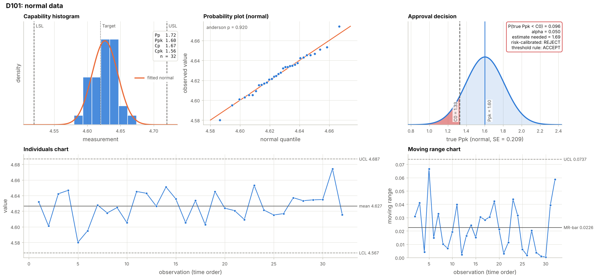

**Figure 11.1.** Overview of the quick-start study. The red area in the decision panel is the probability that the true $P_{pk}$ is below $C_0$: 0.096, above $\alpha = 0.05$.

### 11.3 Outlier screen and control limits

Two kinds of horizontal lines appear in the figures, and they answer different questions. The *fences* of the outlier screen (Section 5.3) are computed from the quartiles before any capability calculation: $Q_1 - k\,\mathrm{IQR}$ and $Q_3 + k\,\mathrm{IQR}$, or the skewness-adjusted fences for non-normal data, with $k$ = `outlier_k` (default 1.5). A point beyond them is a candidate for a recording error or a special cause and is checked by hand. The *control limits* UCL and LCL of the individuals chart are the mean $\pm 3$ within sigma and judge the stability of the process over time. The outlier figure therefore shows only the fences, and the stability figure only the control limits.

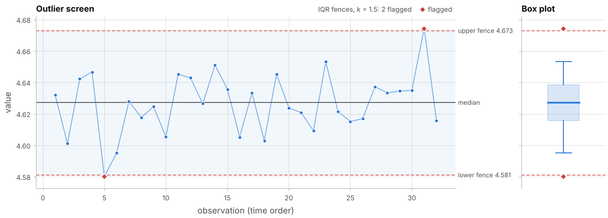

**Figure 11.2.** Outlier screen of the quick-start study: IQR fences with $k = 1.5$; observations 5 and 31 are flagged (red diamonds). Both lie inside the control limits of Figure 11.3.

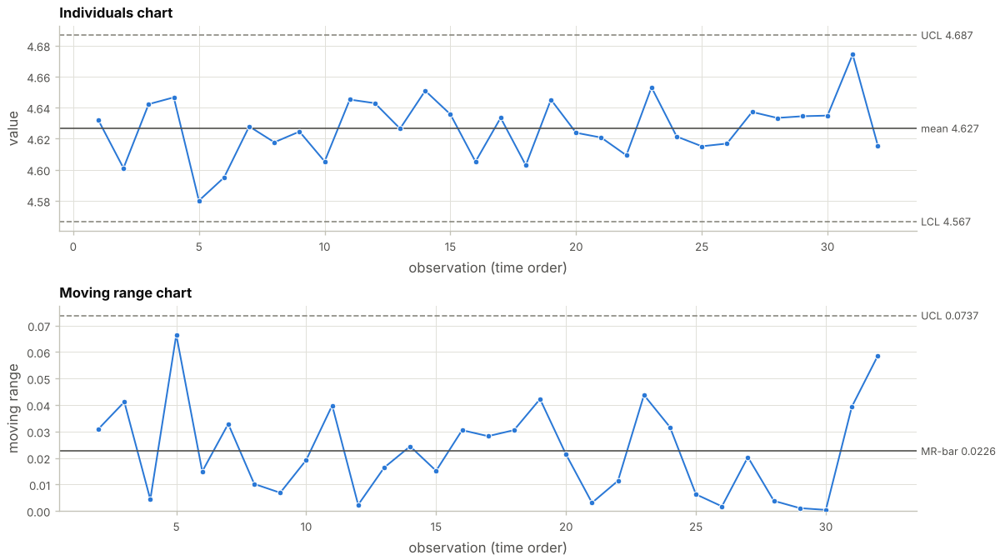

**Figure 11.3.** Stability of the same study: individuals chart with UCL and LCL, and moving range chart. No point is outside the limits.

For the outlier and stability figures, `show_data=True` writes each value next to its point, and in the outlier figure also overlays all values on the box plot (Figure 11.4). It is off by default, because with many points the labels crowd the chart. The values are written with as many decimals as the data have, at most three; `decimals=2`, for example, sets the number. On the command line the same switches are `--show-values` and `--decimals` .

```python
study.plot(kind="outliers", show_data=True)
study.plot(kind="stability", show_data=True)
```

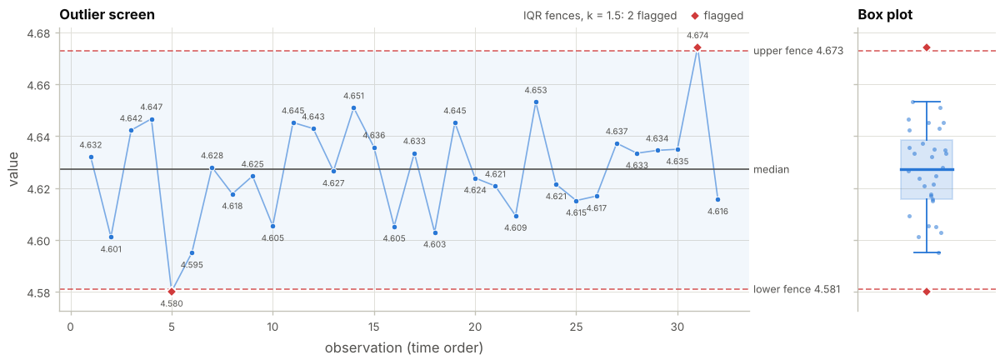

**Figure 11.4.** The outlier screen of Figure 11.2 with `show_data=True`.

### 11.4 Risk-calibrated approval

The approval figure has two panels. The left one shows the uncertainty in the *true* capability given the estimate; the red area is $P(\text{true} < C_0)$, compared with $\alpha$. The right one is on the scale of the *estimate*: the curve is the smallest estimate the risk-calibrated rule accepts with $n$ parts (`min_accepted`, Section 6.5), and the dot is this study. A dot below the curve is rejected; more parts lower the curve.

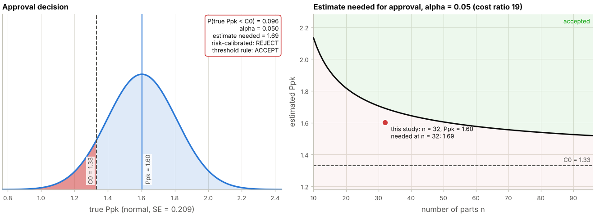

**Figure 11.5.** Approval of the quick-start study. $\widehat P_{pk} = 1.60$ with 32 parts lies below the estimate needed at $n = 32$ (1.69), so the study is rejected at $\lambda = 19$.

### 11.5 UC-Cap risk score

The upper panel shows how the probability of Chapter 7 is built on the logit scale: the statistical anchor $z$, the learned correction $f(\mathbf{x})$ and their sum, with the matching probabilities on the top axis and the risk levels as bands. The lower panel places the score on the 0–100 scale; the blue tick is the anchor-only score $100\,\sigma(z)$, so the distance between the two marks is the effect of the learned correction. `HybridRisk.plot()` draws the same figure. The figure needs the model parameters (Section 7.2), so no example is shown in this manual.

### 11.6 Non-normal data

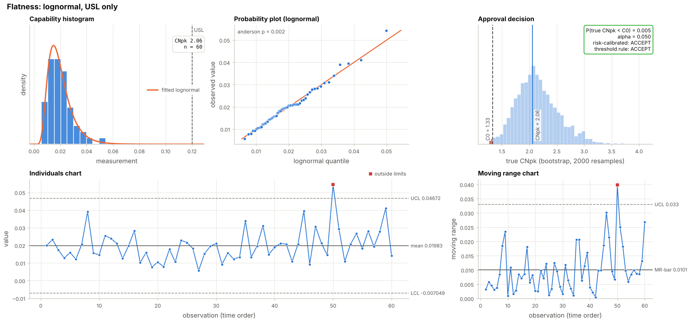

**Figure 11.6.** A skewed one-sided characteristic (flatness, USL only). The lognormal fit follows the long right tail; the decision panel shows the bootstrap distribution of $C_{Npk}$.

### 11.7 The batch overview

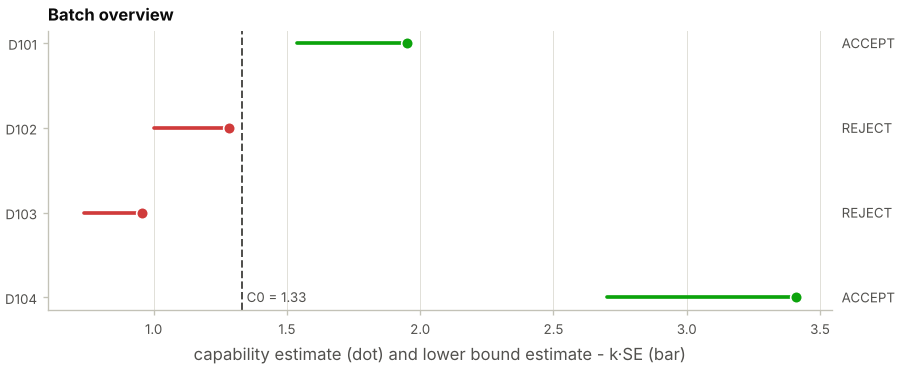

**Figure 11.7.** Batch overview of the template file. Each dimension shows its estimate and the lower bound $\widehat C - k\,\mathrm{SE}$ against $C_0$, coloured by the decision.

### 11.8 Monitoring

`MonitorResult.plot()` draws the subgroup means and the trajectory of $\pi_t$ with its zones (Figure 9.2); `MonitorBatchResult.plot()` the overview of many dimensions (Figure 9.3). Both are described in Chapter 9.

### 11.9 Individual plot functions

All functions are in `uccap.plot`. The panel functions accept an optional matplotlib `ax`, so they can be combined into custom layouts; the figure functions return a whole figure (signatures in Section 13.9).

## 12 Warnings and errors

*Every message the package can give, what it means and what to do.*

### 12.1 Errors

Errors stop the study of one dimension. In `batch_study` they become an ERROR row; elsewhere they are raised as `DataError` (a `ValueError`) or `ValueError`.

Errors.

| Message                                                                                             | Cause                                                             | What to do                                                           |
|:----------------------------------------------------------------------------------------------------|:------------------------------------------------------------------|:---------------------------------------------------------------------|
| *N usable observations; at least 8 are needed*                                                      | Too few values.                                                   | Collect more data.                                                   |
| *all observations are identical*                                                                    | No variation.                                                     | Check gauge resolution and data entry.                               |
| *x has shape …*                                                                                     | Two-dimensional input.                                            | Pass one dimension, use `subgroups=`, or `batch_study`.              |
| *at least one of lsl or usl is required*; *no specification limits*                                 | No limits given.                                                  | Add the limits to the file or the specification table.               |
| *lsl must be below usl*; *target must lie inside the specification limits*                          | Inconsistent specification.                                       | Check for swapped limits or $\pm$ values instead of absolute limits. |
| *give exactly one of alpha or cost_ratio*                                                           | Risk not, or doubly, specified.                                   | Pass one of them.                                                    |
| *UC-Cap needs both limits, or an upper limit only*                                                  | Lower limit alone in `hybrid_risk`.                               | Use `risk_decision`.                                                 |
| *the trained UC-Cap parameters are not included in this release …*                                  | `hybrid_risk` without the model parameters (`ModelNotAvailable`). | Give their location (Section 7.2), or use `risk_decision`.           |
| *fewer than … values: no complete subgroup*                                                         | Monitoring: not one complete subgroup.                            | Collect more data or use a smaller `subgroup_size`.                  |
| *the tolerance-aware prior needs both limits*; *lower limit only: no tolerance width for the prior* | Monitoring with a lower limit only.                               | Pass an explicit `prior`.                                            |

### 12.2 Warnings

Warnings do not stop the analysis. They appear at the end of the report, in `study.warnings` and in the `warnings` column of a batch.

Warnings.

| Message                                                      | Meaning                                                                                                                                                 | What to do                                       |
|:-------------------------------------------------------------|:--------------------------------------------------------------------------------------------------------------------------------------------------------|:-------------------------------------------------|
| *non-numeric entries ignored*; *missing values ignored*      | Entries were dropped: text, infinite values, or a comma without a decimal point (`4,618` may be a decimal or a thousands separator and is not guessed). | Check the source sheet; write `4.618` or `4618`. |
| *small sample (n = …)*                                       | $n < 20$: indices and SE are unreliable.                                                                                                                | Collect more data.                               |
| *data are sorted*                                            | Production order lost.                                                                                                                                  | Pass `time_ordered=False`.                       |
| *coarse measurement resolution*                              | Fewer than 10 distinct values, or a step above half the SD.                                                                                             | Run an MSA; consider a finer gauge.              |
| *sigma within / overall = …*                                 | Ratio outside 0.75–1.25: drift or wrong subgrouping.                                                                                                    | Check stability with the I-MR chart.             |
| *large sample: normality rejected although skewness … small* | $n \ge 500$: the test detects deviations too small to matter.                                                                                           | Consider `force_method="normal"`.                |
| *normality test passed, but … fits much better*              | Normal trails by more than 10 AICc.                                                                                                                     | Consider `force_method="percentile"`.            |
| *empirical percentiles with n = …*                           | Too few points for non-parametric tails.                                                                                                                | Use `percentile_method="fit"`.                   |
| *the mean is outside the specification limits*               | Negative capability.                                                                                                                                    | Adjust the process.                              |

The monitoring report (Chapter 9) lists its notes under `Note`; in `batch_monitor` they fill the `warnings` column.

Notes of the monitoring report.

| Message                                                                   | Meaning                                                  | What to do                                            |
|:--------------------------------------------------------------------------|:---------------------------------------------------------|:------------------------------------------------------|
| *LSL = 0 read as a GD&T bound*; *upper limit only: prior scale USL / 8*   | One-sided tolerance, coded with LSL $= 0$ for the prior. | Use `zero_lsl_gdt=False` for a real lower limit at 0. |
| *lower limit only: q uses that limit only*                                | One-sided conformance with an explicit prior.            | –                                                     |
| *the within-subgroup variation fails the Anderson-Darling normality test* | The Gaussian working model may not hold.                 | Read $\pi$ with care near the boundary.               |
| *only … subgroups: intervention is not allowed before t_min*              | Shorter record than $t_{\min}$.                          | Collect more subgroups.                               |
| *gauge-corrected*                                                         | `gauge_sd` was given.                                    | –                                                     |

## 13 API reference

*The public interface. Everything listed here is importable from `uccap` unless another module is named.*

### 13.1 capability_study

```python
capability_study(x, lsl=None, usl=None, target=None, *, subgroups=None, within="amr",
    mr_span=2, time_ordered=True, normality_test="anderson", alpha=0.05, outlier_method="auto", outlier_k=1.5,
    candidates=DEFAULT_CANDIDATES, force_method=None, percentile_method="fit",
    exclude=None, asymmetric="paper") → CapabilityStudy
```

Runs the workflow of Chapter 5 on one characteristic.

| Parameter           | Default      | Description                                                                                                    |
|:--------------------|:-------------|:---------------------------------------------------------------------------------------------------------------|
| `x`                 | required     | Measurements in production order: list, NumPy array or pandas Series.                                          |
| `lsl`, `usl`        | `None`       | Specification limits; at least one is required.                                                                |
| `target`            | `None`       | Nominal value; needed for $C_{pm}$, $C_{pmk}$ and asymmetric tolerances.                                       |
| `subgroups`         | `None`       | List of arrays; within sigma from the subgroups, and the between sigma is reported.                            |
| `within`            | `"amr"`      | `"amr"`, `"mmr"` or `"srmssd"`; with subgroups `"pooled"`, `"rbar"` or `"sbar"` (Table 5.1).                   |
| `mr_span`           | 2            | Points per moving range, 2 to 10 (Table 5.2).                                                                  |
| `time_ordered`      | `True`       | `False` skips the within sigma.                                                                                |
| `normality_test`    | `"anderson"` | `"anderson"`, `"shapiro"`, `"ks"`, `"chi2"` (chi-square goodness of fit) or `"k2"` (D’Agostino–Pearson).       |
| `alpha`             | 0.05         | Significance level of the normality test.                                                                      |
| `outlier_method`    | `"auto"`     | `"auto"`, `"iqr"`, `"adjusted"`, `"grubbs"`.                                                                   |
| `outlier_k`         | 1.5          | Fence coefficient $k$ of the IQR and adjusted-boxplot screens.                                                 |
| `candidates`        | 10 families  | Names, `"default"` or `"all"` (Table 5.3).                                                                     |
| `force_method`      | `None`       | `"normal"` or `"percentile"`.                                                                                  |
| `percentile_method` | `"fit"`      | `"fit"` or `"empirical"`.                                                                                      |
| `exclude`           | `None`       | `"flagged"` or 1-based observation numbers.                                                                    |
| `asymmetric`        | `"paper"`    | Starred indices for a target off the midpoint: `"paper"` (workflow article) or `"pearn-chen"` (Section 5.6.1). |

#### CapabilityStudy

| Attribute or method                                                                | Description                                                                                                             |
|:-----------------------------------------------------------------------------------|:------------------------------------------------------------------------------------------------------------------------|
| `n`, `mean`                                                                        | Number of observations used; their mean.                                                                                |
| `sigma_within`, `sigma_overall`, `sigma_ratio`                                     | Sigma estimates and their ratio.                                                                                        |
| `sigma_between`, `sigma_bw`                                                        | Between-subgroup and between/within sigma (subgroups only, else NaN).                                                   |
| `normality`                                                                        | Test result: `.test`, `.statistic`, `.p_value`, `.is_normal`.                                                           |
| `normality_other`                                                                  | p-values of the other normality tests, for reference.                                                                   |
| `ppm`                                                                              | Parts per million outside the limits: `"observed"`, `"within"`, `"overall"`, each with `"below"`, `"above"`, `"total"`. |
| `lower_bound(``confidence=0.95)`                                                   | One-sided lower confidence bound of the capability used, $\widehat C - z\,\mathrm{SE}$ (A.23).                          |
| `prediction_interval(``confidence=0.95)`                                           | Interval for the next single part (normal studies).                                                                     |
| `tolerance_interval(``coverage=0.99,` `confidence=0.95)`                           | Interval containing at least `coverage` of the parts (normal studies, Howe’s factor).                                   |
| `skewness`, `excess_kurtosis`                                                      | Sample shape.                                                                                                           |
| `method`                                                                           | `"normal"` or `"percentile"`.                                                                                           |
| `indices`                                                                          | Dictionary of all computed indices (`"Cp"`, `"Ppk"`, `"CNpk"`, …).                                                      |
| `cpk`, `cpk_name`                                                                  | The index used for approval and its name (`"Ppk"` or `"CNpk"`).                                                         |
| `fit`, `candidate_fits`, `failed_fits`                                             | Chosen distribution, all fits ranked by AICc, families that could not be fitted.                                        |
| `data`, `raw_data`                                                                 | Observations used; all observations in time order.                                                                      |
| `outlier_mask`, `excluded_mask`, `missing_mask`                                    | Boolean masks over `raw_data`.                                                                                          |
| `outlier_screen`, `outlier_fences`                                                 | Screen actually used ("iqr", "adjusted" or "grubbs") and its (lower, upper) fences; `None` for Grubbs.                  |
| `spec`, `warnings`                                                                 | The specification; list of warning texts.                                                                               |
| `report()`, `to_dict()`                                                            | Text report; flat dictionary of the main results.                                                                       |
| `without_outliers()`                                                               | The same study with the flagged points excluded.                                                                        |
| `plot(decision=None, title=None, kind="overview", show_data=False, decimals=None)` | Figure by question (Chapter 11).                                                                                        |

### 13.2 risk_decision

```python
risk_decision(study_or_cpk, n=None, *, c0=1.33, alpha=None, cost_ratio=None,
    method="auto", n_boot=1000, rng=0) → RiskDecision
```

Risk-calibrated approval (Chapter 6).

| Parameter      | Default  | Description                                                                                                |
|:---------------|:---------|:-----------------------------------------------------------------------------------------------------------|
| `study_or_cpk` | required | A `CapabilityStudy`, or a capability estimate (then pass `n`).                                             |
| `n`            | `None`   | Sample size, when an estimate is passed.                                                                   |
| `c0`           | 1.33     | Required capability.                                                                                       |
| `alpha`        | `None`   | Tolerable probability of a false acceptance. Give this or `cost_ratio`.                                    |
| `cost_ratio`   | `None`   | $\lambda = c_{\text{FA}}/c_{\text{FR}}$; implies $\alpha = 1/(1+\lambda)$.                                 |
| `method`       | `"auto"` | `"analytic"`, `"bootstrap"`, or `"auto"` (by study method).                                                |
| `n_boot`       | 1000     | Bootstrap resamples.                                                                                       |
| `rng`          | 0        | Seed or NumPy generator of the bootstrap; the same data give the same decision. `None` draws a fresh seed. |

#### RiskDecision

| Attribute or method                     | Description                                                                  |
|:----------------------------------------|:-----------------------------------------------------------------------------|
| `accept`, `threshold_accept`            | Risk-calibrated decision; the plain rule.                                    |
| `cpk_hat`, `index_name`, `n`            | Estimate, its name and the sample size.                                      |
| `se`, `k`, `margin`                     | Standard error, margin factor $z_{1-\alpha}$, and $C_0 + k\cdot\mathrm{SE}$. |
| `p_fail`, `alpha`, `cost_ratio`, `c0`   | Probability below $C_0$ and the risk settings.                               |
| `method`                                | `"analytic"` or `"bootstrap"`.                                               |
| `report()`, `plot(study=None, ax=None)` | Text report; decision panel.                                                 |

### 13.3 sample_size

```python
sample_size(expected, *, c0=1.33, alpha=None, cost_ratio=None, power=0.8, n_max=5000,
    method="simulate", n_sim=20000, rng=0) → SamplePlan
```

Parts needed so that a process with true capability `expected` is approved with probability `power` (Section 6.5).

| Parameter                   | Default      | Description                                                 |
|:----------------------------|:-------------|:------------------------------------------------------------|
| `expected`                  | required     | Assumed true $C_{pk}$.                                      |
| `c0`, `alpha`, `cost_ratio` |              | As in `risk_decision`; $\alpha = 0.05$ if neither is given. |
| `power`                     | 0.8          | Wanted probability of approval.                             |
| `n_max`                     | 5000         | Largest sample searched.                                    |
| `method`                    | `"simulate"` | `"simulate"` or `"approx"` (normal approximation).          |
| `n_sim`, `rng`              | 20000, 0     | Simulation size and seed.                                   |

#### SamplePlan

| Attribute or method                              | Description                                                    |
|:-------------------------------------------------|:---------------------------------------------------------------|
| `n`                                              | Parts needed; `None` when not reachable within `n_max`.        |
| `achieved`, `threshold`                          | Probability of approval and smallest accepted estimate at `n`. |
| `expected`, `power`, `c0`, `alpha`, `cost_ratio` | The settings.                                                  |
| `report()`                                       | Text report.                                                   |

Related functions in `uccap.risk`: `min_accepted(n, *, c0, alpha, cost_ratio)` and `acceptance_probability(true_cpk, n, *, c0, alpha, cost_ratio, method, n_sim, rng)`.

### 13.4 hybrid_risk

```python
hybrid_risk(data, lsl=None, usl=None, nominal=None, *, n_boot=200, rng=0,
    thresholds=None, costs=None) → HybridRisk
```

UC-Cap risk that the true $P_{pk}$ is below 1.33 (Chapter 7). Needs the model parameters (Section 7.2); without them it raises `ModelNotAvailable`.

| Parameter    | Default  | Description                                                          |
|:-------------|:---------|:---------------------------------------------------------------------|
| `data`       | required | Measurements, or a `CapabilityStudy` (its data and limits are used). |
| `lsl`, `usl` | `None`   | Both limits are required.                                            |
| `nominal`    | `None`   | Drawing nominal; defaults to the midpoint.                           |
| `n_boot`     | 200      | Bootstrap resamples for $\mathrm{SE}(P_{pk})$, as in training.       |
| `rng`        | 0        | Seed of the bootstrap.                                               |
| `thresholds` | `None`   | Risk bands (low, high); (0.40, 0.70) by default.                     |
| `costs`      | `None`   | ($c_{FA}$, $c_{FR}$, $c_R$): bands from the three-action policy.     |

#### HybridRisk

| Attribute or method            | Description                                                               |
|:-------------------------------|:--------------------------------------------------------------------------|
| `p`, `score`, `level`          | Probability $\pi$, score $100\,\pi$, and Low / Medium / High.             |
| `thresholds`                   | The bands used for `level`.                                               |
| `model_level`, `elevated`      | Level from the bands alone, and whether the conservative layer raised it. |
| `driver`, `action`             | Decision layer, compact reason and action labels (Section 7.4.1).         |
| `reason`, `action_detail`      | The same reason and action in full.                                       |
| `z`, `correction`              | Statistical anchor and learned correction $f(\mathbf{x})$.                |
| `p_stat`                       | Anchor-only probability $\sigma(z)$.                                      |
| `features`                     | All model inputs, as a dictionary.                                        |
| `report()`, `plot(title=None)` | Text report; UC-Cap figure (Section 11.5).                                |

Lower-level functions in `uccap.hybrid`: `compute_features(x, lsl, usl, nominal=None)`, `predict(rows)` (a feature dictionary, a list of them or a DataFrame), `residual(rows)`, `risk_level(p, thresholds=(0.40, 0.70))`, `review_thresholds(c_fa, c_fr, c_review)`, and the constants `C0`, `TAU_LOW`, `TAU_HIGH`, `LEVEL_ACTION`; the module `uccap.hybrid.mechanism` holds the decision layer (`signals`, `displayed_level`, `primary_driver`, `action`, `reason_detail`, `action_detail`). The model parameters are located with `set_model_path(path)`, `model_path()` and `model_available()` (Section 7.2); `compute_features` and the mechanism signals do not need them.

### 13.5 batch_study

```python
batch_study(data, specs=None, *, c0=1.33, alpha=None, cost_ratio=None, n_boot=1000,
    rng=0, hybrid=True, risk_thresholds=None, risk_costs=None, progress=False,
    **study_kwargs) → BatchResult
```

| Parameter                       | Default  | Description                                                                                                                                            |
|:--------------------------------|:---------|:-------------------------------------------------------------------------------------------------------------------------------------------------------|
| `data`                          | required | File path, pasted text, DataFrame, dictionary or `TableInput`.                                                                                         |
| `specs`                         | `None`   | Specification table or dictionary; read from `data` when omitted.                                                                                      |
| `c0`                            | 1.33     | Required capability; `None` skips the decisions.                                                                                                       |
| `alpha`, `cost_ratio`           | `None`   | As in `risk_decision`; $\alpha = 0.05$ if neither is given.                                                                                            |
| `n_boot`, `rng`                 | 1000, 0  | Bootstrap settings for non-normal dimensions.                                                                                                          |
| `hybrid`                        | `True`   | Add the UC-Cap risk columns (both limits, or an upper limit only) when the model parameters are available; otherwise they are left out with a warning. |
| `risk_thresholds`, `risk_costs` | `None`   | Risk bands, as `thresholds` and `costs` of `hybrid_risk`.                                                                                              |
| `zero_lsl_gdt`                  | `True`   | Read nominal 0 with LSL 0 as a GD&T characteristic, upper limit only (Section 5.6.1).                                                                  |
| `progress`                      | `False`  | Print one line per dimension.                                                                                                                          |
| `**study_kwargs`                |          | Any option of `capability_study`.                                                                                                                      |

#### BatchResult

| Attribute or method                                                                     | Description                                                                                                                                         |
|:----------------------------------------------------------------------------------------|:----------------------------------------------------------------------------------------------------------------------------------------------------|
| `frame`                                                                                 | DataFrame with every computed column (Table 8.2).                                                                                                   |
| `studies`, `decisions`, `risks`, `errors`                                               | Dictionaries by dimension name.                                                                                                                     |
| `table(columns=None, rename=None, decimals=4)`                                          | Selected and renamed columns, rounded to `decimals` places for display and export (`None`: full precision, as in `frame`).                          |
| `report(dimension)`                                                                     | Study, decision and UC-Cap report of one dimension.                                                                                                 |
| `subset(dimensions)`                                                                    | A `BatchResult` with only the listed dimensions, in their original order; its tables, reports and exports cover those dimensions only.              |
| `plot(ax=None)`                                                                         | Batch overview.                                                                                                                                     |
| `uccap.export.decision_notes(result)`                                                   | The rules behind the decisions of `result`, with its settings, as (heading, text) pairs; shown above the HTML table and in the *How decided* sheet. |
| `to_html(path=None, columns=None, rename=None, rules=None, title="Capability results")` | Coloured HTML page; returns the HTML text.                                                                                                          |
| `to_excel(path, columns=None, rename=None, rules=None, details=True)`                   | Coloured workbook.                                                                                                                                  |

### 13.6 monitor_study

```python
monitor_study(data, lsl=None, usl=None, nominal=None, *, subgroup_size=5, q0=0.997,
    gamma_a=0.95, gamma_r=0.80, forgetting=0.95, t_min=10, n_draws=2000,
    prior="tolerance", gauge_sd=None, zero_lsl_gdt=True, rng=0, name="")
    → MonitorResult
```

Operational acceptability monitoring of one characteristic (Chapter 9); the settings are explained in Table 9.1.

| Parameter      | Default  | Description                                                                               |
|:---------------|:---------|:------------------------------------------------------------------------------------------|
| `data`         | required | Measurements in production order, cut into consecutive subgroups; or a list of subgroups. |
| `lsl`, `usl`   | `None`   | At least one limit (Section 9.5 for one-sided tolerances).                                |
| `nominal`      | `None`   | Prior centre; defaults to the middle of the tolerance.                                    |
| `zero_lsl_gdt` | `True`   | Read nominal 0 with LSL 0 as an upper limit only.                                         |
| `name`         | `""`     | Name shown in the report and the figure.                                                  |

#### MonitorResult

| Attribute or method            | Description                                                                                              |
|:-------------------------------|:---------------------------------------------------------------------------------------------------------|
| `frame`                        | One row per subgroup: `t`, `n`, `mean`, `sd`, `mu_post`, `sigma_post`, `weight`, `pi`, `q_pred`, `zone`. |
| `pi`, `pi_final`, `pi_min`     | All $\pi_t$; the last; the lowest from $t_{\min}$ on.                                                    |
| `zone`, `intervention`         | Zone of the last subgroup; first subgroup in the intervene zone, or `None`.                              |
| `category`                     | Monitoring category (Table 9.2).                                                                         |
| `settings`, `prior`, `notes`   | Settings used, the `MonitorPrior`, notes of the report.                                                  |
| `report()`, `plot(title=None)` | Text report; trajectory figure (Figure 9.2).                                                             |

### 13.7 batch_monitor

```python
batch_monitor(data, specs=None, *, zero_lsl_gdt=True, progress=False,
    **monitor_kwargs) → MonitorBatchResult
```

Runs `monitor_study` for every dimension; `data` and `specs` as in `batch_study`, the keywords of `monitor_study` apply to all dimensions (Section 9.5).

#### MonitorBatchResult

| Attribute or method                                                                      | Description                                                                                                                                                                                   |
|:-----------------------------------------------------------------------------------------|:----------------------------------------------------------------------------------------------------------------------------------------------------------------------------------------------|
| `frame`                                                                                  | One row per dimension: `dimension`, `target`, `LSL`, `USL`, `n`, `subgroups`, `mean`, `sd_overall`, `Ppk_normal`, `pi_final`, `pi_min`, `first_intervention`, `zone`, `category`, `warnings`. |
| `results`, `errors`, `settings`                                                          | `MonitorResult` and error message by dimension; the settings used.                                                                                                                            |
| `table(columns=None, rename=None, decimals=4)`                                           | Selected and renamed columns, as for `BatchResult`.                                                                                                                                           |
| `trajectories(decimals=4)`                                                               | Every subgroup of every dimension in one table.                                                                                                                                               |
| `report(dimension)`, `plot()`                                                            | Report of one dimension; overview figure (Figure 9.3).                                                                                                                                        |
| `to_html(path=None, columns=None, rename=None, rules=None, title=...)`                   | Coloured HTML page with how the zones are set.                                                                                                                                                |
| `to_excel(path, columns=None, rename=None, rules=None, details=True, trajectories=True)` | Workbook: Results, How decided, Reports, Trajectories.                                                                                                                                        |

### 13.8 Reading data

| Attribute or method           | Description                                                                                                                            |
|:------------------------------|:---------------------------------------------------------------------------------------------------------------------------------------|
| `read_table(source, sheet=0)` | Reads any layout (Chapter 4); returns a `TableInput` with `data`, `specs`, `layout`, `units`, `descriptions`, `notes` and `summary()`. |
| `read_data(path, sheet=0)`    | Plain table from CSV, TXT or Excel, as a DataFrame.                                                                                    |
| `read_text(text)`             | Plain table from pasted text.                                                                                                          |
| `read_clipboard()`            | Plain table from cells copied to the clipboard.                                                                                        |

### 13.9 Plot functions

| Attribute or method                                                                                                                           | Description                                                                                                                                                                                            |
|:----------------------------------------------------------------------------------------------------------------------------------------------|:-------------------------------------------------------------------------------------------------------------------------------------------------------------------------------------------------------|
| *Figures (return a matplotlib Figure)*                                                                                                        |                                                                                                                                                                                                        |
| `study.plot(decision=None, title=None, kind="overview")`                                                                                      | One of the figures below by `kind`.                                                                                                                                                                    |
| `outlier_figure(study, title=None, show_data=False, decimals=None)`                                                                           | Outlier screen: fences and box plot; `show_data` writes the values on the points and overlays them on the box plot; `decimals` sets their decimals (default: as many as the data have, at most three). |
| `stability_figure(study, title=None, show_data=False, decimals=None)`                                                                         | Individuals and moving range charts; `show_data` and `decimals` as above.                                                                                                                              |
| `capability_figure(study, title=None)`                                                                                                        | Histogram and probability plot.                                                                                                                                                                        |
| `approval_figure(study, decision=None, title=None, **kwargs)`                                                                                 | Decision panel and estimate needed against $n$; without a decision, $\alpha = 0.05$ unless given.                                                                                                      |
| `uccap_figure(study_or_risk, title=None, **kwargs)`                                                                                           | UC-Cap contributions and risk score; also `HybridRisk.plot()`.                                                                                                                                         |
| `study_overview(study, decision=None, title=None)`                                                                                            | The main panels in one figure.                                                                                                                                                                         |
| *Panels (take an optional `ax`, return it)*                                                                                                   |                                                                                                                                                                                                        |
| `outlier_chart(study, ax=None, show_data=False, decimals=None)`, `outlier_box(study, ax=None, show_data=False)`                               | Values against the outlier fences; box plot.                                                                                                                                                           |
| `individuals_chart(study, ax=None, show_data=False, decimals=None)`, `moving_range_chart(study, ax=None, show_data=False, decimals=None)`     | Control charts with UCL and LCL.                                                                                                                                                                       |
| `capability_histogram(study, ax=None, bins="auto")`                                                                                           | Histogram with limits and fitted density.                                                                                                                                                              |
| `probability_plot(study, ax=None)`                                                                                                            | Probability plot for the distribution used.                                                                                                                                                            |
| `decision_plot(decision, study=None, ax=None, n_boot=2000, rng=0)`                                                                            | Uncertainty in the true capability against $C_0$.                                                                                                                                                      |
| `required_plot(decision, ax=None, n_range=None)`                                                                                              | Smallest accepted estimate against $n$, with this study.                                                                                                                                               |
| `uccap_contributions(risk, ax=None)`, `uccap_gauge(risk, ax=None)`                                                                            | Logit decomposition; risk score with levels.                                                                                                                                                           |
| `batch_plot(result, ax=None, c0=None)`                                                                                                        | Batch overview.                                                                                                                                                                                        |
| `monitor_figure(result, title=None)`, `monitor_overview(batch, title=None)`                                                                   | Monitoring: one characteristic (figure); many dimensions (figure).                                                                                                                                     |
| `monitor_means(result, ax=None)`, `monitor_chart(result, ax=None)`                                                                            | Subgroup means and posterior mean; $\pi_t$ with its zones.                                                                                                                                             |
| `planning_plot(expected=(1.5, 1.67, 2.0), *, c0=1.33, alpha=None, cost_ratio=None, power=0.8, n_range=(8, 200), ax=None, n_sim=20000, rng=0)` | Probability of approval against sample size.                                                                                                                                                           |

### 13.10 Lower-level functions

| Module           | Functions                                                                                                                                                                                                                                                                                                                                                                               |
|:-----------------|:----------------------------------------------------------------------------------------------------------------------------------------------------------------------------------------------------------------------------------------------------------------------------------------------------------------------------------------------------------------------------------------|
| `uccap.workflow` | `sigma_overall`, `sigma_amr`, `sigma_mmr`, `sigma_srmssd`, `sigma_pooled`, `sigma_rbar`, `sigma_sbar`; `cp`, `cpk`, `cpu`, `cpl`, `cpm`, `cpmk`, `normal_indices`, `percentile_indices`; `check_normality`, `chi_square_gof`; `iqr_outliers`, `grubbs_outliers`, `adjusted_boxplot_outliers`, `iqr_fences`, `adjusted_fences`; `fit_distribution`, `best_fit`; `sigma_between`; `Spec`. |
| `uccap`          | `cite`: BibTeX of the articles; `read_table`, `read_data`: see above.                                                                                                                                                                                                                                                                                                                   |
| `uccap.risk`     | `se_cpk`, `p_fail_normal`, `k_from_alpha`, `k_from_cost_ratio`, `bootstrap_p_fail`, `expected_loss`; `min_accepted`, `acceptance_probability`.                                                                                                                                                                                                                                          |
| `uccap.monitor`  | `conformance` ($q$ of (9.1)), `cpk_for_q0`, `subgroups`, `MonitorPrior` (with `tolerance_aware`), `monitor_notes`; the constants `ZONES`, `CATEGORIES`.                                                                                                                                                                                                                                 |

## 14 Validation and implementation notes

*How the results were checked against independent software, and the details that the articles leave open.*

### 14.1 Validation

uccap is checked against independent implementations, not only against itself (Table 14.1). Eight simulated data sets of $n = 50$ (normal, lognormal, Weibull, gamma, exponential, both extreme value families and logistic) are stored as CSV files so that R and Python read identical numbers. The comparisons run as part of the test suite; the full table and the scripts are in `docs/validation.md` and `validation/`.

**Table 14.1.** Summary of the validation.

| Check                                                                                           | Reference                              | Items | Result                                                        |
|:------------------------------------------------------------------------------------------------|:---------------------------------------|:------|:--------------------------------------------------------------|
| Distribution fits (log-likelihood, fitted $P_{0.135}$, $P_{50}$, $P_{99.865}$)                  | R `fitdistrplus`, `MASS`               | 30    | all agree                                                     |
| Normality tests (AD $A^2$ and $p$, Shapiro–Wilk, Lilliefors)                                    | R `nortest`, `stats`                   | 32    | all agree                                                     |
| Mean, overall sigma, within sigma (AMR)                                                         | R base                                 | 24    | all agree                                                     |
| Empirical percentiles                                                                           | R `quantile(type = 7)`                 | 8     | all agree                                                     |
| Control-chart constants $d_2(n)$, $c_4(n)$                                                      | Numerical integration in R             | 33    | all agree                                                     |
| $C_p$, $C_{pk}$, $C_{pl}$, $C_{pu}$                                                             | NIST/SEMATECH e-Handbook §6.1.6 \[18\] | 4     | exact                                                         |
| Constants $d_2$, $c_4$, $d_4$, $w = 2,\dots,10$                                                 | Workflow article \[1\], Table 1        | 27    | all agree                                                     |
| Case study: $\sigma$ overall and 18 within-$\sigma$ estimates, $P_p$, $P_{pk}$, $C_p$, $C_{pk}$ | Workflow article, Tables 3–5           | 57    | $\sigma$, $P_p$, $P_{pk}$ exact; $C_p$, $C_{pk}$ within 0.7 % |
| Margin $k$ for $\lambda = 1, 4, 9, 19, 99$                                                      | Risk article, Table 1                  | 5     | exact                                                         |
| Expected loss of both rules, $\lambda = 2,\dots,100$                                            | Risk article, Table 2                  | 12    | within Monte Carlo error                                      |
| Operating characteristics of the monitoring rule                                                | Monitoring article, Tables 4 and 11    | 12    | close; see text                                               |
| **127 of 127** R comparisons within tolerance (R 4.3.3).                                        |                                        |       |                                                               |

The lower block reproduces results printed in the articles (`validation/workflow_case_study.py`, `validation/risk_simulation.py`, run by `tests/test_paper_reproduction.py`). For the workflow article, dimension 105 of the case study is recomputed; the within-sigma $C_p$ and $C_{pk}$ differ by at most 0.7 % because the article’s data table prints the readings to three decimals. For the risk article, Table 2 is the expected loss $\lambda\cdot P(\text{accept})$ at $n = 32$ for a centred normal process just below the requirement (true $C_{pk} = 1.32$); with $10^6$ replications every value lies within two Monte Carlo standard errors of the article’s 12,000-replication estimate.

For the monitoring article, `validation/monitor_simulation.py` repeats the simulation study with $B = 1000$ replications per scenario and the settings of the article ($\mu = 0$, $\sigma = 1$, LSL $= -4$, USL $= 4$, $T = 120$ subgroups of 5, $t_0 = 60$, $M = 500$, prior $(0, 10^{-3}, 2, 1)$). Table 14.2 compares the results. The gradual drift scenario is left out because its path is not specified in the article. The probabilities agree within the Monte Carlo error of 1000 replications, except the probability of acting on the persistent shift to 1.0 in Table 11 (0.831 against 0.874), which is close to the value of Table 4 of the same article (0.841). The median delays agree, except 22 against 20 subgroups for the shift to 1.0. The test suite runs a short version (100 replications).

**Table 14.2.** Simulation study of the monitoring article reproduced ($B = 1000$).

| Scenario                             | Quantity                                      | uccap    | Article       |
|:-------------------------------------|:----------------------------------------------|:---------|:--------------|
| Stable                               | $P(\text{any intervention})$, Tables 4 and 11 | 0.012    | 0.015         |
| Shift to 1.0 after $t_0$             | $P(\text{any intervention})$, Table 4 / 11    | 0.831    | 0.841 / 0.874 |
|                                      | median delay from $t_0$, Table 4              | 22       | 20            |
| Shift to 0.5 after $t_0$             | $P(\text{any intervention})$, Table 11        | 0.016    | 0.017         |
| Transient 1.2, 20 subgroups          | $P(\text{any intervention})$, Table 11        | 0.878    | 0.867         |
| Shift to 1.5 after $t_0$             | detection / median delay, Table 11            | 1.00 / 6 | 1.00 / 6      |
| Transient 1.5, 10 subgroups          | detection / median delay, Table 11            | 0.89 / 6 | 0.88 / 6      |
| $\sigma$ from 1.0 to 1.8 after $t_0$ | detection / median delay, Table 11            | 1.00 / 9 | 1.00 / 9      |

A comparison package for Minitab (`validation/minitab/`) contains the same data sets, step-by-step instructions and the values uccap reports. The UC-Cap model parameters, which are not included in this release (Section 7.2), reproduced the test metrics of the article exactly (Brier score 0.0664, RMSE 0.2576, ECE 0.0587 on the test set \[3, Table 10\]) when they were exported from the training run. The data are not public, so this check is not part of the test suite.

### 14.2 Implementation choices

The following details are not prescribed by the articles. They are documented so that results can be reproduced exactly.

1.  Outlier screening uses interquartile-range fences or the skewness-adjusted boxplot (Section 5.3).

2.  Asymmetric tolerances use the Pearn–Chen indices.

3.  The SRMSSD within sigma is made unbiased with the constant $c_4(n)$.

4.  The Anderson–Darling p-value uses the approximation of D’Agostino and Stephens \[12\].

5.  The minimum of 8 usable values is a technical lower limit, not a recommended sample size: it is the smallest sample for which the Anderson–Darling test of R’s `nortest` package, the reference used in validation, gives a result, and it leaves at least 7 moving ranges for the within sigma. The articles work with larger samples, for example 32 parts in the case study of the workflow article and 20 measurements per dimension in the hybrid article; uccap warns below 20.

6.  Approval uses the overall sigma ($P_{pk}$), matching the estimator and standard error of the risk-calibration article.

7.  The distribution library is aligned with Minitab’s Individual Distribution Identification and with JMP; Johnson families are fitted by maximum likelihood.

8.  The bootstrap for three-parameter families keeps the fitted threshold fixed.

9.  Data-quality warnings and their thresholds are listed in Chapter 12.

10. UC-Cap inputs: the input definitions were checked against the training table of the article. The $P_{pk}$/$P_p$ rule, distances, anchor, margin and normality agree on all 10,000 training rows. Two inputs are approximations: for non-normal samples the best-fit label is chosen by uccap’s own rule (lowest AICc among lognormal, Weibull, gamma and logistic, kept if its goodness-of-fit test passes, otherwise “empirical”), because the article does not state the rule of the training table; and $\mathrm{SE}(P_{pk})$ uses 200 bootstrap resamples with a fixed seed.

11. Monitoring: the posterior draws use the seed `rng`; the report’s normality note tests within-subgroup (Helmert) contrasts; one-sided tolerances follow the conventions of Chapter 9.

## Appendix A. Formula summary

This appendix collects the formulas that uccap implements, with a short note on what each one estimates and where it comes from. Equation numbers of the source articles are given with the citation, for example \[1, Eq. (4)\] for the workflow article, \[2, Eq. (26)\] for the risk-calibration article and \[4, Eq. (25)\] for the monitoring article. Where uccap goes beyond the articles, this is stated. The chapters refer to these equations where they are used.

### A.1 Within and overall sigma

Capability indices compare the tolerance with the spread of the process, so everything starts with an estimate of $\sigma$. Two kinds are needed. The *within* sigma measures short-term variation, between neighbouring parts or inside rational subgroups, and is the basis of the potential indices $C_p$, $C_{pk}$, $C_{pm}$, $C_{pmk}$. The *overall* sigma measures all variation in the sample, including shifts and drift, and is the basis of $P_p$, $P_{pk}$ and of the approval decision (Section 5.4).

For individual values in time order the within sigma comes from moving ranges $MR_i = \max(x_i,\dots,x_{i-w+1}) - \min(x_i,\dots,x_{i-w+1})$ over $w$ consecutive points (`mr_span`, default $w = 2$):

```math
\begin{aligned}
\hat\sigma_{\text{AMR}} &= \frac{\overline{MR}}{d_2(w)} && \text{[1, Eq.~(28)]}\\
\hat\sigma_{\text{MMR}} &= \frac{\widetilde{MR}}{d_4(w)} && \text{[1, Eq.~(29)]}\\
\hat\sigma_{\text{SRMSSD}} &= \sqrt{\frac{\sum_{i=2}^{n}(x_i-x_{i-1})^2}{2(n-1)}}\Big/c_4(n) && \text{[1, Eq.~(30)]}
\end{aligned}
```

The average moving range (A.1) is the classical estimator of the individuals chart \[17\]; the median moving range (A.2) is less affected by a single large jump. The constants $d_2(w)$ and $d_4(w)$ are the mean and the median of the range of $w$ standard normal values (Table 5.2). For (A.3) the article writes the unbiasing constant as $c_4(w)$; uccap uses $c_4(n)$ for the $n$ values in the sum.

With $k$ subgroups of sizes $n_j$, ranges $R_j$ and standard deviations $s_j$:

```math
\begin{aligned}
\hat\sigma_{\bar R} &= \frac{\bar R}{d_2(m)}, \qquad \hat\sigma_{\bar S} = \frac{\bar s}{c_4(m)} && \text{[1, Eqs.~(31), (32)]}\\
\hat\sigma_{\text{pooled}} &= \sqrt{\frac{\sum_j (n_j-1)s_j^2}{\sum_j n_j - k}} && \text{[1, Eq.~(33)]}\\
\hat\sigma_{\text{overall}} &= \sqrt{\frac{1}{n-1}\sum_{i=1}^{n}(x_i-\bar x)^2} && \text{[1, Eq.~(35)]}
\end{aligned}
```

$\bar R$ and $\bar S$ need equal subgroup sizes $m$; the pooled estimator does not. The between-subgroup sigma of Section 5.4, $\hat\sigma_{\text{between}} = \sqrt{\max(0,\ s_{\bar x}^2 - \hat\sigma_{\text{within}}^2/\bar m)}$, is an addition of uccap and is reported only.

### A.2 Normal-based indices

For approximately normal data the indices measure how many $3\sigma$ fit between the process and the limits. $C_p$ looks only at the spread, $C_{pk}$ also at the position of the mean, and $C_{pm}$ and $C_{pmk}$ in addition penalise distance from the target $T$ \[9\]:

```math
\begin{aligned}
C_p &= \frac{\mathrm{USL}-\mathrm{LSL}}{6\sigma} && \text{[1, Eq.~(2)]}\\
C_{pk} &= \min\left(\frac{\mathrm{USL}-\mu}{3\sigma},\ \frac{\mu-\mathrm{LSL}}{3\sigma}\right) = \min(C_{pu}, C_{pl}) && \text{[1, Eq.~(4)]}\\
C_{pm} &= \frac{\mathrm{USL}-\mathrm{LSL}}{6\sqrt{\sigma^2+(\mu-T)^2}} && \text{[1, Eq.~(8)]}\\
C_{pmk} &= \frac{\min(\mathrm{USL}-\mu,\ \mu-\mathrm{LSL})}{3\sqrt{\sigma^2+(\mu-T)^2}} && \text{[1, Eq.~(12)]}
\end{aligned}
```

With the within sigma these are the $C$ indices; with the overall sigma the same formulas give $P_p$, $P_{pk}$, $P_{pu}$, $P_{pl}$, $P_{pm}$ and $P_{pmk}$ \[1, Eqs. (16), (17)\].

**One-sided tolerances.** With only one limit, $C_{pk}$ is the distance from the mean to that limit, $C_{pu} = (\mathrm{USL}-\mu)/3\sigma$ or $C_{pl} = (\mu-\mathrm{LSL})/3\sigma$ \[1, Eqs. (6), (7)\], and $C_p$ is not defined. With a target, $C_{pm}$ uses the distance from the target to the limit, $|L-T|/3\sqrt{\sigma^2+(\mu-T)^2}$, and $C_{pmk}$ the distance from the mean to the limit over the same denominator \[1, Eqs. (10), (11), (14), (15)\].

**Asymmetric tolerances.** When the target $T$ is not the midpoint of the limits, a mean that moves towards the nearer limit is more harmful than one that moves towards the farther limit, and the indices above do not see this. The workflow article uses starred indices built on the distances $d_l = T-\mathrm{LSL}$ and $d_u = \mathrm{USL}-T$:

```math
\begin{aligned}
C_p^* &= \min\left(\frac{d_u}{3\sigma},\ \frac{d_l}{3\sigma}\right) && \text{[1, Eq.~(3)]}\\
C_{pk}^* &= \min(C_{pl}^*, C_{pu}^*) && \text{[1, Eq.~(5)]}\\
&\qquad C_{pl}^* = \frac{\max(0,\ d_l - |T-\mu|)}{3\sigma}, \quad C_{pu}^* = \frac{\max(0,\ d_u - |T-\mu|)}{3\sigma} \notag\\
C_{pm}^* &= \frac{\min(d_u, d_l)}{3\sqrt{\sigma^2+(\mu-T)^2}} && \text{[1, Eq.~(9)]}\\
C_{pmk}^* &= \frac{\min(C_{pl}^*, C_{pu}^*)}{\sqrt{1+\bigl((\mu-T)/\sigma\bigr)^2}} && \text{[1, Eq.~(13)]}
\end{aligned}
```

The article writes $C_{pl}^*$ as $\frac{d_l}{3\sigma}\bigl(1 - |T-\mu|/d_l\bigr)$ and sets it to zero when $|T-\mu| > d_l$, which is the same as (A.12). This is the default (`asymmetric="paper"`).

As an alternative, `asymmetric="pearn-chen"` gives the generalisation of Pearn and Chen \[19\], which rescales the deviation of the mean to the shorter side, $d^* = \min(d_u, d_l)$ and $A^* = \max\{d^*(\mu-T)/d_u,\ d^*(T-\mu)/d_l\}$, and uses

```math
C_{pk}^* = \frac{d^*-A^*}{3\sigma}, \qquad
C_{pm}^* = \frac{d^*}{3\sqrt{\sigma^2+A^{*2}}}, \qquad
C_{pmk}^* = \frac{d^*-A^*}{3\sqrt{\sigma^2+A^{*2}}} .
```

The two forms agree when the mean is on target. They differ when the mean moves towards the farther limit: the article’s form charges the full deviation $|T-\mu|$ against the shorter side, the Pearn–Chen form only the rescaled deviation $A^*$. For symmetric and one-sided tolerances both reduce to (A.7)–(A.10).

### A.3 Percentile indices for non-normal data

When the data are not normal, $\mu \pm 3\sigma$ no longer covers 99.73 % of the parts. The percentile method replaces it with the 0.135 %, 50 % and 99.865 % percentiles $P_{0.135}$, $P_{50}$, $P_{99.865}$ of the fitted distribution (or of the sample) \[10\]:

```math
\begin{aligned}
C_{Np} &= \frac{\mathrm{USL}-\mathrm{LSL}}{P_{99.865}-P_{0.135}} && \text{[1, Eq.~(18)]}\\
C_{Npk} &= \min\left(\frac{\mathrm{USL}-P_{50}}{P_{99.865}-P_{50}},\ \frac{P_{50}-\mathrm{LSL}}{P_{50}-P_{0.135}}\right) && \text{[1, Eq.~(19)]}
\end{aligned}
```

$C_{Npm}$ and $C_{Npmk}$ \[1, Eqs. (20), (21)\] use $\tau = \sqrt{\bigl((P_{99.865}-P_{0.135})/6\bigr)^2 + (P_{50}-T)^2}$ in place of $\sqrt{\sigma^2+(\mu-T)^2}$; the one-sided forms keep only the relevant term \[1, Eqs. (22)–(27)\].

### A.4 Outlier fences

The fences describe how far from the quartiles a value may lie before it is flagged for a check. They are not part of the workflow article’s equations; uccap uses the standard definitions. Tukey’s fences \[21\] are

```math
\bigl[\,Q_1 - k\,\mathrm{IQR},\ \ Q_3 + k\,\mathrm{IQR}\,\bigr], \qquad \mathrm{IQR} = Q_3 - Q_1,
```

with $k = 1.5$ by default (`outlier_k`). For skewed data the adjusted boxplot \[15\] widens the fence on the long side using the medcouple MC \[7\]:

```math
\bigl[\,Q_1 - k\,e^{-4\,\mathrm{MC}}\,\mathrm{IQR},\ \ Q_3 + k\,e^{3\,\mathrm{MC}}\,\mathrm{IQR}\,\bigr] \quad (\mathrm{MC} \ge 0),
```

with the exponents $-3\,\mathrm{MC}$ and $4\,\mathrm{MC}$ when $\mathrm{MC} < 0$.

### A.5 Choice of distribution

Candidate distributions are fitted by maximum likelihood $L$ and compared with information criteria that reward fit and penalise the number of parameters $k$ \[8\]:

```math
\mathrm{AIC} = -2\ln L + 2k, \quad
\mathrm{AICc} = \mathrm{AIC} + \frac{2k(k+1)}{n-k-1}, \quad
\mathrm{BIC} = -2\ln L + k\ln n \quad \text{[1, Eq.~(1)]}
```

AICc corrects AIC for small samples and is used for the ranking; AIC and BIC are shown for reference.

### A.6 Risk-calibrated approval

The estimate $\widehat C$ ($P_{pk}$, or $C_{Npk}$ for non-normal data) is itself uncertain. Its standard error is given in (6.1), after the finite-sample analysis of the threshold rule \[5\] \[2, App. A\]; it is the classical large-sample approximation \[6\], derived for normal data. The probability that the true index is below the requirement $C_0$, given the data, is then approximately

```math
P(C < C_0 \mid \text{data}) \approx \Phi\!\left(\frac{C_0 - \widehat C}{\mathrm{SE}(\widehat C)}\right) \qquad \text{[2, Eq.~(26)]}.
```

The tolerated risk $\alpha$ follows from the costs of a false approval $c_{FA}$ and a false rejection $c_{FR}$:

```math
\alpha = \frac{c_{FR}}{c_{FA}+c_{FR}} = \frac{1}{1+\lambda}, \qquad \lambda = \frac{c_{FA}}{c_{FR}}, \qquad
k = z_{1-\alpha} \qquad \text{[2, Eqs.~(19), (45)]}.
```

The rule (6.2) accepts when (A.21) is at most $\alpha$, which is the same as $\widehat C \ge C_0 + k\,\mathrm{SE}(\widehat C)$ \[2, Eqs. (28), (29)\]. The requirement $C_0$ is unchanged; the margin $k\,\mathrm{SE}$ expresses the sampling uncertainty of a finite study and shrinks as $n$ grows. With $k = 0$ the rule is the usual threshold rule $\widehat C \ge C_0$. The one-sided lower confidence bound

```math
\mathrm{LCB}_{1-\gamma} = \widehat C - z_{1-\gamma}\,\mathrm{SE}(\widehat C) \qquad \text{[2, Eq.~(34)]}
```

gives the same decision at $\gamma = \alpha$ and is reported as the 95 % lower bound. For non-normal data the failure probability is estimated from $B$ bootstrap resamples \[13\]:

```math
\hat p_{\text{fail}} = \frac{1}{B}\sum_{b=1}^{B} I\bigl(\widehat C^{*(b)} < C_0\bigr) \qquad \text{[2, Eq.~(B.1)]}.
```

### A.7 UC-Cap score

The hybrid model \[3\] starts from the statistical evidence (A.21), written as a $z$ value for $C_0 = 1.33$, and adds a learned correction $f(\mathbf{x})$ from features of the sample (Chapter 7):

```math
\pi = \frac{1}{1+\exp\bigl(-(z + f(\mathbf{x}))\bigr)}, \qquad z = \frac{1.33-\widehat{P}_{pk}}{\mathrm{SE}(\widehat{P}_{pk})}, \qquad
\text{score} = 100\,\pi .
```

Without the correction ($f = 0$), $\pi$ is the failure probability (A.21). The score estimates the same risk as the approval rule and supports it; it is calibrated for the setting of the training data.

### A.8 Operational acceptability monitoring

For subgroup $t$ with $n_t$ values, mean $\bar x_t$ and sum of squares $S_t$, the discounted running statistics are updated as

```math
W_t = \lambda_f W_{t-1} + n_t, \quad
\bar x_{w,t} = \bar x_{w,t-1} + \frac{n_t\,\delta}{W_t}, \quad
Q_t = \lambda_f Q_{t-1} + S_t + \frac{\lambda_f W_{t-1}\, n_t\, \delta^2}{W_t}, \qquad \delta = \bar x_t - \bar x_{w,t-1},
```

starting from zero \[4, Eq. (24), Algorithm 1\]. With the prior $(\mu_0, \kappa_0, \alpha_0, \beta_0)$, which is not discounted, the posterior is \[4, Eqs. (25), (26)\]

```math
\kappa_t = \kappa_0 + W_t,\quad \mu_t^{(p)} = \frac{\kappa_0\mu_0 + W_t\bar x_{w,t}}{\kappa_t},\quad
\alpha_t = \alpha_0 + \frac{W_t}{2},\quad \beta_t = \beta_0 + \frac{Q_t}{2} + \frac{\kappa_0 W_t(\bar x_{w,t}-\mu_0)^2}{2\kappa_t},
```

```math
\sigma^2 \sim \text{Inv-Gamma}(\alpha_t, \beta_t), \qquad \mu \mid \sigma^2 \sim N\bigl(\mu_t^{(p)}, \sigma^2/\kappa_t\bigr),
```

and from $M$ draws $(\mu^{(m)}, \sigma^{(m)})$, with $q$ of (9.1) \[4, Eqs. (18), (27), (28)\],

```math
\hat\pi_t = \frac{1}{M}\sum_{m=1}^{M} I\bigl(q(\mu^{(m)}, \sigma^{(m)}) \ge q_0\bigr), \qquad
\mathrm{SE}(\hat\pi_t) \le \frac{1}{2\sqrt M}.
```

The tolerance-aware prior is $\mu_0 =$ nominal, $\kappa_0 = 10^{-3}$, $\alpha_0 = 2$, $\beta_0 = \max\{s_0^2(\alpha_0-1), 10^{-12}\}$ with $s_0 = (\mathrm{USL}-\mathrm{LSL})/8$; the half-life of past evidence is $\log 0.5/\log\lambda_f$ subgroups \[4, Sec. 4.4\]. The zones follow \[4, Eqs. (20), (21)\]: continue if $\hat\pi_t \ge \gamma_A$, intervene if $\hat\pi_t \le \gamma_R$ and $t \ge t_{\min}$, monitor otherwise.

## Appendix B. Glossary

| Term                          | Meaning                                                                                                                        |
|:------------------------------|:-------------------------------------------------------------------------------------------------------------------------------|
| AICc                          | Akaike information criterion with small-sample correction; lower is better.                                                    |
| Anchor ($z$)                  | Distance of $\widehat{P}_{pk}$ below 1.33 in standard errors; the statistical part of UC-Cap.                                  |
| $C_0$                         | Required capability, typically 1.33 or 1.67.                                                                                   |
| $C_{pk}$, $P_{pk}$            | Capability with within (short-term) and overall (long-term) sigma.                                                             |
| $C_{Npk}$                     | Percentile-based capability for non-normal data.                                                                               |
| Cost ratio $\lambda$          | Cost of a false acceptance divided by the cost of a false rejection.                                                           |
| Conformance $q$, target $q_0$ | Probability that a part lies within the limits for a given process state; the state is acceptable when $q \ge q_0$.            |
| False acceptance              | Approving a process whose true capability is below $C_0$.                                                                      |
| Forgetting factor $\lambda_f$ | Weight per subgroup of age with which past evidence enters the monitoring posterior.                                           |
| Medcouple                     | Robust measure of skewness used by the adjusted boxplot.                                                                       |
| Moving range                  | Absolute difference between consecutive measurements.                                                                          |
| MSA                           | Measurement system analysis (gauge R&R, resolution).                                                                           |
| One-sided tolerance           | Only USL or only LSL is specified, e.g. flatness or position.                                                                  |
| $p_{\text{fail}}$             | Probability that the true capability is below $C_0$, given the data.                                                           |
| $\pi_t$                       | Posterior acceptability probability: the probability, given the data up to subgroup $t$, that the process state is acceptable. |
| Standard error (SE)           | Standard deviation of an estimate over repeated samples.                                                                       |
| Zone                          | continue ($\pi_t \ge \gamma_A$), intervene ($\pi_t \le \gamma_R$, $t \ge t_{\min}$) or monitor.                                |

## Appendix C. Frequently asked questions

The answers follow the articles \[1, 2, 3, 4\]. Several questions have no single answer: they depend on the state of the process, the purpose of the study and the requirement agreed with the customer. The answers therefore state the conditions under which each option applies and what uccap does by default.

#### Q. Should I use $C_{pk}$ or $P_{pk}$?

It depends on the state of the process and on what the index is meant to say \[1, Sec. 3.5\].

- $C_{pk}$ uses the within sigma. It measures the *potential* capability of a process that is in statistical control, and is useful for predicting consistent performance when the process is stable.

- $P_{pk}$ uses the overall sigma. It evaluates the *actual performance* of the process over the period sampled and gives a snapshot of current performance, even if the process is unstable.

- Long-term variation is typically larger than short-term variation, so $P_{pk}$ is usually the smaller of the two. When the process is stable the two are close.

If a customer or industry requirement names one index, that index governs; uccap reports both. The approval rule in uccap uses $P_{pk}$ (or $C_{Npk}$ for non-normal data), because the standard error of the risk-calibration article (6.1) is derived for the estimator with the sample standard deviation \[2\]. A large gap between $C_{pk}$ and $P_{pk}$ points to shifts or drift and is worth explaining before either index is used (Section 5.4).

#### Q. Does the risk-calibrated rule replace the usual requirement, such as $P_{pk} \ge 1.33$?

No. The requirement $C_0$ stays as it is. The usual rule $\widehat C \ge C_0$ compares a point estimate with the threshold and gives no explicit protection against a wrong approval near the threshold \[2, Sec. 7\]. The risk-calibrated rule asks the same question while accounting for the finite-sample uncertainty of the estimate: it adds a margin $k\,\mathrm{SE}$ (A.22) that shrinks as $n$ grows. Decisions for clearly capable or clearly incapable processes stay the same; the rule matters near the threshold and with the moderate samples of 20 to 50 parts that validation studies typically use \[2, Sec. 1\]. It is an aid for deciding under that uncertainty, not a new standard.

#### Q. Why does a process with $P_{pk} = 1.5$ not pass the risk-calibrated rule?

The estimate is above $C_0 = 1.33$, so the usual rule is met. With 32 parts its standard error (6.1) is about 0.20, and the probability that the true $P_{pk}$ is below 1.33 (A.21) is about 0.19. At a tolerated risk of $\alpha = 0.05$ ($\lambda = 19$) that is more than accepted, and an estimate of about 1.69 would be needed at this sample size (Figure 6.3). The calibration constant $k$ links the decision to the operational priorities \[2, Sec. 7\]: if a false approval costs less, a smaller $\lambda$ applies (A.22); otherwise more parts reduce the uncertainty (Section 6.5).

#### Q. The normality test passes but another distribution has a lower AICc. Which is used?

The normal model. In the workflow article, a data set that passes the normality test is analysed with the normal methods \[1, Sec. 2.1\]; the distribution ranking is used for data that fail it. The ranking is still printed for reference, and uccap warns when the normal model trails the best fit by more than 10 AICc units \[8\]. The article also notes that a chosen distribution must make sense for the process being studied \[1, Sec. 4\]; when there is a physical reason to expect a skewed distribution, `force_method="percentile"` applies the fitted distribution instead.

#### Q. Are flagged outliers removed?

No. The outlier screen identifies points that may distort the analysis or indicate a problem with that dimension \[1, Sec. 7\], and uccap only flags them. They are removed only when you ask for it with `exclude`, and the report lists what was excluded (Section 5.3).

#### Q. Can the risk-calibrated rule be used for non-normal data?

Yes. The analytic standard error (6.1) is derived for normal data and can deviate noticeably for highly skewed distributions \[2, Sec. 5.5\]. For non-normal studies `risk_decision` therefore uses the bootstrap failure probability (A.24) by default (`method="auto"`) \[2, App. B\].

#### Q. What is the difference between the approval decision and the UC-Cap score?

Both are aids for deciding under the uncertainty of finite samples; neither replaces the capability index or the requirement. The approval decision is a rule for one study at a stated risk and works for any $C_0$, sample size and tolerance type. The UC-Cap score refines rather than replaces the statistical estimate \[3, Sec. 6.1\]: it starts from the same evidence and adds a learned correction. It is suited to screening large batches of dimensions, hundreds to thousands, so that problem dimensions are found quickly instead of applying one fixed threshold such as 1.33 or 1.67 to every dimension. The model was trained for $C_0 = 1.33$ and bilateral tolerances or an upper limit only (Chapter 7); outside that setting the score is indicative. Its trained parameters are not included in this release (Section 7.2).

#### Q. How does monitoring relate to the approval and to control charts?

The approval decides once, from a validation sample, whether a process can be released. Monitoring starts after that and asks, subgroup by subgroup, whether the accumulated evidence still supports continued operation \[4, Sec. 1\]. Control charts show that a statistic has left its in-control range; the monitoring rule acts on the probability that the process state is still acceptable, so isolated chart signals and changes that leave conformance intact rarely lead to intervention. Charts remain useful as complementary diagnostics, and the rule can act on acceptable states close to the boundary (Chapter 9).

#### Q. Can I use my own column names?

Yes. Common names are recognised (Table 4.1); otherwise rename the columns in pandas first.

#### Q. Does uccap send my data anywhere?

No. The Python package computes everything on your computer.

## Appendix D. How to cite and references

Please cite the article behind each module you use: \[1\] for `uccap.workflow`, \[2\] for `uccap.risk` and `sample_size`, \[3\] for `uccap.hybrid`, \[4\] for `uccap.monitor`. The file `CITATION.cff` in the repository lists them, and `uccap.cite()` returns their BibTeX entries (`uccap.cite("workflow")`, `"risk"`, `"hybrid"` or `"monitor"` for one of them; `uccap --cite` on the command line). The other entries are the sources of the classical methods the workflow builds on.

\[1\] F. Jiang and L. Yang. Practical process capability indices workflows. *The International Journal of Advanced Manufacturing Technology*, 143(7–8):3581–3599, 2026. [doi:10.1007/s00170-026-17782-7](https://doi.org/10.1007/s00170-026-17782-7).

\[2\] F. Jiang and L. Yang. Risk-calibrated process capability approval with finite samples. *The International Journal of Advanced Manufacturing Technology*, 144(9–10):7189–7206, 2026. [doi:10.1007/s00170-026-18284-2](https://doi.org/10.1007/s00170-026-18284-2).

\[3\] F. Jiang and L. Yang. A hybrid statistical learning framework for capability-based decision support in manufacturing. *The International Journal of Advanced Manufacturing Technology*, 2026. [doi:10.1007/s00170-026-18833-9](https://doi.org/10.1007/s00170-026-18833-9).

\[4\] F. Jiang and L. Yang. Bayesian operational acceptability monitoring for manufacturing process control. *The International Journal of Advanced Manufacturing Technology*, accepted for publication, 2026.

\[5\] F. Jiang and L. Yang. Finite-sample decision instability in threshold-based process capability approval. arXiv:2603.11315, 2026.

\[6\] A. F. Bissell. How reliable is your capability index? *Journal of the Royal Statistical Society, Series C (Applied Statistics)*, 39(3):331–340, 1990.

\[7\] G. Brys, M. Hubert and A. Struyf. A robust measure of skewness. *Journal of Computational and Graphical Statistics*, 13(4):996–1017, 2004.

\[8\] K. P. Burnham and D. R. Anderson. *Model Selection and Multimodel Inference*. 2nd edition, Springer, New York, 2002.

\[9\] L. K. Chan, S. W. Cheng and F. A. Spiring. A new measure of process capability: $C_{pm}$. *Journal of Quality Technology*, 20(3):162–175, 1988.

\[10\] J. A. Clements. Process capability calculations for non-normal distributions. *Quality Progress*, 22(9):95–100, 1989.

\[11\] R. D’Agostino and E. S. Pearson. Tests for departure from normality. Empirical results for the distributions of $b_2$ and $\sqrt{b_1}$. *Biometrika*, 60(3):613–622, 1973.

\[12\] R. B. D’Agostino and M. A. Stephens. *Goodness-of-Fit Techniques*. Marcel Dekker, New York, 1986.

\[13\] B. Efron and R. J. Tibshirani. *An Introduction to the Bootstrap*. Chapman & Hall, New York, 1993.

\[14\] F. E. Grubbs. Procedures for detecting outlying observations in samples. *Technometrics*, 11(1):1–21, 1969.

\[15\] M. Hubert and E. Vandervieren. An adjusted boxplot for skewed distributions. *Computational Statistics & Data Analysis*, 52(12):5186–5201, 2008.

\[16\] H. W. Lilliefors. On the Kolmogorov–Smirnov test for normality with mean and variance unknown. *Journal of the American Statistical Association*, 62(318):399–402, 1967.

\[17\] D. C. Montgomery. *Introduction to Statistical Quality Control*. 8th edition, Wiley, Hoboken, 2019.

\[18\] NIST/SEMATECH. *e-Handbook of Statistical Methods*, Section 6.1.6. <https://www.itl.nist.gov/div898/handbook/>.

\[19\] W. L. Pearn and K. S. Chen. New generalization of process capability index $C_{pk}$. *Journal of Applied Statistics*, 25(6):801–810, 1998.

\[20\] S. S. Shapiro and M. B. Wilk. An analysis of variance test for normality (complete samples). *Biometrika*, 52(3–4):591–611, 1965.

\[21\] J. W. Tukey. *Exploratory Data Analysis*. Addison-Wesley, Reading, MA, 1977.
